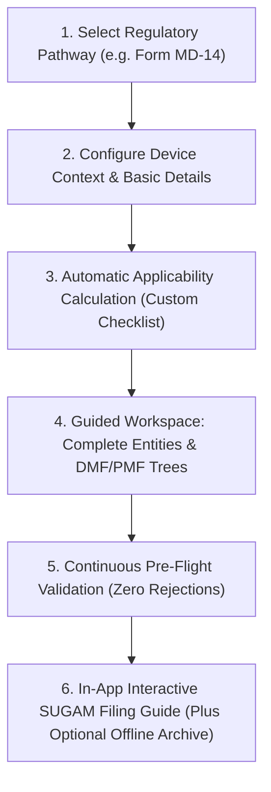

# CDSCO Medical Device Submission Dossier Builder

A structured regulatory workspace for preparing, validating, and organizing complete CDSCO medical device applications and supporting technical dossiers (Device Master File, Plant Master File, Essential Principles) prior to submission on the CDSCO **SUGAM / MD-Portal**.

---

## Presentation and Product Requirements Suite

All business rationale, user requirements, UI/UX screen mockups, pre-technical system design, and demonstration scripts are documented in the [`docs/`](file:///c:/Users/Sam/Documents/MyData/Projects/CDSCO_new/docs) folder:

* **[01. Project Concept and Vision](file:///c:/Users/Sam/Documents/MyData/Projects/CDSCO_new/docs/01_PROJECT_CONCEPT_AND_VISION.md)**: Executive pitch, core pain points in CDSCO filings today, platform solution, the 7 core pathways, and business value.
* **[02. User Requirements and Capabilities](file:///c:/Users/Sam/Documents/MyData/Projects/CDSCO_new/docs/02_USER_REQUIREMENTS_AND_CAPABILITIES.md)**: User personas, Jobs-to-be-Done, and core capabilities in plain business and user language.
* **[03. UI/UX Design and Screen Walkthroughs](file:///c:/Users/Sam/Documents/MyData/Projects/CDSCO_new/docs/03_UI_UX_DESIGN_AND_SCREEN_WALKTHROUGHS.md)**: Complete visual screen wireframes for Dashboard, Setup Wizard, Entity Workspace (with Upload vs Generate choice), DMF Tree, Evidence Vault, Validation Inspector, and SUGAM Handoff Center.
* **[04. Conceptual System Design](file:///c:/Users/Sam/Documents/MyData/Projects/CDSCO_new/docs/04_CONCEPTUAL_SYSTEM_DESIGN.md)**: Practical application structure designed prior to tech stack selection: core data components, conditional checklist filtering, reusable document attachments, and pre-submission checks.
* **[05. Regulatory Forms and Technical Dossier Matrix](file:///c:/Users/Sam/Documents/MyData/Projects/CDSCO_new/docs/05_REGULATORY_FORMS_AND_DOSSIER_MATRIX.md)**: Comparative matrix across all seven MDR 2017 application streams, statutory checklists, and Fourth Schedule DMF/PMF hierarchies.

---

## Technical Specifications Suite

Complete engineering specifications, data schemas, and document generation architectures are documented in [`docs/technical_reference/`](file:///c:/Users/Sam/Documents/MyData/Projects/CDSCO_new/docs/technical_reference):

* **[01. Project Charter and Regulatory Scope](file:///c:/Users/Sam/Documents/MyData/Projects/CDSCO_new/docs/technical_reference/01_PROJECT_CHARTER_AND_SCOPE.md)**: Official mandate, statutory standards, jurisdiction boundaries, and milestone schedule.
* **[02. User Requirements Specification (URS)](file:///c:/Users/Sam/Documents/MyData/Projects/CDSCO_new/docs/technical_reference/02_USER_REQUIREMENTS_SPECIFICATION_URS.md)**: Formal engineering requirements (UR-01 through UR-09) prioritized by MoSCoW criteria.
* **[03. System Architecture and Data Flow](file:///c:/Users/Sam/Documents/MyData/Projects/CDSCO_new/docs/technical_reference/03_SYSTEM_ARCHITECTURE_AND_DATA_FLOW.md)**: Multi-engine architecture, operational sequences, and entity state machines.
* **[04. Engineering and Data Model Specification](file:///c:/Users/Sam/Documents/MyData/Projects/CDSCO_new/docs/technical_reference/04_ENGINEERING_AND_DATA_MODEL_SPEC.md)**: Relational schemas, DSL rules engine, RESTful API endpoints, and validation severities.
* **[05. Document Engines and Dual Fulfillment Logic](file:///c:/Users/Sam/Documents/MyData/Projects/CDSCO_new/docs/technical_reference/05_DOCUMENT_ENGINES_AND_FULFILLMENT_LOGIC.md)**: Cross-form document landscape, engine applicability (commercial vs test), guided questionnaire processing logic, and multi-file dossier assembly under 10MB.

---

## Core Product Workflow

