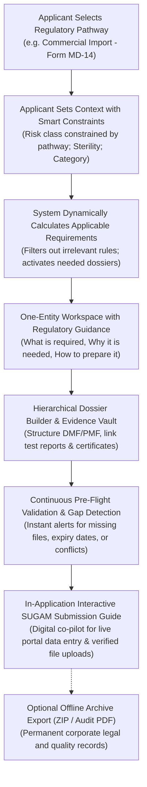

# Project Concept and Product Vision

**Document Code:** VISION-CDSCO-001  
**Project Name:** CDSCO Medical Device Submission Dossier Builder  
**Classification:** Product Definition and Executive Presentation Document  
**Status:** Approved Baseline for Stakeholder Presentation  

---

## 1. The Core Problem: Why CDSCO Submissions Are Broken Today

Preparing a medical device application for the Central Drugs Standard Control Organization (CDSCO) in India is one of the most complex regulatory challenges in the MedTech industry.

Today, applicants face four critical pain points:

1. **Scattered Regulatory Requirements:** The *Medical Devices Rules, 2017* (MDR 2017) span hundreds of pages across rules, schedules, appendices, and gazette notifications. Applicants struggle to know which exact documents and technical files apply to their specific device.
2. **The "Dossier Is Not a Form" Reality:** Submitting on the government SUGAM portal requires extensive technical dossiers—specifically the **Device Master File (DMF)**, **Plant Master File (PMF)**, and **Essential Principles Checklist**. These are not simple form fields; they are multi-level technical hierarchies containing dozens of test reports, validation protocols, and declarations.
3. **High Rejection Rates Due to Minor Gaps:** CDSCO queries and rejections frequently happen due to preventable discrepancies: device names spelled differently across documents, expired Free Sale Certificates, missing sterilization validation reports, or broken cross-references between the DMF and test certificates.
4. **No Guidance at Point of Entry:** Government portals offer static upload fields with zero explanation of *what* a requirement means, *why* CDSCO asks for it, or *how* to prepare it properly.

---

## 2. Product Solution: What the Dossier Builder Is

The **CDSCO Medical Device Submission Dossier Builder** is an intelligent, structured preparation workspace designed to guide an applicant through compiling, verifying, and validating their complete regulatory application and technical dossiers **before** they file on the government SUGAM portal.

---

## 3. The Three Core Design Principles

### Principle 1: One Regulatory Entity at a Time
Instead of confronting users with a 50-page form or a confusing folder list, the system presents one clear entity at a time (a required field, document slot, or dossier section). For every single item, the system provides an **8-Point Guidance Card**:
* What is required?
* Why is it required?
* What should be provided?
* How should it be provided?
* Regulatory source citation
* Supporting evidence files
* Target location on the SUGAM portal
* Real-time completion status

### Principle 2: Hierarchical Dossiers (Never Flat Folders)
The Device Master File (DMF) and Plant Master File (PMF) are structured as interactive, collapsible trees mirroring the Fourth Schedule of MDR 2017. Users can navigate from executive summaries down to specific test reports (such as biocompatibility or sterilization) section by section.

### Principle 3: Relational Evidence Linking
Documents are uploaded once to an Evidence Vault and can be linked to multiple requirements. For example, a single ISO 13485 certificate satisfies administrative requirements, manufacturing quality requirements, and Essential Principles simultaneously. If a file is updated, all connected requirements update automatically.

### Principle 4: Dual Fulfillment (Upload Existing vs. Generate via Guided Form)
Users are never locked into a single process. For statutory documents (covering letters, declarations, Essential Principles, pro-formas), users can either upload an existing document directly or click "Generate" to answer a few guided questions and auto-generate the completed CDSCO pro-forma. External lab reports (biocompatibility, sterility) remain upload-only.

---

## 4. Operational Scope: Seven Core Application Forms

The platform is designed around the seven core operational application forms under the *Medical Devices Rules, 2017*:

| Application Form | Legal Activity | Authority | Risk Classes | Primary Dossiers Handled |
| :--- | :--- | :--- | :--- | :--- |
| **Form MD-14** *(Anchor)* | Commercial Import of Medical Devices & IVDs | Central (CLA) | Class A, B, C, D | Full DMF (Part III), PMF (Part II), Essential Principles, Free Sale Certificates, Power of Attorney. |
| **Form MD-7** | Commercial Manufacturing (Domestic) | Central (CLA) | Class C, Class D | Full DMF, Full PMF, ISO 13485 QMS Manual, Cleanroom Layouts, Risk Management. |
| **Form MD-8** | Loan Licence to Manufacture (Domestic) | Central (CLA) | Class C, Class D | Full DMF, Primary Site PMF, Quality Agreement, Technical Staff Authorization. |
| **Form MD-3** | Commercial Manufacturing (Domestic) | State (SLA) | Class A, Class B | Abbreviated DMF, PMF, Finished Device Specifications, Manufacturing Flow. |
| **Form MD-4** | Loan Licence to Manufacture (Domestic) | State (SLA) | Class A, Class B | Abbreviated DMF, Parent Site Consent, Quality Agreement. |
| **Form MD-12** | Manufacture for Test, Evaluation or Research | CLA / SLA | All Classes | Testing Protocol, Batch Quantity Limits, Non-Commercial Undertaking. |
| **Form MD-16** | Import for Test, Evaluation or Analysis | Central (CLA) | All Classes | Testing Protocol, Consignment Details, Disposal Protocol. |

*Note on Clinical and Novel Devices (Form MD-22 & MD-26):* These specialized pathways are designated for future expansion because clinical trials and novel device approvals involve custom protocols and Subject Expert Committee (SEC) reviews rather than standardized checklists.

---

## 5. Output and Handoff Architecture: How the User Files on SUGAM

The system does not abandon the user with a simple PDF or zip file. The core handoff experience consists of:

1. **The Primary Handoff: In-Application Interactive SUGAM Submission Guide**  
   An interactive digital co-pilot that mirrors the exact tabs and fields of the live government portal (**SUGAM** / **cdsco.mdonline.gov.in**):
   * **Step-by-Step Portal Navigation:** Tells the user exactly where to click.
   * **1-Click Copy Values:** One-click copy buttons for corporate details, IEC codes, device schedules, model lists, and intended use statements.
   * **Direct File Downloads (<10MB Verified):** Provides direct download buttons for each specific file required by each portal slot, pre-compressed and verified to be within the government's 10 MB per-file limit.
   * **Filing Progress Tracker:** Interactive checkboxes (`[x] Uploaded to Portal`) allowing users to check off each step as they complete it on the live government portal.

2. **The Secondary Backup: Optional Offline Dossier Archive Export (ZIP & Audit PDF)**  
   For corporate record-keeping, legal audits, and internal regulatory archives, users can optionally download:
   * A cleanly organized ZIP archive with official CDSCO naming prefixes (`00_Index.pdf`, `01_Covering_Letter.pdf`, `04_Power_of_Attorney.pdf`, `08_DMF_Compiled.pdf`).
   * A printable `SUGAM_Handoff_Summary.pdf` summarizing all prepared files and submission details.
