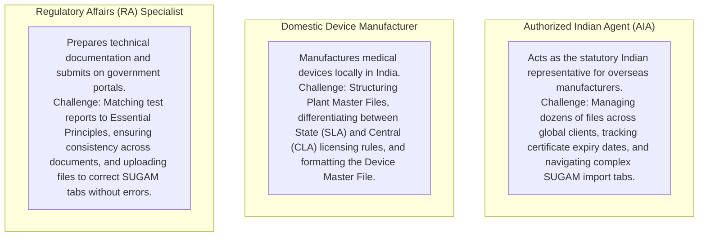
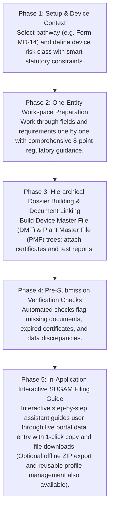

# User Requirements and Platform Capabilities

**Document Code:** URC-CDSCO-001  
**Project Name:** CDSCO Medical Device Submission Dossier Builder  
**Classification:** Business Analysis and User Requirements Specification  
**Status:** Approved Baseline for Stakeholder Presentation  

---

## 1. Project Context: Why This Platform Exists

The Central Drugs Standard Control Organization (CDSCO) manages medical device regulatory filings in India via its online government portals (**SUGAM** and **cdsco.mdonline.gov.in**). 

Filing an application on SUGAM is notoriously error-prone:
* The government portal is purely a transactional data-entry interface with multiple complex tabs (*Applicant Details*, *Manufacturing Site*, *Product Details*, *Document Upload*, *Fee Payment*).
* It provides **no explanation** of what documents are required for specific device classes, **no guidance** on what CDSCO reviewers look for, and **no validation** to catch discrepancies before submission.
* As a result, applicants face frequent rejection queries, delays of 3 to 6 months, or outright rejections due to preventable mistakes: mismatched device names between forms and test reports, expired Free Sale Certificates, missing sterilization validation files, or improperly formatted Device Master Files.

**The Solution:**  
The **CDSCO Medical Device Submission Dossier Builder** acts as a comprehensive **Pre-Submission Preparation Workspace and Interactive SUGAM Filing Assistant**. It guides the applicant step-by-step through assembling their technical dossiers, validating every requirement against statutory rules, and then providing an **interactive in-application guide** that walks the user field-by-field and tab-by-tab through filling out the live SUGAM portal.

---

## 2. Target User Personas and Their Daily Challenges

---

## 3. High-Level User Journey

The core end-to-end user workflow consists of five focused phases:

---

## 4. Comprehensive User Requirements (UR-01 through UR-09)

Requirements are prioritized according to the standard **MoSCoW** convention:
* **Must Have:** Core non-negotiable capabilities essential for assembling, verifying, and filing a valid CDSCO submission.
* **Could Have:** Optional convenience features (e.g., offline archive exports, reusable profile databases) that enhance efficiency but are not strictly required to complete a submission.

---

### UR-01: Pathway Selection First & Smart Statutory Risk Class Constraints
* **MoSCoW Priority:** **Must Have (Core P0)**
* **User Problem:** Under the *Medical Devices Rules, 2017*, regulatory pathways (e.g., Form MD-3 vs. Form MD-7) are strictly tied to device risk classes and licensing authorities. If a user chooses Form MD-3 and then enters Class D, they create an illegal filing. The system must prevent conflicting data while letting experienced users pick their known pathway directly.
* **Requirement:** The system shall present a focused setup flow:
  1. **Select Statutory Pathway:** User selects from the 7 core pathways (Form MD-14, MD-7, MD-8, MD-3, MD-4, MD-12, MD-16).
  2. **Define Regulatory Context with Smart Constraints:** The system automatically constrains the Risk Class selector to valid statutory options based on the chosen pathway:
     * Choosing **Form MD-7 or MD-8** (Central Authority Mfg/Loan) locks the Risk Class selector strictly to `[Class C, Class D]` (Class A & B disabled with helpful tooltips).
     * Choosing **Form MD-3 or MD-4** (State Authority Mfg/Loan) locks the Risk Class selector strictly to `[Class A, Class B]` (Class C & D disabled).
     * Choosing **Form MD-14** (Commercial Import) keeps all four classes `[Class A, B, C, D]` eligible.
     * User sets Category (Medical Device vs. IVD), Sterility, and Software/AI inclusion.
* **User Value:** The user picks their known pathway directly, while the system guarantees 100% regulatory validity by preventing conflicting risk classes.
* **Acceptance Criteria:**
  * Selecting Form MD-7 automatically disables Class A and Class B in the risk class selector.
  * Selecting Form MD-3 automatically disables Class C and Class D.
  * Selecting `Sterile: Yes` activates sterilization validation protocols (ISO 11135 / ISO 11137) and DMF Section 6.3.
  * Non-applicable rules are automatically marked `Not Applicable` with clear statutory citations.

---

### UR-02: One-Entity Regulatory Workspace with 8-Point Guidance Card
* **MoSCoW Priority:** **Must Have (Core P0)**
* **User Problem:** Most regulatory clerks do not know the exact legal reason why CDSCO asks for a specific document, how it must be authenticated (notarized vs. apostilled), or where it goes on the government portal.
* **Requirement:** The system shall structure the preparation workflow one entity at a time (field, document slot, or dossier section). For every single item, the system shall provide an **8-Point Guidance Card**:
  1. **What is required?** (Exact statutory requirement under MDR 2017)
  2. **Why is it required?** (Regulatory safety and legal justification)
  3. **What to provide?** (Expected format, pro-forma template, or required clauses)
  4. **How to provide it?** (Step-by-step instructions for data entry or document upload)
  5. **Regulatory source citation:** (Rule 34, Fourth Schedule Part I/II/III, or official CDSCO checklist reference)
  6. **Related evidence:** (Attached test reports, certificates, or drawings)
  7. **Target SUGAM location:** (Exact portal tab, sub-tab, and field name)
  8. **Operational status:** (Satisfied, Missing, Incomplete, Invalid, or Conditional)
* **User Value:** Non-expert staff can assemble flawless submissions without expensive external regulatory consultants.
* **Dual Fulfillment Option ("Upload Existing" vs. "Generate via Guided Form"):**  
  For each statutory requirement, the user is given a clear choice:
  * **Option A: [ Upload Existing Document ]** &mdash; If the applicant already has a finalized, signed document from their regulatory or legal team, they can upload it directly.
  * **Option B: [ Generate via Guided Form ]** &mdash; If the applicant does not have the document ready, clicking this opens a focused questionnaire asking for the required details (e.g. device names, addresses, standards), and automatically generates the finished statutory PDF/Word document using standard CDSCO templates.
* **Document Classification List (What Can Be Generated vs. What Is Upload-Only):**
  | Document Name | Fulfillment Mode | In-App Form Action (If "Generate" Chosen) |
  | :--- | :--- | :--- |
  | **1. Official Covering Letter** | **Upload OR Generate** | Asks for DCGI/SLA recipient, device schedule, fee challan ref; generates formal letter on company letterhead. |
  | **2. Statutory Form (MD-14, MD-7, MD-3, etc.)** | **Upload OR Generate** | Takes applicant details, manufacturing site, and SKU list; generates official Gazette application form. |
  | **3. Power of Attorney Pro-forma (First Schedule Part I)** | **Upload OR Generate** | Asks for overseas maker signers, Indian agent info, device list; generates statutory legal draft for apostille. |
  | **4. Essential Principles (EP) Matrix (Appendix II)** | **Upload OR Generate** | Interactive table asking Applicability (Yes/No), Standard, and linked test report; generates finished PDF matrix. |
  | **5. Declaration of Conformity (DoC)** | **Upload OR Generate** | Auto-compiles applicable ISO/IEC standards and generates official conformity declaration. |
  | **6. Predicate Equivalence Comparison (DMF 3.0)** | **Upload OR Generate** | Asks for approved predicate brand, licence number, and specs; generates side-by-side comparison table. |
  | **7. TSE / BSE Animal-Origin Declaration** | **Upload OR Generate** | Asks 1 confirmation question ("Contains animal tissue? Yes/No"); generates standard statutory undertaking. |
  | **8. Medical Device Schedule / SKU Table** | **Upload OR Generate** | Structured table entry for catalog numbers, sizes, shelf-life, and packaging; generates clean Schedule appendix. |
  | **9. ISO 13485 QMS Certificate** | **Upload Only** | External Notified Body audit certificate (cannot be auto-generated). |
  | **10. Free Sale Certificate (FSC) / CFS** | **Upload Only** | Foreign government health authority certificate (cannot be auto-generated). |
  | **11. Wholesale Licence (Form 20B/21B or MD-42)** | **Upload Only** | State Drug Controller issued licence (cannot be auto-generated). |
  | **12. Lab Test Reports (Biocompatibility, Sterility, Bench)** | **Upload Only** | Official accredited testing laboratory protocols and results (cannot be auto-generated). |
  | **13. Clinical Evaluation Report (CER)** | **Upload Only** | Clinical investigations or literature-based safety evaluation compiled by clinical experts. |
  | **14. Cleanroom & HVAC Architectural Schematics** | **Upload Only** | Plant engineering drawings, cleanroom cascades, and HVAC validation reports. |
* **Acceptance Criteria:**
  * Every statutory entity displays all 8 guidance facets.
  * For generatable documents, users can switch between direct upload and in-app form generation at any time.
  * Generated documents adhere strictly to official CDSCO Gazette pro-formas.

---

### UR-03: Hierarchical Technical Dossier Builder (DMF and PMF)
* **MoSCoW Priority:** **Must Have (Core P0)**
* **User Problem:** On the government SUGAM portal, applicants often try to dump an unorganized 200-page PDF into a single upload slot, resulting in CDSCO reviewer queries because sections are missing or out of order.
* **Requirement:** The system shall structure the **Device Master File (DMF)** and **Plant Master File (PMF)** as interactive, collapsible trees matching the Fourth Schedule of MDR 2017:
  * **DMF Tree (Part III):** 1.0 Executive Summary -> 2.0 Specifications -> 3.0 Predicate Comparison -> 4.0 Essential Principles -> 5.0 Risk Management -> 6.0 V&V Studies (Bench, Biocompatibility, Sterilization, Software, Usability) -> 7.0 Clinical Evidence -> 8.0 Labels & IFU.
  * **PMF Tree (Part II):** 1.0 Overview -> 2.0 Operations & Cleanrooms -> 3.0 QMS Procedures -> 4.0 Personnel -> 5.0 Premises & HVAC -> 6.0 Equipment & Calibration -> 7.0 Sanitation.
* **User Value:** The user builds the dossier section by section. Each branch tracks its own completion state, eliminating missed technical sections.
* **Acceptance Criteria:**
  * Leaf nodes allow attaching specific test reports.
  * Parent sections display aggregate completion percentages.

---

### UR-04: Central Document Library & Multi-Section Linking
* **MoSCoW Priority:** **Must Have (Core P0)**
* **User Problem:** Applicants often have to provide the same ISO 13485 certificate or test report in multiple parts of a dossier. If a renewed certificate is issued, updating every separate copy is tedious and leads to version mismatches.
* **Requirement:** The system shall provide a centralized **Document Library**:
  * Documents (PDF, DOCX) are uploaded once with metadata: Document Type, Issuing Body, Issue Date, Expiration Date, and Standards Applied.
  * A single document can be attached to multiple requirements (e.g. an ISO 13485 certificate satisfies administrative requirements, PMF Section 3.0, and Essential Principle 3 simultaneously).
* **User Value:** Updating a certificate in the Document Library automatically updates all linked requirements across the entire submission.
* **Acceptance Criteria:**
  * Replacing a document updates all connected requirement nodes and flags them for confirmation.
  * System alerts the user if an uploaded document is within 90 days of statutory expiration.

---

### UR-05: Essential Principles (EP) Compliance Matrix
* **MoSCoW Priority:** **Must Have (Core P0)**
* **User Problem:** CDSCO requires an Essential Principles checklist demonstrating that the device meets safety and design requirements. Mapping these principles to international standards (ISO, IEC, ASTM) and linking objective proof is difficult without structured tooling.
* **Requirement:** The system shall provide an interactive compliance matrix for the CDSCO Essential Principles:
  * Covers General Requirements and Design/Manufacturing Requirements.
  * Allows marking principles as `Applicable` or `Not Applicable` (with mandatory written justification).
  * Requires linking at least one verified test report from the Document Library for every applicable principle.
* **User Value:** Eliminates the risk of submitting an incomplete Essential Principles matrix, which is a top cause of CDSCO deficiency letters.
* **Acceptance Criteria:**
  * System prevents marking an Essential Principle as complete unless supporting test reports or certificates are attached.

---

### UR-06: Pre-Submission Checklist & Validation Checks
* **MoSCoW Priority:** **Must Have (Core P0)**
* **User Problem:** Applicants discover errors only after submitting on SUGAM and waiting months for CDSCO officers to issue queries or reject the application.
* **Requirement:** The system shall run continuous automated pre-submission checks:
  1. **Missing Items Check:** Flags missing mandatory fields, unfilled forms, and unattached required files.
  2. **Data Consistency Check:** Detects discrepancies across documents (e.g. device brand name spelled differently in Form MD-14 vs. Free Sale Certificate vs. DMF).
  3. **Evidence Coverage Check:** Ensures every applicable Fourth Schedule section and Essential Principle has valid supporting documentation.
  4. **Validity & Expiry Check:** Checks certificate expiration dates against expected regulatory review timelines (e.g. warning if an FSC expires in under 60 days).
* **User Value:** Catches 100% of preventable clerical and structural errors before the user touches the government portal.
* **Acceptance Criteria:**
  * Real-time dashboard highlights `Blocking Errors` (must fix to proceed), `Warnings` (advisories), and `Consistency Discrepancies`.
  * Each issue provides a 1-click "Resolve Now" link directly to the affected entity.

---

### UR-07: In-Application Interactive SUGAM Submission Guide (Core Handoff Feature)
* **MoSCoW Priority:** **Must Have (Core P0 - Primary Handoff)**
* **User Problem:** When applicants are ready to file on the government portal, they have to juggle dozens of open files and switch between multiple folders, trying to figure out which file goes into which SUGAM tab, what field names mean, and what values to type. This leads to accidental file mix-ups and portal submission errors.
* **Requirement:** The primary handoff feature of the platform shall be an **In-Application Interactive SUGAM Submission Guide**:
  * The guide operates as a step-by-step digital co-pilot mirroring the exact tabs and fields of the live CDSCO SUGAM / MD-Online portal:
    * **Step 1: Application Type & Portal Navigation** (Exact buttons to click on the portal dashboard).
    * **Step 2: Applicant & Correspondence Details** (With 1-click **"Copy Value"** buttons for Company Name, IEC Code, Wholesale Licence numbers).
    * **Step 3: Manufacturing Site Details** (Copyable site names, addresses, and cleanroom data).
    * **Step 4: Product Schedule & Device Details** (Copyable device names, intended use statements, model tables, and variant codes).
    * **Step 5: Document Uploads** (Clear mapping showing the exact file required for each SUGAM upload slot, with 1-click **"Download This File"** buttons pre-verified to be under the portal's 10MB limit).
    * **Step 6: Fee Payment & Bharatkosh Challan** (Step-by-step guidance for fee payment and challan receipt upload).
    * **Step 7: Final Verification & Acknowledgement** (Checklist for reviewing portal entries before clicking the government submit button).
  * The user can check off each step (`[x] Completed on SUGAM`) as they work through the government portal, tracking live filing progress.
* **User Value:** Eliminates the stress and guesswork of portal submission. Regulatory staff can complete the live SUGAM filing in a fraction of the time with complete confidence and zero file mix-ups.
* **Acceptance Criteria:**
  * Every required SUGAM tab and field has an explicit corresponding card in the guide.
  * Every field has a 1-click "Copy Value" button.
  * Every document upload slot provides a 1-click download of the exact prepared file.
  * User can mark steps as completed to maintain an internal filing audit trail.

---

### UR-08: Optional Dossier Archive Export (ZIP / PDF Compilation)
* **MoSCoW Priority:** **Could Have (Optional / Secondary P2)**
* **User Problem:** While filing is done on the government portal, regulatory teams, legal departments, and corporate archives require a permanent, offline digital archive of the complete dossier package.
* **Requirement:** The system shall provide an optional 1-click export of the complete submission package:
  * Generates a cleanly organized ZIP archive where every file is numbered with official CDSCO checklist prefixes (`00_Executive_Summary.pdf`, `01_Covering_Letter.pdf`, `04_Power_of_Attorney.pdf`, `08_Device_Master_File.pdf`, `14_Plant_Master_File.pdf`).
  * Generates a printable `SUGAM_Handoff_Summary.pdf` for internal quality audits.
* **User Value:** Regulatory teams maintain a perfectly organized, audit-ready offline copy of exactly what was filed on the government portal.
* **Acceptance Criteria:**
  * Export package contains all compiled PDFs organized and ready for permanent archiving.
  * Files are properly compressed to adhere to standard document archiving standards.

---

### UR-09: Optional Reusable Organizational Profiles & Corporate Context
* **MoSCoW Priority:** **Could Have (Optional / Efficiency P2)**
* **User Problem:** Applicants who file dozens of applications throughout the year spend unnecessary time re-typing company constitution details, Wholesale Licences (Form 20B/21B or Form MD-42), Import Export Codes (IEC), and manufacturing site addresses for every new submission.
* **Requirement:** The system may optionally maintain reusable corporate profiles for:
  * Authorized Indian Agents (AIA)
  * Foreign Manufacturers
  * Manufacturing and Sterilization Sites
  * Device Families
* **User Value:** When initiating a new application, selecting a saved profile from a dropdown automatically populates repetitive company and site information. (Users can also enter details directly without creating saved profiles).
* **Acceptance Criteria:**
  * Modifying an address or licence in a profile updates linked draft submissions with user confirmation.
  * System alerts the user if a profile's Wholesale Licence is expiring soon.

---

## 5. Summary of Platform Capabilities & MoSCoW Prioritization

| Code | Capability | MoSCoW Priority | Traditional Manual Approach | With CDSCO Dossier Builder |
| :--- | :--- | :--- | :--- | :--- |
| **UR-01** | **Pathway Selection & Smart Constraints** | **Must Have** | Guessing between SLA vs. CLA forms and risking invalid filings. | **Direct statutory pathway selection** with automatic risk class guardrails. |
| **UR-02** | **One-Entity Guidance Workspace** | **Must Have** | Guessing what CDSCO wants or hiring expensive consultants. | **8-Point Guidance Card** explaining What, Why, and How at every step. |
| **UR-03** | **Dossier Builder (DMF/PMF)** | **Must Have** | Unstructured flat folders with missing sections. | **Interactive hierarchical tree** matching Fourth Schedule Part II and III. |
| **UR-04** | **Central Document Library** | **Must Have** | Duplicate files scattered across local folders. | **Upload once, link everywhere** with automatic expiry monitoring. |
| **UR-05** | **Essential Principles Matrix** | **Must Have** | Incomplete manual spreadsheets with missing test links. | **Interactive checklist** linking objective lab reports to each safety clause. |
| **UR-06** | **Pre-Submission Checks** | **Must Have** | Errors discovered only when CDSCO rejects the filing. | **Automated pre-flight checks** catch missing items and typos beforehand. |
| **UR-07** | **Interactive SUGAM Guide** | **Must Have (Core Handoff)** | Juggling folders, guessing tabs, risking file mix-ups. | **Digital co-pilot** with 1-click copy values and direct file attachments. |
| **UR-08** | **Offline Dossier Archive Export** | **Could Have (Optional)** | Unorganized download folders. | **Standardized numbered ZIP archive** with complete audit trail. |
| **UR-09** | **Reusable Organizational Profiles** | **Could Have (Optional)** | Re-typing company details for every single filing. | **Saved profiles** auto-fill repetitive corporate data across filings. |
