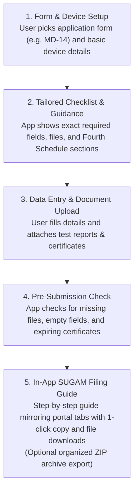
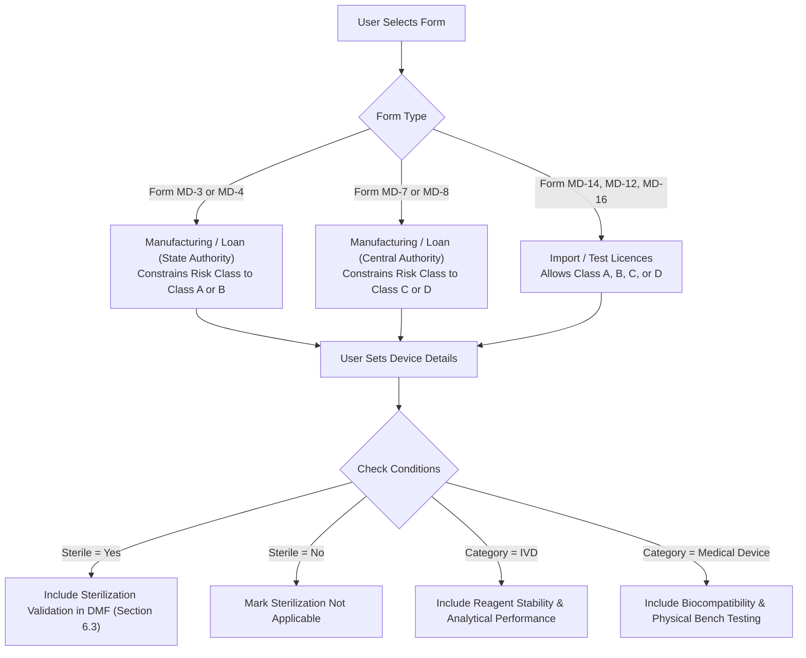
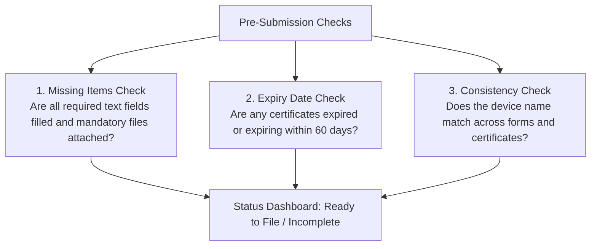

# Conceptual System Design

**Document Code:** CSD-CDSCO-001  
**Project Name:** CDSCO Medical Device Submission Dossier Builder  
**Classification:** Pre-Technical System Design and Application Structure  
**Status:** Baseline for Stakeholder Presentation  

---

## 1. Application Overview

The CDSCO Medical Device Submission Dossier Builder is designed as a focused, user-friendly web application. Its goal is simple: help applicants assemble all required regulatory data and documents for CDSCO submissions, catch common mistakes before filing, and provide a clear step-by-step guide to enter data smoothly into the government SUGAM portal.

---

## 2. Core Application Data Structure

Rather than over-complicating the system, the application is organized around five practical data components:

| Component | What It Stores | Plain Example |
| :--- | :--- | :--- |
| **1. Company Profiles (Optional)** | Optional reusable organization data saved to auto-fill multiple submissions (or entered directly per application). | Indian Agent name, Wholesale Licence number (Form 20B/21B), Foreign Manufacturer address. |
| **2. Submission Record** | The active filing session and device information. | Form MD-14 application for "Orthopedic Pedicle Screw", Class C, Sterile. |
| **3. Requirement Checklist** | The list of statutory fields and dossier sections required for this specific submission. | Covering letter, Form MD-14 particulars, Device Master File (DMF), Plant Master File (PMF), Essential Principles. |
| **4. Document Library** | Uploaded regulatory files, certificates, and test reports. | `ISO_13485_Certificate.pdf` (saved with issue and expiry dates). |
| **5. Validation Summary** | The list of remaining tasks, missing documents, or warnings. | Warning: "Sterilization test report not yet attached to DMF Section 6.3". |

---

## 3. How the Checklist Adapts (Conditional Filtering)

The requirements under the Medical Devices Rules, 2017 change depending on the form, risk class, and device characteristics. The system uses simple conditional logic to show users only what is relevant to their application.

### Simple Rules Applied:
1. **Valid Risk Class Selection:**
   * If the user selects **Form MD-3 or MD-4**, the risk class dropdown only allows **Class A or Class B** (Class C and D are disabled because State Licensing Authorities only handle low-risk devices).
   * If the user selects **Form MD-7 or MD-8**, the risk class dropdown only allows **Class C or Class D** (Central Licensing Authority handles moderate-to-high risk devices).
   * If the user selects **Form MD-14**, all classes (**A, B, C, D**) are enabled.
2. **Sterility Rules:**
   * If `Sterile = Yes`, the checklist activates sterilization validation protocols and shelf-life stability requirements.
   * If `Sterile = No`, sterilization sections are marked not applicable.
3. **Device Category:**
   * In-vitro diagnostic (IVD) devices receive IVD-specific performance sections; general medical devices receive standard biocompatibility and bench testing sections.

---

## 4. Document Management: Upload vs. In-App Generation

For every required regulatory document, the system provides a flexible, dual-choice fulfillment model:

1. **Option A: Upload Existing Document:**  
   If the applicant already has the finalized PDF or Word document (e.g. pre-signed Covering Letter, or apostilled Power of Attorney), they upload it directly.
2. **Option B: Generate via Guided In-App Form:**  
   If the applicant does not have the document prepared, clicking "Generate" opens a brief, guided questionnaire. The user enters key details (e.g., recipient authority, device model table, standards applied), and the app automatically generates the official statutory document (PDF/Word) using standard CDSCO Gazette pro-formas.

### Document Classification Overview:
* **Generatable in App (or Upload):** Official Covering Letter, Statutory Forms (MD-14/MD-7/MD-3), Power of Attorney draft, Essential Principles Matrix, Declaration of Conformity, Predicate Device Comparison Table, TSE/BSE Non-Animal Declaration, and SKU Schedules.
* **Upload Only (Third-Party Evidence):** External laboratory test reports (Biocompatibility, Sterilization, Bench tests), ISO 13485 certificates, Free Sale Certificates, Wholesale Licences, and Cleanroom CAD schematics.

### Reusable Attachments (Upload Once, Link Everywhere):
Instead of asking users to upload the same PDF multiple times into different sections:
* The user uploads an external certificate or lab report to the **Document Library** once.
* The user can attach that same file to any relevant checklist item (for example, linking an ISO 13485 certificate to administrative checklists, PMF Section 3.0, and Essential Principles).
* The user enters key file details once: Document Name, Issuing Body, and Expiry Date.
* If a document is updated with a renewed version, the update is reflected wherever that document was attached.

---

## 5. Pre-Submission Checklist Checks

Before the user moves to the government SUGAM portal, the application runs a simple pre-submission check to flag incomplete items:

### Issue Levels:
* **Incomplete / Missing:** A required field or mandatory document is missing. The user must complete it before filing.
* **Warning / Expiring Soon:** A certificate is nearing its expiry date. The user is alerted so they are not surprised by a CDSCO query later.

---

## 6. Filing Handoff to SUGAM

Once all checks pass, the application helps the user complete the submission on the government SUGAM portal:

1. **In-App Interactive SUGAM Guide (Primary):**
   * Displays step-by-step guidance arranged in the exact order of SUGAM portal tabs (*Applicant Details*, *Manufacturing Sites*, *Device Details*, *Document Uploads*, *Payment*).
   * Provides 1-click **"Copy"** buttons for data values to paste directly into SUGAM fields.
   * Provides 1-click **"Download"** buttons for the exact prepared PDF files to upload into SUGAM slots (ensuring files are under the 10MB limit).
   * Allows the user to check off each step as they complete it on the portal.

2. **Optional Offline ZIP Archive (Secondary):**
   * If the user wants a backup copy for their company files, a 1-click export creates an organized ZIP folder containing all prepared documents with clear file names matching the CDSCO checklist order.
