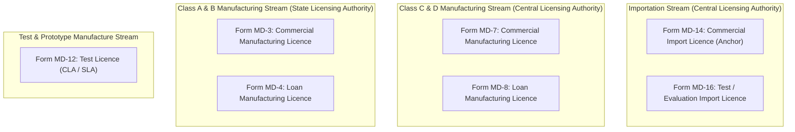
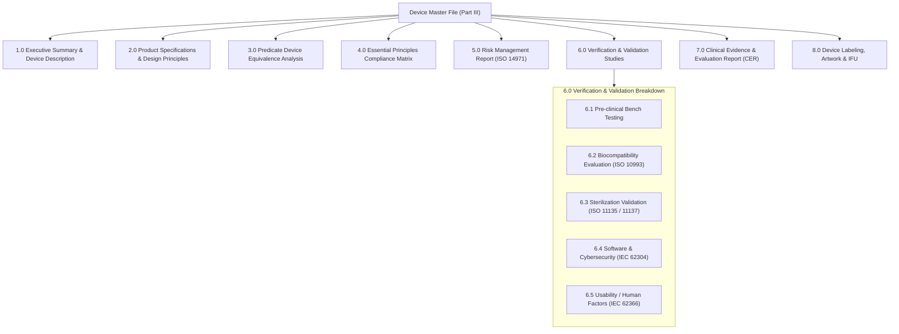
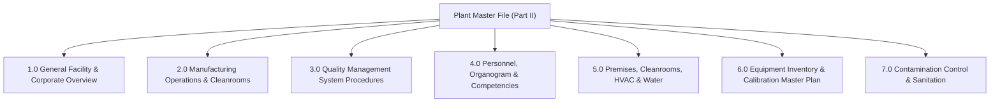

# Regulatory Forms and Technical Dossier Matrix

**Document Identifier:** RDM-CDSCO-001  
**Revision:** 1.3  
**Classification:** Regulatory Knowledge Base and Dossier Architecture  
**Governing Standard:** Medical Devices Rules, 2017 (MDR 2017), Gazette of India  
**Status:** Approved for Implementation  

---

## 1. Statutory Framework and Jurisdiction Allocation

The *Medical Devices Rules, 2017* (promulgated under the Drugs and Cosmetics Act, 1940) partition regulatory authority according to device risk classification and statutory activity:

* **Central Licensing Authority (CLA):** Vested in the Drugs Controller General (India), CDSCO HQ, New Delhi. The CLA holds exclusive jurisdiction over:
  * Commercial importation of all device classes (Class A, B, C, D) under **Form MD-14**.
  * Commercial manufacture and loan licensing of Class C and Class D devices under **Form MD-7** and **Form MD-8**.
  * Import test licences under **Form MD-16**.
* **State Licensing Authority (SLA):** Vested in the respective State Drug Control Administrations. The SLA holds jurisdiction over:
  * Commercial manufacture and loan licensing of Class A and Class B devices under **Form MD-3** and **Form MD-4**.
* **Shared Jurisdiction:** Test and evaluation manufacturing licences under **Form MD-12** fall under the CLA or SLA based on risk classification.

---

## 2. Master Comparative Regulatory Matrix: The Seven Core Forms

| # | Application Pro-Forma | Statutory Purpose | Competent Authority | Risk Classification | Core Technical Dossiers & Upload Slots | Resulting Legal Instrument |
| :- | :--- | :--- | :--- | :--- | :--- | :--- |
| **1** | **Form MD-14** *(Anchor)* | Commercial Import Licence for Medical Devices & IVDs | Central Licensing Authority (CLA) | Class A, Class B, Class C, Class D | • Full Device Master File (Part III) • Plant Master File (Part II) • Essential Principles Matrix • **36 Discrete Portal Upload Slots** | **Form MD-15** *(Import Licence)* |
| **2** | **Form MD-7** | Commercial Manufacturing Licence for Class C & D Devices | Central Licensing Authority (CLA) | Class C, Class D | • Full Device Master File (Part III) • Full Plant Master File (Part II) • ISO 13485 QMS Manual & Cleanroom Layout • **48 Discrete Portal Upload Slots** | **Form MD-9** *(Mfg Licence)* |
| **3** | **Form MD-8** | Loan Licence to Manufacture Class C & D Devices | Central Licensing Authority (CLA) | Class C, Class D | • Full Device Master File • Primary Site PMF & Consent Letter • Bilateral Agreement & MD-9 Licence Copy • **26 Discrete Portal Upload Slots** | **Form MD-10** *(Loan Licence)* |
| **4** | **Form MD-3** | Commercial Manufacturing Licence for Class A & B Devices | State Licensing Authority (SLA) | Class A, Class B | • Abbreviated Device Master File (Part II) • Plant Master File • Essential Principles Checklist • **37 Discrete Portal Upload Slots** | **Form MD-5** *(Mfg Licence)* |
| **5** | **Form MD-4** | Loan Licence to Manufacture Class A & B Devices | State Licensing Authority (SLA) | Class A, Class B | • Abbreviated Device Master File • Parent Manufacturing Site Consent & MD-5 • Quality Agreement & Testing Protocols • **37 Discrete Portal Upload Slots** | **Form MD-6** *(Loan Licence)* |
| **6** | **Form MD-12** | Application to Manufacture for Test, Evaluation, Demonstration or Research | Central / State Licensing Authority | All Risk Classes | • Test Protocol and Justification • Non-commercial Stamp Undertaking • **12 Discrete Portal Upload Slots** | **Form MD-13** *(Test Mfg Licence)* |
| **7** | **Form MD-16** | Application to Import for Test, Evaluation, Analysis or Training | Central Licensing Authority (CLA) | All Risk Classes | • Foreign Manufacturer Authorization • Test Protocol & Small Qty Justification • **12 Discrete Portal Upload Slots** | **Form MD-17** *(Test Import Licence)* |

---

## 3. Mandatory Statutory Checklists Across Core Pathways

### Stream 1: Form MD-14 Commercial Import Licence Checklist (Anchor Pathway)
*Governed by Rule 34 and Fourth Schedule (Part I, II, III).*

| Dossier Component | Document Name | Fulfillment Mode | Statutory Description & Purpose |
| :--- | :--- | :--- | :--- |
| **1. Administrative & Legal** | Covering Letter | **Upload OR In-App Generate** | Formal application letter specifying device models, accessories, and intended use. |
| | Fee Receipt / Challan | **Upload Only** | Official proof of payment via Bharatkosh treasury portal. |
| | Form MD-14 Execution | **Upload OR In-App Generate** | Statutory pro-forma completed and signed by Authorized Indian Agent. |
| | Power of Attorney | **Upload OR In-App Generate** | Notarized & apostilled PoA executed by foreign manufacturer (First Schedule Part I). Draft pro-forma generated in-app. |
| | Wholesale Drug Licence | **Upload Only** | Valid Form 20B / Form 21B or Form MD-42 held by Indian Agent. |
| | Constitution Documents | **Upload Only** | Certificate of Incorporation, Memorandum, and Board Resolution of Indian Agent. |
| **2. Regulatory Approvals** | Free Sale Certificate (Origin) | **Upload Only** | FSC issued by National Regulatory Authority of country of origin. |
| | Free Sale Certificate (Reference) | **Upload Only** | FSC/CFS from reference countries (US FDA, CE, TGA Australia, Health Canada, Japan). |
| | ISO 13485:2016 Certificate | **Upload Only** | Valid accredited QMS certificate for foreign manufacturing site. |
| | Declaration of Conformity | **Upload OR In-App Generate** | Duly signed manufacturer declaration asserting conformity to applicable standards. |
| **3. Technical Dossiers** | Device Master File (DMF) | **Assembled via App (Stitched)** | Compiled technical file structured per Fourth Schedule Part III. |
| | Plant Master File (PMF) | **Assembled via App (Stitched)** | Manufacturing site dossier structured per Fourth Schedule Part II. |
| | Essential Principles Checklist | **Upload OR In-App Generate** | Complete matrix showing compliance to safety and performance principles. |
| | Labels & IFU Artwork | **Upload Only** | Product labels, blister artwork, outer cartons, and Instructions for Use. |
| **4. Verification Evidence** | Sterilization Validation | **Upload Only** | Validation study (ISO 11135 / ISO 11137) demonstrating SAL 10^-6 (if sterile). |
| | Biocompatibility Evaluation | **Upload Only** | Biological safety reports in accordance with ISO 10993 series. |
| | Software Lifecycle Records | **Upload Only** | Architecture, verification, and cybersecurity dossier per IEC 62304 (if software). |
| | Risk Management Report | **Upload Only** | ISO 14971:2019 risk management report and risk benefit analysis. |
| | Clinical Evaluation Report | **Upload Only** | Literature-based CER demonstrating clinical safety and performance. |

---

### Stream 2 & 3: Form MD-7 and MD-8 Domestic Class C & D Manufacturing Checklists
*Governed by Rule 20(1), Rule 21, and Fourth Schedule.*

1. **Covering Letter & Statutory Fee Payment:** Formal application letter detailing devices, variants, and Bharatkosh transaction reference.
2. **Plant Master File (Fourth Schedule Part II):**
   * Site ownership deed or registered lease agreement.
   * Architectural layout plans depicting certified cleanrooms (ISO Class 7 / Class 8) with differential pressure cascades.
   * HVAC schematic diagrams, air changes per hour (ACPH) validation, and HEPA filter integrity test reports.
   * Water purification system validation (USP / Ph. Eur. Purified Water or Water for Injection).
   * Equipment inventory, qualification records (DQ/IQ/OQ/PQ), and Calibration Master Plan.
3. **Device Master File (Fourth Schedule Part III):**
   * Detailed design specifications, engineering drawings, and complete Bill of Materials (BOM).
   * In-Process Quality Control (IPQC) checkpoints and sampling plans.
   * Electrical safety (IEC 60601-1) and Electromagnetic Compatibility (IEC 60601-1-2) test reports.
   * Real-time and accelerated stability / shelf-life study data.
4. **Competent Technical Staff:** Academic credentials, experience certificates, and formal appointment letters for Production In-Charge and Quality Assurance In-Charge (MDR 2017 Rule 26).
5. **Loan Licence Specifics (MD-8):** Quality agreement with host manufacturing site, consent letter of licensee, and shared facility contamination control protocol.

---

### Stream 4 & 5: Form MD-3 and MD-4 Domestic Class A & B Manufacturing Checklists
*Governed by Rule 20(2), Rule 21, and Fifth Schedule.*

1. Duly executed Form MD-3 or MD-4 with SLA statutory fee receipt.
2. **Abbreviated Device Master File:** Focus on raw material quality specifications, finished device release testing, packaging integrity, and sterilization records (if applicable).
3. Evidence of compliance with ISO 13485 Quality Management System standards.
4. Manufacturing site layout plan, equipment list, and environment monitoring logs.
5. Appointment letters and credentials for competent technical personnel.
6. For Loan Licence (MD-4): Formal agreement with parent manufacturing plant and capacity utilization certificate.

---

### Stream 6 & 7: Form MD-12 and MD-16 Test & Evaluation Licences Checklists
*Governed by Rule 31 and Rule 40.*

1. **Detailed Protocol:** Statement of experimental objectives (bench testing, destructive testing, clinical trial support, or demonstration at an accredited NABL testing facility).
2. **Quantity Justification:** Mathematical justification limiting the requested units strictly to the quantity necessary for testing.
3. **Non-Commercial Undertaking:** Notarized undertaking on stamp paper affirming that devices will not be commercially marketed, sold, or distributed.
4. **Reconciliation and Disposal Protocol:** Formal documentation governing inventory tracking, secure storage, and post-testing destruction of residual units.
5. **Import Specifics (MD-16):** Official Letter of Authorization from the foreign manufacturer and pro-forma invoice.

---

## 4. Hierarchical Dossier Architectures (Fourth Schedule)

### Device Master File (DMF) Hierarchy (Fourth Schedule Part III)

### Plant Master File (PMF) Hierarchy (Fourth Schedule Part II)

### In Vitro Diagnostic (IVD) Dossier Hierarchy (Fourth Schedule Appendix III)

```mermaid
flowchart TD
    IVD_Root["IVD Device Master File (Appendix III)"]
    I1["1.0 Executive Summary & Design Info"]
    I2["2.0 Regulatory Status of Similar Device in India"]
    I3["3.0 Essential Principles Checklist"]
    I4["4.0 Risk Analysis & Clinical Evidences"]
    I5["5.0 Analytical Performance (Sensitivity, Specificity, Calibrator Traceability)"]
    I6["6.0 Three-Tier Stability (Shelf-life, In-Use, Shipping)"]
    I7["7.0 Product Insert, Pack Size & Labels"]
    I8["8.0 Specimen Batch Test Reports (3 Batches)"]
    I9["9.0 Performance Evaluation Report (PER - Central Lab / Rule 83)"]
    I10["10.0 Post Market Surveillance (PMS)"]

    IVD_Root --> I1
    IVD_Root --> I2
    IVD_Root --> I3
    IVD_Root --> I4
    IVD_Root --> I5
    IVD_Root --> I6
    IVD_Root --> I7
    IVD_Root --> I8
    IVD_Root --> I9
    IVD_Root --> I10
```

---

## 5. Appendix: Future Specialized Pathways (Clinical & Novel Devices)

Forms **MD-22** and **MD-26** are deferred to future specialized releases due to their non-standardized regulatory nature:

* **Form MD-22 (Clinical Investigation Permission - Rule 51):**
  * Requires custom Clinical Investigation Plans (CIP as per ISO 14155), Investigator's Brochures (IB), multi-center Institutional Ethics Committee (IEC) approvals, patient insurance policies, and clinical trial registry entries (CTRI).
  * Requirements cannot be satisfied through a standardized engineering dossier checklist because trial protocols and clinical endpoints are bespoke to each investigational therapy.
* **Form MD-26 (Novel Medical Device Permission - Rule 63):**
  * Applies exclusively to devices with no established predicate in India.
  * Governed by case-by-case evaluation by CDSCO Subject Expert Committees (SEC), clinical waiver evaluations, and tailored post-market surveillance (PMS) commitments.
