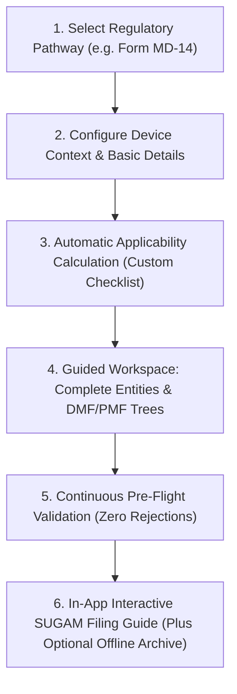

# CDSCO Medical Device Submission Dossier Builder
## Project Presentation and Requirements Suite

This documentation suite provides a business, user-centric, and design-focused presentation of the **CDSCO Medical Device Submission Dossier Builder**.

It is specifically structured for **stakeholder presentations, executive pitches, and product design reviews** before finalizing technical implementation stacks.

---

## Presentation Documentation Index

| # | Document Title | Purpose & What You Will See | Direct File Link |
| :- | :--- | :--- | :--- |
| **01** | **Project Concept and Vision** | Executive pitch, core pain points in CDSCO filings today, platform solution, the 7 core pathways, and business value. | [01_PROJECT_CONCEPT_AND_VISION.md](file:///c:/Users/Sam/Documents/MyData/Projects/CDSCO_new/docs/01_PROJECT_CONCEPT_AND_VISION.md) |
| **02** | **User Requirements and Capabilities** | User personas (AIA, Manufacturer, RA Lead), Jobs-to-be-Done, and core capabilities in plain business and user language. | [02_USER_REQUIREMENTS_AND_CAPABILITIES.md](file:///c:/Users/Sam/Documents/MyData/Projects/CDSCO_new/docs/02_USER_REQUIREMENTS_AND_CAPABILITIES.md) |
| **03** | **UI/UX Design and Screen Walkthroughs** | Complete visual screen wireframes for Dashboard, Setup Wizard, Entity Workspace (with Upload vs Generate choice), DMF Tree, Evidence Vault, Validation Inspector, and SUGAM Handoff Center. | [03_UI_UX_DESIGN_AND_SCREEN_WALKTHROUGHS.md](file:///c:/Users/Sam/Documents/MyData/Projects/CDSCO_new/docs/03_UI_UX_DESIGN_AND_SCREEN_WALKTHROUGHS.md) |
| **04** | **Conceptual System Design** | Practical application structure designed prior to tech stack selection: core data components, conditional checklist filtering, reusable document attachments, and pre-submission checks. | [04_CONCEPTUAL_SYSTEM_DESIGN.md](file:///c:/Users/Sam/Documents/MyData/Projects/CDSCO_new/docs/04_CONCEPTUAL_SYSTEM_DESIGN.md) |
| **05** | **Regulatory Forms and Technical Dossier Matrix** | Complete comparative matrix across all seven MDR 2017 application streams, statutory checklists, and Fourth Schedule DMF/PMF hierarchies. | [05_REGULATORY_FORMS_AND_DOSSIER_MATRIX.md](file:///c:/Users/Sam/Documents/MyData/Projects/CDSCO_new/docs/05_REGULATORY_FORMS_AND_DOSSIER_MATRIX.md) |

---

## Technical Specifications Suite

Detailed engineering blueprints, relational schemas, DSL rules, and document generation logic are located in [`technical_reference/`](file:///c:/Users/Sam/Documents/MyData/Projects/CDSCO_new/docs/technical_reference):

| # | Technical Specification | Scope & Focus | Direct Link |
| :- | :--- | :--- | :--- |
| **01** | **Project Charter & Scope** | Official mandate, statutory standards, jurisdiction boundaries, and milestones. | [01_PROJECT_CHARTER_AND_SCOPE.md](file:///c:/Users/Sam/Documents/MyData/Projects/CDSCO_new/docs/technical_reference/01_PROJECT_CHARTER_AND_SCOPE.md) |
| **02** | **User Requirements Specification (URS)** | Formal engineering requirements (UR-01 through UR-09) prioritized by MoSCoW. | [02_USER_REQUIREMENTS_SPECIFICATION_URS.md](file:///c:/Users/Sam/Documents/MyData/Projects/CDSCO_new/docs/technical_reference/02_USER_REQUIREMENTS_SPECIFICATION_URS.md) |
| **03** | **System Architecture & Data Flow** | Multi-engine topology, operational sequences, and entity state machines. | [03_SYSTEM_ARCHITECTURE_AND_DATA_FLOW.md](file:///c:/Users/Sam/Documents/MyData/Projects/CDSCO_new/docs/technical_reference/03_SYSTEM_ARCHITECTURE_AND_DATA_FLOW.md) |
| **04** | **Engineering & Data Model Spec** | Relational schemas, DSL rules engine, RESTful API endpoints, and validation severities. | [04_ENGINEERING_AND_DATA_MODEL_SPEC.md](file:///c:/Users/Sam/Documents/MyData/Projects/CDSCO_new/docs/technical_reference/04_ENGINEERING_AND_DATA_MODEL_SPEC.md) |
| **05** | **Document Engines & Dual Fulfillment Logic** | Cross-form document landscape, engine applicability (commercial vs test), guided questionnaire processing logic, and multi-file dossier assembly under 10MB. | [05_DOCUMENT_ENGINES_AND_FULFILLMENT_LOGIC.md](file:///c:/Users/Sam/Documents/MyData/Projects/CDSCO_new/docs/technical_reference/05_DOCUMENT_ENGINES_AND_FULFILLMENT_LOGIC.md) |

---

## Core Product Workflow at a Glance

