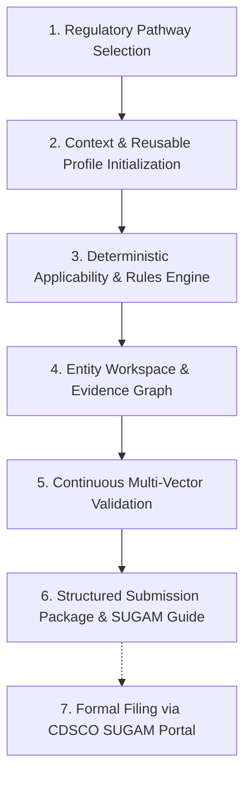
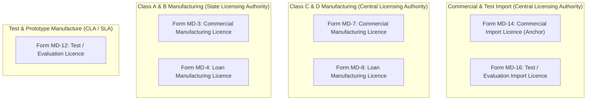
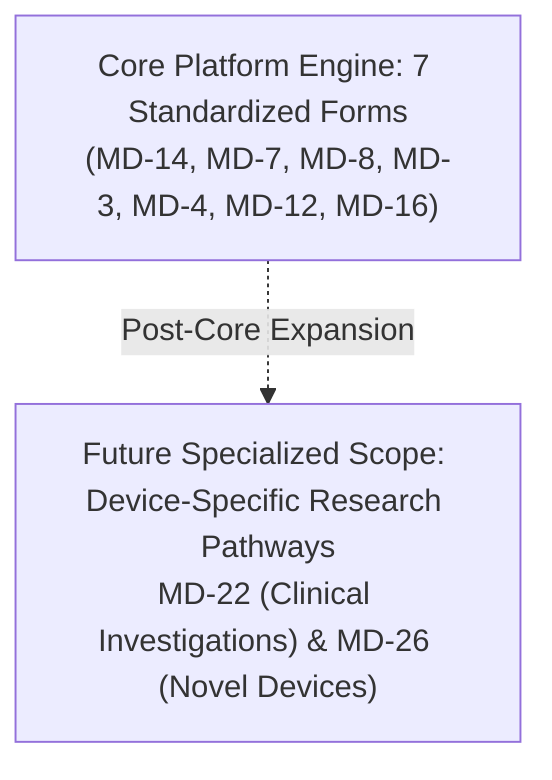

# Project Charter and Regulatory Scope Specification

**Document Identifier:** CHARTER-CDSCO-001  
**Revision:** 1.3  
**Classification:** Regulatory Technology Architecture Specification  
**Governing Standard:** Medical Devices Rules, 2017 (MDR 2017), Ministry of Health and Family Welfare, Government of India  
**Status:** Approved for Implementation  

---

## 1. Executive Summary and Strategic Mandate

The **CDSCO Medical Device Submission Dossier Builder** is a specialized regulatory preparation environment engineered to guide medical device manufacturers, importers, and Authorized Indian Agents (AIA) through the end-to-end assembly, cross-referencing, continuous validation, and packaging of statutory CDSCO medical device submissions prior to electronic filing on the CDSCO **SUGAM / MD-Portal**.

Under the *Medical Devices Rules, 2017*, obtaining regulatory approval in India requires compiling multi-tiered technical evidence, including:
1. Administrative documentation, powers of attorney, wholesale licences, and fee receipts.
2. Device Master Files (DMF) prepared in accordance with the Fourth Schedule (Part III) and international IMDRF standards.
3. Plant Master Files (PMF) prepared in accordance with the Fourth Schedule (Part II) detailing facility layout, cleanrooms, and quality management systems.
4. Essential Principles (EP) of Safety and Performance matrices mapped to harmonized standards.
5. Risk management files, verification and validation protocols, sterilization validation data, biocompatibility reports, clinical evaluation reports, and software life-cycle records.

The platform provides a deterministic, rules-driven workspace where every field, document requirement, and technical clause is treated as an interconnected regulatory entity backed by statutory justification and automated verification.

---

## 2. Product Boundaries: Scope Inclusions vs. Non-Goals

To maintain technical integrity and regulatory defensibility, the platform defines rigid boundaries regarding its responsibilities:

| Operational Dimension | Out of Scope (Non-Goals) | In Scope (System Mandate) |
| :--- | :--- | :--- |
| **Transaction Processing** | Direct programmatic bot submission into the SUGAM portal or automated bypass of CDSCO portal controls. | Pre-submission dossier structuring, discrepancy elimination, and generation of a field-by-field SUGAM upload mapping guide. |
| **Dossier Architecture** | Generic flat folder storage or unindexed multi-megabyte PDF uploads. | Hierarchical dossier trees reflecting the Fourth Schedule, tracking section-level requirements, sub-sections, and file attachments. |
| **Artificial Intelligence** | Unsupervised automated document parsing that populates regulatory fields without audit or validation. | Optional assistive extraction layers where suggestions must undergo mandatory human verification before triggering deterministic validation. |
| **Regulatory Authority** | Autonomous legal or regulatory decision-making on behalf of licensing bodies. | Deterministic verification against codified MDR 2017 rules, official CDSCO checklists, and gazette notifications. |
| **Form Customization** | Siloed, hardcoded web forms tailored exclusively to a single application type. | A declarative, data-driven regulatory engine that instantiates multiple application workflows from unified schema definitions. |

---

## 3. Core Operational Scope: The Seven Core Medical Device Applications

The core operational scope of the platform encompasses **seven standardized CDSCO application forms** under the *Medical Devices Rules, 2017*. These forms represent well-defined regulatory pathways with structured statutory checklists and repeatable documentation frameworks:

### Statutory Comparison Matrix: The Seven Core Operational Forms

| # | Form Code | Statutory Reference | Official Purpose | Licensing Authority | Risk Class Coverage | Resulting Legal Instrument |
| :- | :--- | :--- | :--- | :--- | :--- | :--- |
| **1** | **Form MD-14** *(Anchor)* | Rule 34(1) | Commercial Import Licence for Medical Devices & IVDs | Central Licensing Authority (CLA) | Class A, B, C, D | **Form MD-15** *(Import Licence)* |
| **2** | **Form MD-7** | Rule 20(1) | Commercial Manufacturing Licence for Class C & D Devices | Central Licensing Authority (CLA) | Class C, Class D | **Form MD-9** *(Mfg Licence)* |
| **3** | **Form MD-8** | Rule 21 | Loan Licence to Manufacture Class C & D Devices | Central Licensing Authority (CLA) | Class C, Class D | **Form MD-10** *(Loan Licence)* |
| **4** | **Form MD-3** | Rule 20(2) | Commercial Manufacturing Licence for Class A & B Devices | State Licensing Authority (SLA) | Class A, Class B | **Form MD-5** *(Mfg Licence)* |
| **5** | **Form MD-4** | Rule 21 | Loan Licence to Manufacture Class A & B Devices | State Licensing Authority (SLA) | Class A, Class B | **Form MD-6** *(Loan Licence)* |
| **6** | **Form MD-12** | Rule 31 | Manufacturing Licence for Test, Evaluation, Demonstration or Research | Central / State Licensing Authority | All Risk Classes | **Form MD-13** *(Test Licence)* |
| **7** | **Form MD-16** | Rule 40 | Import Licence for Test, Evaluation, Demonstration or Research | Central Licensing Authority (CLA) | All Risk Classes | **Form MD-17** *(Test Import Licence)* |

---

## 4. Specialized Research Pathways: Partitioned to Future Scope

Forms **MD-22** and **MD-26** are intentionally partitioned into **Future Scope** and excluded from the core implementation:

### Rationale for Future Scope Partitioning

1. **Form MD-22 (Clinical Investigation Permission):**
   * Clinical trial documentation varies radically across investigational devices (sample sizes, primary endpoints, statistical analysis plans, patient injury compensation insurance, and multi-center Institutional Ethics Committee approvals).
   * It does not adhere to a single standardized engineering dossier template.
2. **Form MD-26 (Novel Medical Device Permission):**
   * Novel devices lack an established predicate in India.
   * Requirements are driven by individual Subject Expert Committee (SEC) recommendations, literature reviews, and bespoke clinical trial waivers, requiring ad-hoc regulatory consulting rather than a static compliance checklist.

---

## 5. User Personas and Operational Profiles

| Regulatory Persona | Operational Responsibilities | Primary System Needs |
| :--- | :--- | :--- |
| **Authorized Indian Agent (AIA)** | Power of Attorney validity, Wholesale Licence upkeep, foreign manufacturer coordination. | Profile reuse across multi-principal dossiers, certificate expiration monitoring. |
| **Domestic Device Manufacturer** | Cleanroom classification, Plant Master File assembly, competent technical staff tracking. | Fourth Schedule Part II alignment, SLA vs. CLA jurisdiction differentiation. |
| **Regulatory Affairs Specialist** | Device Master File compilation, Essential Principles compliance, cross-reference integrity. | One-entity-at-a-time workspace, real-time consistency checks, gap reports. |
| **Quality Assurance Lead** | ISO 13485 QMS manual, test records, validation master plan maintenance. | Traceability graph, evidence versioning, audit trail tracking. |

---

## 6. Phased Engineering Delivery Roadmap

| Phase | Milestone Name | Pathway Scope | Primary Architectural Deliverables |
| :--- | :--- | :--- | :--- |
| **Phase 1** | Import Anchor | **Form MD-14** | Core Engine, DMF (Part III), PMF (Part II), Essential Principles Matrix, Continuous Validation & SUGAM Handoff Package. |
| **Phase 2** | Domestic Class C/D | **Form MD-7, Form MD-8** | CLA Manufacturing and Loan Licences, cleanroom classification, HVAC and water system validation. |
| **Phase 3** | Domestic Class A/B | **Form MD-3, Form MD-4** | SLA Manufacturing and Loan Licences, abbreviated DMF. |
| **Phase 4** | Test & Evaluation | **Form MD-12, Form MD-16** | Test manufacturing and import licences, small quantity justifications, non-commercial undertakings. |
| **Future** | Clinical & Novel | **Form MD-22, Form MD-26** | Clinical trial protocols, SEC review dossiers, novel device justifications. |

### Architectural Gate Criteria
* **Gate 1 (Phase 1 Exit):** Successful end-to-end execution of a complex Form MD-14 submission, including a 30+ node DMF, 20+ node PMF, 48 Essential Principles, and output of a validated handoff package.
* **Gate 2 (Phase 2 Exit):** Verification that domestic manufacturing forms (MD-7, MD-8) run on the identical core engine without modifying code outside application definition schemas.
* **Gate 3 (Phase 3 & 4 Exit):** Full operation across all 7 core forms with zero software redeployments.
