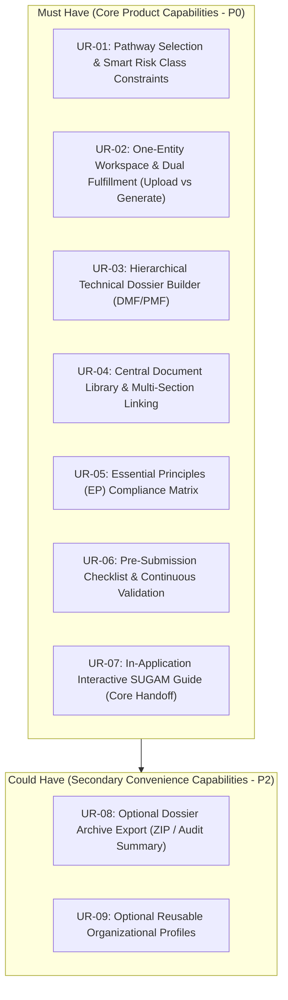

# User Requirements Specification (URS)

**Document Identifier:** URS-CDSCO-001  
**Revision:** 2.0  
**Classification:** Product Engineering Requirement Baseline  
**Governing Standard:** Medical Devices Rules, 2017 (MDR 2017)  
**Status:** Approved for Implementation  

---

## 1. System Objectives and Regulatory Lifecycle

This document specifies the functional and non-functional requirements for the **CDSCO Medical Device Submission Dossier Builder**. The system serves as a preparation platform enabling regulatory affairs personnel to assemble, verify, cross-reference, and validate statutory CDSCO submissions and complex technical dossiers (such as the Device Master File and Plant Master File) before executing formal filings on the CDSCO SUGAM portal.

### Operational Lifecycle Stages

| Lifecycle Stage | Primary Actor | Key Operational Tasks | System Verification Gates |
| :--- | :--- | :--- | :--- |
| **1. Initialization** | Regulatory Specialist | Select pathway (e.g. Form MD-14) and set device classification with smart statutory constraints. | Pathway constraints enforce legal risk classes; active requirements instantiated. |
| **2. Guided Preparation** | Regulatory Specialist | Complete form fields with 8-point guidance, choosing between direct upload or in-app form generation for statutory documents. | Field type validation, statutory pro-forma adherence. |
| **3. Dossier Assembly & Linking** | Regulatory Specialist | Structure Fourth Schedule DMF/PMF trees, attach test reports/certificates, and complete Essential Principles matrix. | Leaf-node evidence coverage, multi-requirement reference integrity. |
| **4. Pre-Submission Validation** | System Engine | Automated audits across completeness, consistency, evidence coverage, and certificate validity. | Zero blocking errors; clear advisory warnings for impending certificate expirations. |
| **5. SUGAM Filing & Handoff** | Specialist & System | Guided portal data entry via In-Application SUGAM Guide (with 1-click copy and downloads), plus optional offline ZIP archive. | Pre-verified 10MB per-file ceiling; 100% portal field coverage. |

---

## 2. Functional Requirements Architecture (MoSCoW Baseline)

---

### UR-01: Pathway Selection First & Smart Statutory Risk Class Constraints
* **Priority:** **Must Have (P0)**
* **Requirement Statement:** The system shall allow an applicant to initialize a submission by selecting an applicable regulatory pathway from the seven core MDR 2017 application streams and enforce valid statutory risk classes.
* **Regulatory Context:** MDR 2017 Rules 20, 21, 31, 34, and 40 establish distinct filing requirements for domestic manufacture, commercial import, loan licensing, and testing.
* **Functional Description:**
  1. User selects from the 7 core pathways: Form MD-14, MD-7, MD-8, MD-3, MD-4, MD-12, MD-16.
  2. The system dynamically constrains the risk class selector based on the statutory jurisdiction:
     * Selecting **Form MD-7 or MD-8** (Central Authority) strictly locks risk class options to `Class C` and `Class D` (Class A and B disabled).
     * Selecting **Form MD-3 or MD-4** (State Authority) strictly locks risk class options to `Class A` and `Class B` (Class C and D disabled).
     * Selecting **Form MD-14** (Import Licence) keeps all four classes (`Class A, B, C, D`) selectable.
  3. User defines operational parameters: Category (`Medical Device` vs. `IVD`), Sterility (`Sterile` vs. `Non-Sterile`), and Software inclusion.
* **Acceptance Criteria:**
  * Incompatible risk class selections are disabled with statutory explanatory tooltips.
  * Setting `Sterile: Yes` activates Fourth Schedule Section 6.3 and sterilization validation requirements.

---

### UR-02: One-Entity Regulatory Workspace with 8-Point Guidance Card & Dual Fulfillment
* **Priority:** **Must Have (P0)**
* **Requirement Statement:** The system shall structure the preparation workflow one requirement at a time, providing an 8-Point Guidance Card and offering a flexible choice between uploading an existing document or auto-generating it via a guided in-app form.
* **Functional Description:**
  1. Every statutory requirement displays an **8-Point Guidance Card**:
     * What is required, Why it is required, What to provide, How to provide it, Regulatory citation, Target SUGAM location, Related evidence, and Completion status.
  2. **Dual Fulfillment Option:** For each statutory document, the user chooses:
     * **Option A: [ Upload Existing Document ]** &mdash; Uploads a pre-signed, finalized PDF/Word document directly.
     * **Option B: [ Generate via Guided Form ]** &mdash; Answers a focused questionnaire; the system auto-generates the finished statutory PDF/Word document using standard CDSCO templates.
  3. **Supported Generatable Documents:** Official Covering Letter, Statutory Form pro-forma (MD-14/MD-7/MD-3), Power of Attorney pro-forma (First Schedule Part I), Essential Principles Table, Declaration of Conformity (DoC), Predicate Comparison Table, TSE/BSE Non-Animal Declaration, and SKU Schedule tables.
  4. **Upload-Only Documents:** Laboratory test reports (biocompatibility, sterility, bench), ISO 13485 certificates, Free Sale Certificates, Wholesale Licences, and Cleanroom CAD schematics.
* **Acceptance Criteria:**
  * For generatable documents, users can switch between direct upload and in-app form generation.
  * Generated documents adhere strictly to official CDSCO Gazette formats.

---

### UR-03: Hierarchical Technical Dossier Builder (DMF and PMF)
* **Priority:** **Must Have (P0)**
* **Requirement Statement:** The system shall structure the Device Master File (DMF) and Plant Master File (PMF) as interactive, collapsible trees matching the Fourth Schedule of MDR 2017, and provide an Assembly Builder to compile and optimize them.
* **Functional Description:**
  1. DMF Tree mirrors Fourth Schedule Part III (Chapters 1.0 through 8.0).
  2. PMF Tree mirrors Fourth Schedule Part II (Chapters 1.0 through 7.0).
  3. **Assembly Builder:** Stitches chapter PDFs, test reports, and declarations into a unified dossier PDF:
     * Prepends an official Cover Page and Table of Contents.
     * Inserts section dividers and stamps continuous page numbers.
     * Injects PDF bookmarks for reviewer sidebar navigation.
     * Checks file size against the SUGAM 10MB limit and applies image optimization (downsampling to 150 DPI) if needed.
* **Acceptance Criteria:**
  * Leaf nodes allow attaching chapter files and lab reports.
  * Assembly Builder generates a compiled, bookmarked PDF under 10MB.

---

### UR-04: Central Document Library & Multi-Section Linking
* **Priority:** **Must Have (P0)**
* **Requirement Statement:** The system shall maintain a centralized Document Library where external evidence files are uploaded once and attached to multiple statutory requirements.
* **Functional Description:**
  1. Documents are stored with key metadata: Document Type, Issuing Body, Issue Date, Expiration Date, and Standards Applied.
  2. A single document (e.g. ISO 13485 Certificate) can be linked to multiple requirement nodes simultaneously.
  3. Updating or replacing a document updates all connected requirement nodes and prompts for confirmation.
* **Acceptance Criteria:**
  * Uploading a new version of a certificate updates all linked references across the submission.
  * System alerts the user if an uploaded document is within 90 days of expiration.

---

### UR-05: Essential Principles (EP) Compliance Matrix
* **Priority:** **Must Have (P0)**
* **Requirement Statement:** The system shall provide an interactive compliance matrix for the CDSCO Essential Principles (Fourth Schedule Appendix II) and render the completed table directly as an official PDF.
* **Functional Description:**
  1. Pre-populates all standard CDSCO safety and performance clauses.
  2. For each clause, user selects Applicability (`Yes` / `No`), Standard Applied, and links supporting lab test reports from the Document Library.
  3. Renders the completed matrix directly into a clean, official `Essential_Principles_Checklist.pdf` ready for SUGAM upload.
* **Acceptance Criteria:**
  * System requires justification for any principle marked `Not Applicable`.
  * Generates an official, publication-ready PDF table.

---

### UR-06: Pre-Submission Checklist & Continuous Validation Checks
* **Priority:** **Must Have (P0)**
* **Requirement Statement:** The system shall run continuous automated pre-submission checks across completeness, data consistency, evidence coverage, and certificate validity.
* **Functional Description:**
  1. **Completeness Audit:** Flags missing mandatory fields, unfilled forms, and unattached required files.
  2. **Data Consistency Audit:** Detects naming discrepancies across forms, certificates, and test reports.
  3. **Evidence Coverage Audit:** Ensures every applicable Fourth Schedule chapter and Essential Principle has valid supporting documentation attached.
  4. **Validity Audit:** Flags certificates expiring within 60 days.
* **Acceptance Criteria:**
  * Real-time dashboard highlights `Blocking Errors` (must fix to proceed) and `Warnings`.
  * 1-click "Resolve Now" shortcuts navigate directly to the affected entity.

---

### UR-07: In-Application Interactive SUGAM Submission Guide (Core Handoff)
* **Priority:** **Must Have (P0 - Core Product Handoff)**
* **Requirement Statement:** The system shall provide a step-by-step digital co-pilot mirroring the live CDSCO SUGAM / MD-Online portal tabs to guide the applicant through live portal submission.
* **Functional Description:**
  1. Mirrors the exact tab structure of the live portal (*Applicant Details*, *Manufacturing Site*, *Product Details*, *Document Uploads*, *Payment*).
  2. Provides 1-click **"Copy Value"** buttons for corporate data, IEC codes, device schedules, model lists, and intended use statements.
  3. Provides 1-click **"Download This File"** buttons for each specific upload slot, with files pre-checked to be under the 10MB limit.
  4. Interactive checkboxes allow users to check off each step as completed on the government portal.
* **Acceptance Criteria:**
  * Every required SUGAM tab and upload slot has a corresponding guidance card.
  * All downloadable files are verified to be under 10MB prior to portal upload.

---

### UR-08: Optional Dossier Archive Export (ZIP / Audit Summary)
* **Priority:** **Could Have (Optional P2)**
* **Requirement Statement:** The system shall provide an optional 1-click export of the complete submission package into an organized, numbered ZIP archive and printable audit summary for permanent company records.
* **Functional Description:**
  1. Compiles a clean ZIP archive with official CDSCO checklist prefixes (`01_Covering_Letter.pdf`, `04_Power_of_Attorney.pdf`, `08_Device_Master_File.pdf`).
  2. Generates a printable `SUGAM_Handoff_Summary.pdf` for internal quality and legal audits.
* **Acceptance Criteria:**
  * Archive contains all compiled PDFs organized in statutory order for permanent corporate retention.

---

### UR-09: Optional Reusable Organizational Profiles & Corporate Context
* **Priority:** **Could Have (Optional P2)**
* **Requirement Statement:** The system may optionally maintain reusable corporate profiles for Authorized Indian Agents, Foreign Manufacturers, and Manufacturing Sites to streamline recurring submissions.
* **Functional Description:**
  1. Maintains reusable profiles storing company constitution details, Wholesale Licences (Form 20B/21B or MD-42), and site addresses.
  2. When creating a new submission, selecting a profile auto-populates administrative details. Users can also enter information directly without creating profiles.
* **Acceptance Criteria:**
  * Modifying an address in a profile updates linked draft submissions upon user confirmation.

---

## 3. Non-Functional Requirements Specification (NFR)

| Identifier | Category | Performance Standard and Verification Target |
| :--- | :--- | :--- |
| **NFR-01** | **Performance & Latency** | Applicability rules recalculation and validation checks shall execute in under 200ms for dossiers containing up to 250 entities. |
| **NFR-02** | **Data Integrity** | Transactional integrity guaranteed across entity state changes and document attachments. Zero data loss on concurrent edits. |
| **NFR-03** | **Audit Trail Compliance** | Immutable, time-stamped audit logging for all data entries, file attachments, and rule evaluations in alignment with 21 CFR Part 11 principles. |
| **NFR-04** | **Information Security** | Encryption at rest (AES-256) for technical dossiers and proprietary files. Encryption in transit via TLS 1.3. |
| **NFR-05** | **Architecture Decoupling** | Complete separation of regulatory logic and form schemas from backend code. |
| **NFR-06** | **Browser Compatibility** | Full operational capability across modern desktop browsers (Chrome, Edge, Safari, Firefox). |

---

## 4. Requirements Traceability & Verification

Every requirement specified herein (UR-01 through UR-09 and NFR-01 through NFR-06) maps directly to explicit unit, integration, and end-to-end test specifications with automated test cases. For the complete verification matrix, test execution procedures, and CI/CD quality gates, refer to:

* **[07. System Verification, Test Specification, and Requirements Traceability Matrix (RTM)](file:///c:/Users/Sam/Documents/MyData/Projects/CDSCO_new/docs/technical_reference/07_SYSTEM_VERIFICATION_AND_TEST_TRACEABILITY.md)**

