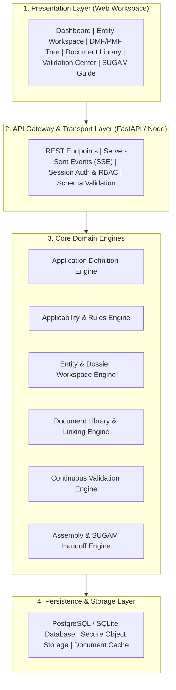
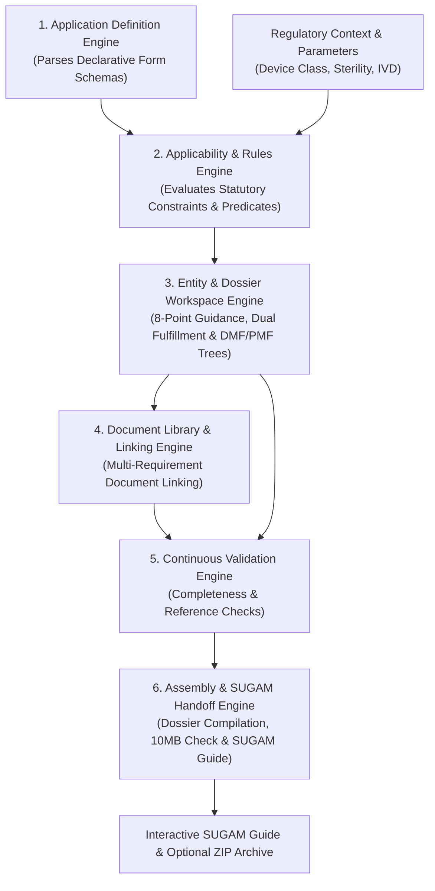
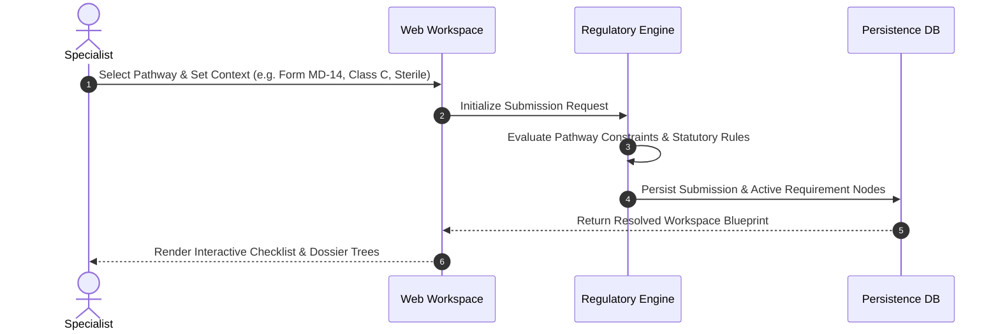
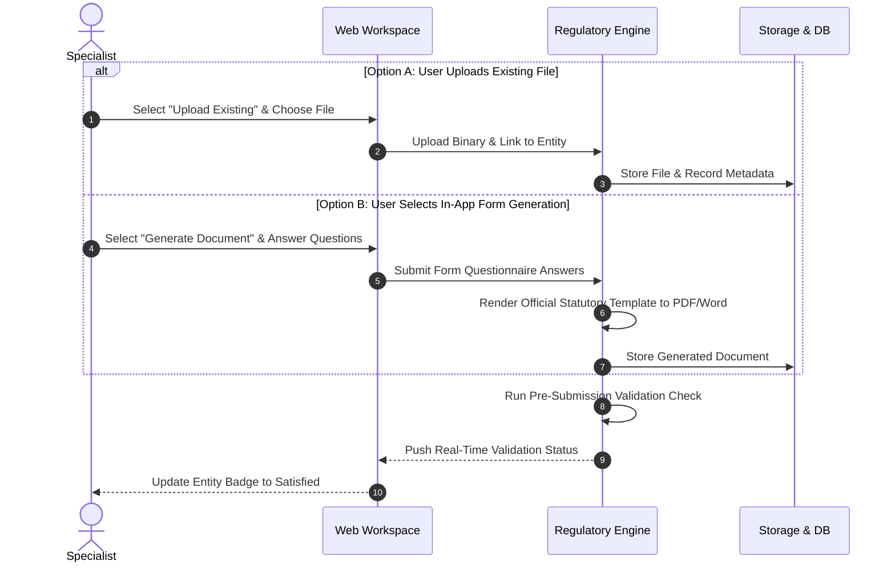
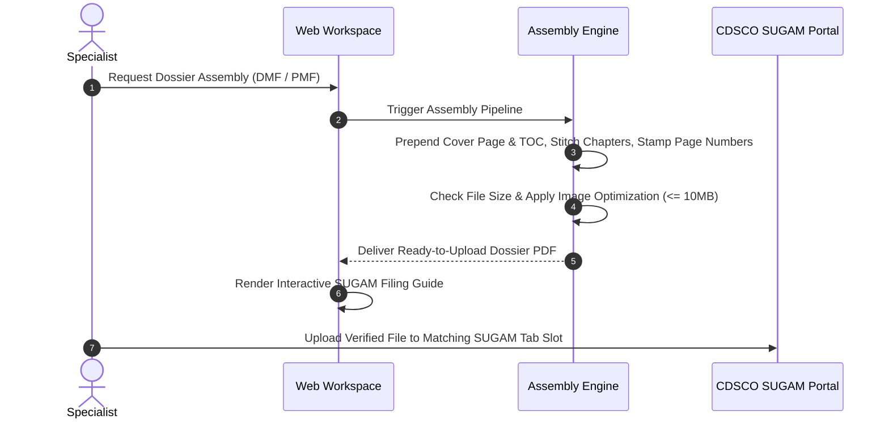
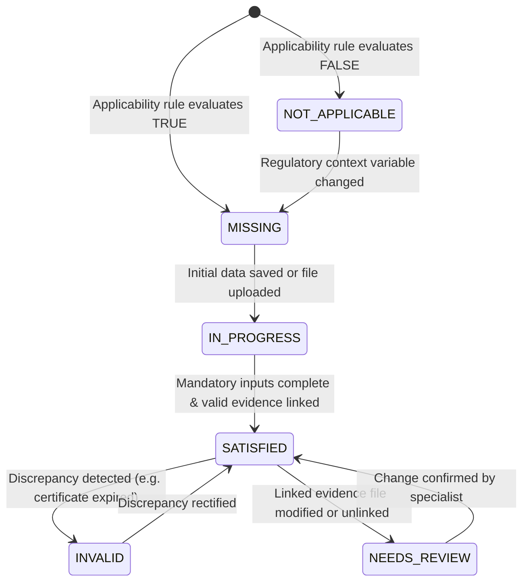
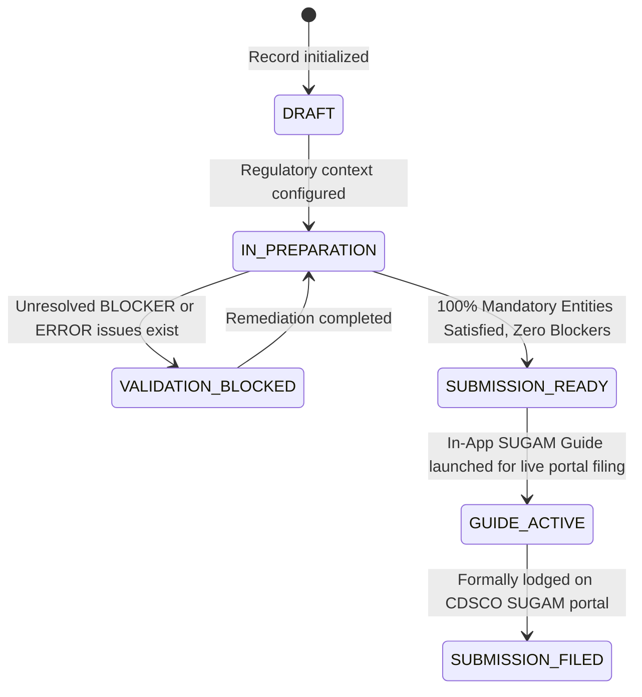

# System Architecture and Data Flow Specification

**Document Identifier:** SAD-CDSCO-001  
**Revision:** 2.0  
**Classification:** Technical Architecture and System Design Baseline  
**Governing Standard:** Medical Devices Rules, 2017 (MDR 2017)  
**Status:** Approved for Implementation  

---

## 1. Architectural Principles and System Overview

The system architecture is structured around a **declarative, domain-driven engine** designed to decouple volatile regulatory rules and statutory forms from backend application logic and frontend presentation components.

---

## 2. Core Domain Engines Pipeline

### Functional Allocation Across Core Engines

| Engine Designation | Architectural Responsibility | Primary Inputs | Generated Outputs |
| :--- | :--- | :--- | :--- |
| **Application Definition Engine** | Parses declarative form schemas. Provides blueprints for forms MD-14, MD-7, MD-3, etc. | Declarative JSON Schemas | Compiled In-Memory Application Blueprint |
| **Applicability & Rules Engine** | Evaluates statutory constraints against regulatory context parameters (Risk Class, IVD, Sterility) to calculate requirement applicability. | Regulatory Context Attributes | Active, Conditional, and Non-Applicable Entity Lists |
| **Entity & Dossier Workspace Engine** | Manages one-entity-at-a-time rendering, resolves the 8-point regulatory guidance model, supports Dual Fulfillment (Upload vs. Generate), and tracks DMF/PMF hierarchy states. | Active Entity Key & Submission State | Resolved Entity ViewModel with Guidance, Form Generation, and Actions |
| **Document Library & Linking Engine** | Manages external certificates and test reports; enforces many-to-many relationships between files and statutory requirements. | Document Uploads and Linking Requests | Central Document Registry with Expiration Tracking |
| **Continuous Validation Engine** | Evaluates submission state across completeness, data consistency, technical evidence coverage, and certificate validity. | Field Payloads, Document Links, and Rule Sets | Categorized Issue Logs and Readiness Metrics |
| **Assembly & SUGAM Handoff Engine** | Stitches dossier sections into continuous PDFs (under 10MB), powers the In-App Interactive SUGAM Guide, and generates optional offline ZIP archives. | Validated Dossier Structure and Binary Assets | Interactive SUGAM Co-Pilot, Compiled PDFs, and Numbered ZIP Archive |

---

## 3. End-to-End Operational Data Flows

### Flow 1: Submission Initialization and Dynamic Rule Resolution

#### Flow 1 Step-by-Step Technical Execution

| Step | Action | Sender | Receiver | Technical Payload & Operation |
| :--- | :--- | :--- | :--- | :--- |
| **1** | Select Pathway | Specialist | Web Workspace | Chooses Form MD-14, sets device risk class (Class A/B/C/D), sterility, and category (MD/IVD). |
| **2** | Initialize Request | Web Workspace | API Gateway | `POST /api/v1/submissions` with pathway code and regulatory context JSON. |
| **3** | Rule Evaluation | Rules Engine | Rules Engine | Evaluates boolean conditions; activates mandatory requirements and marks non-applicable items. |
| **4** | State Persistence | Rules Engine | Persistence DB | Persists submission master record, active entity states, and Fourth Schedule DMF/PMF nodes. |
| **5** | Return Blueprint | Persistence DB | Web Workspace | Returns compiled hierarchy tree with 8-point guidance definitions and initial validation status. |
| **6** | Display Workspace | Web Workspace | Specialist | Displays interactive tree explorer and active requirement checklist. |

---

### Flow 2: Dual Fulfillment (Upload vs. Generate) and Evidence Linking

#### Flow 2 Step-by-Step Technical Execution

| Step | Action | Sender | Receiver | Technical Payload & Operation |
| :--- | :--- | :--- | :--- | :--- |
| **1** | Select Fulfillment | Specialist | Web Workspace | Chooses between Option A (Upload Existing) or Option B (Generate via Guided Form). |
| **2A** | Upload Existing | Web Workspace | Regulatory Engine | `POST /api/v1/submissions/{id}/evidence/upload-and-link` with binary file and entity key. |
| **2B** | In-App Generate | Web Workspace | Regulatory Engine | `POST /api/v1/submissions/{id}/entities/{key}/generate` with questionnaire answers; renders template. |
| **3** | Store Payload | Regulatory Engine | Storage & DB | Saves document in secure storage, records metadata (issue date, expiry date, standards). |
| **4** | Validate & Update | Regulatory Engine | Regulatory Engine | Updates requirement state and runs pre-submission validation checks. |
| **5** | Push Status | Regulatory Engine | Web Workspace | Pushes updated readiness metrics and cleared blocker logs. |
| **6** | Update UI | Web Workspace | Specialist | Entity badge transitions to `SATISFIED`; readiness counter updates immediately. |

---

### Flow 3: Dossier Assembly & SUGAM Filing Handoff

---

## 4. Lifecycle State Machines

### Regulatory Entity Lifecycle State Machine

### Global Submission Dossier Lifecycle State Machine

---

## 5. Security Architecture and Data Protection

1. **Access Controls (RBAC):** Role-Based Access Control enforcing least privilege:
   * `Regulatory Specialist`: Read, write, upload, generate documents, and execute validation.
   * `Quality Assurance Reviewer`: Read, audit verification, approval gating.
   * `System Administrator`: Schema management, application definition updates.
2. **Data Security Standards:**
   * Data at rest: Secure AES-256 encryption across database records and object storage.
   * Data in transit: Mandatory TLS 1.3 encryption across all client-server interactions.
   * Document integrity: Secure file storage and validation ensuring document authenticity.
