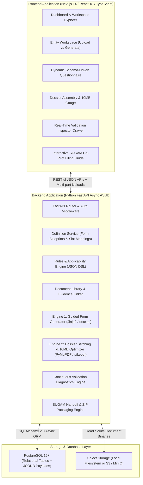
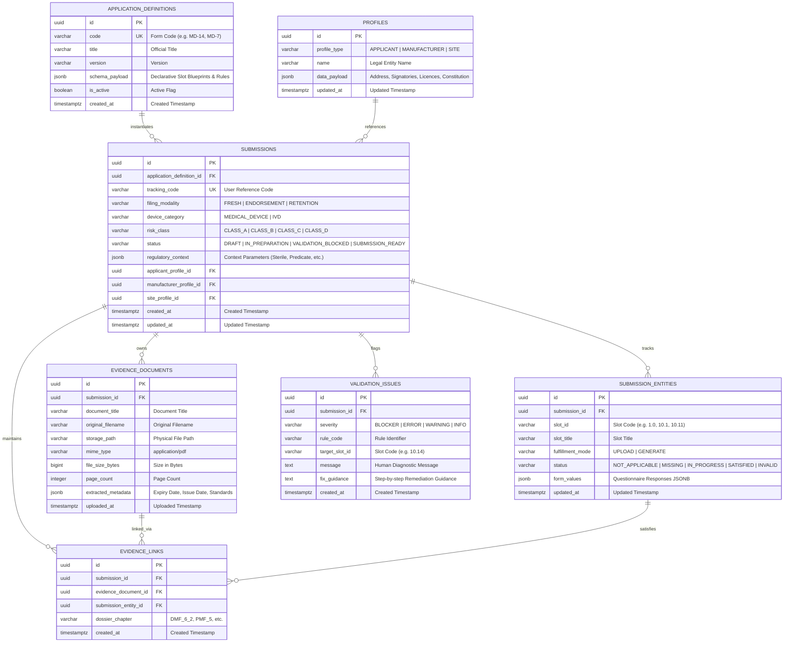
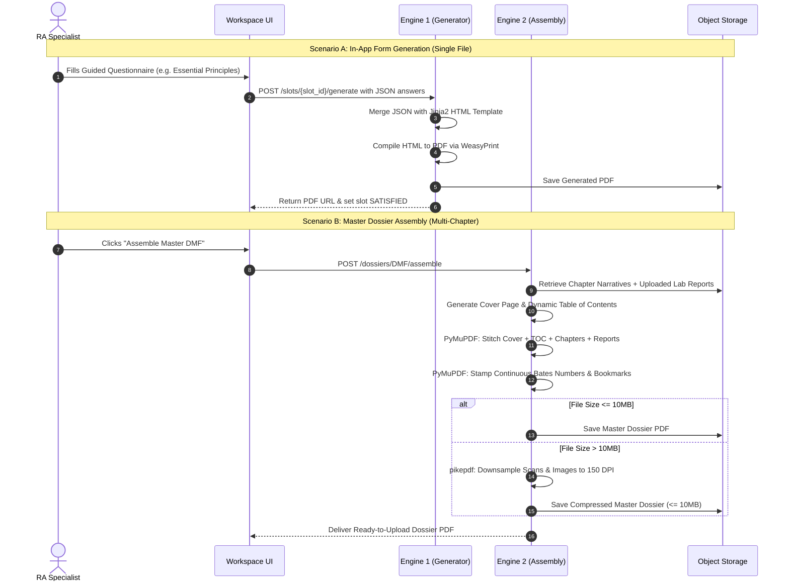

# Engineering Architecture, Data Model, and Implementation Blueprint

**Document Identifier:** EMS-CDSCO-001  
**Revision:** 2.0  
**Classification:** Full-Stack Engineering Architecture, Data Model, and Work Breakdown  
**Governing Standard:** Medical Devices Rules, 2017 (MDR 2017), Gazette of India  
**Verified Primary Source:** CDSCO Online System for Medical Devices (`cdscomdonline.gov.in`)  
**Status:** Approved for Implementation  

---

## 1. Executive Technical Summary and Architecture Topology

The **CDSCO Medical Device Submission Dossier Builder** is a modern web application designed to prepare, validate, and assemble complete statutory applications for India's CDSCO SUGAM portal.

To satisfy the regulatory requirements discovered from the official CDSCO portal checklists—including the **36 to 48 discrete upload slots**, the **Fourth Schedule multi-chapter DMF/PMF hierarchies**, **In Vitro Diagnostic (IVD) Appendix III analytics**, and **10MB portal size constraints**—the system is organized into a clean, decoupled 3-tier architecture:



---

## 2. Recommended Technology Stack and Rationale

| Architectural Tier | Selected Technology | Technical Rationale |
| :--- | :--- | :--- |
| **Frontend Framework** | **Next.js 14 / React 18** (TypeScript) | Fast App Router routing, server-side caching, strict typing, high productivity for enterprise dashboards. |
| **Styling & UI Kit** | **Tailwind CSS + Lucide Icons** | Rapid styling, custom regulatory design tokens, zero external CSS runtime bloat. |
| **Client State & Cache** | **TanStack Query (React Query v5)** | Effortless server-state synchronization, optimistic UI updates, automatic cache invalidation on edits. |
| **Client Form Management** | **React Hook Form + Zod** | High-performance schema validation, deep JSON nested field handling, zero unnecessary re-renders. |
| **Document Preview** | **PDF.js / React-PDF** | In-browser embedded PDF preview without forcing external downloads. |
| **Backend Framework** | **Python 3.11+ FastAPI** | High-throughput asynchronous ASGI web server, automatic OpenAPI / Swagger generation, native Pydantic v2 data validation. |
| **PDF Compilation (Engine 1)** | **WeasyPrint / ReportLab** | Converts clean Jinja2 HTML/CSS templates directly into high-fidelity, printable PDF documents. |
| **Word Export (Engine 1)** | **python-docx / docxtpl** | Fills placeholders inside official Word `.docx` pro-formas for legal stamp-paper execution. |
| **PDF Stitching (Engine 2)** | **PyMuPDF (`fitz`)** | Blazing-fast C-native PDF merging, continuous Bates page numbering, and dynamic Table of Contents injection. |
| **PDF Compression (Engine 2)** | **pikepdf (qpdf engine)** | Lossless PDF stream recompression and automated 150 DPI color downsampling to guarantee output &le; 10MB. |
| **Relational Database** | **PostgreSQL 15+** | Rock-solid ACID compliance, robust `JSONB` querying with GIN indexing for flexible regulatory schemas. |
| **Object / Binary Storage** | **Local FS (Dev) / MinIO / S3 (Prod)** | Simple, content-addressable storage for raw evidence files and compiled dossiers. |

---

## 3. Relational Database Schema (PostgreSQL DDL)

The persistence layer combines structured relational models for identity, submissions, and document links with PostgreSQL `JSONB` columns for semi-structured portal slot values and regulatory context.



### Complete PostgreSQL Table Definitions

```sql
-- 1. Statutory Form Definitions
CREATE TABLE application_definitions (
    id UUID PRIMARY KEY DEFAULT gen_random_uuid(),
    code VARCHAR(50) NOT NULL,
    title VARCHAR(255) NOT NULL,
    version VARCHAR(50) NOT NULL,
    schema_payload JSONB NOT NULL,
    is_active BOOLEAN DEFAULT TRUE,
    created_at TIMESTAMPTZ DEFAULT NOW(),
    CONSTRAINT uq_app_def_code_version UNIQUE (code, version)
);
CREATE INDEX idx_app_def_schema ON application_definitions USING GIN (schema_payload);

-- 2. Master Submissions Record
CREATE TABLE submissions (
    id UUID PRIMARY KEY DEFAULT gen_random_uuid(),
    application_definition_id UUID NOT NULL REFERENCES application_definitions(id),
    tracking_code VARCHAR(100) UNIQUE NOT NULL,
    filing_modality VARCHAR(50) NOT NULL DEFAULT 'FRESH', -- FRESH, ENDORSEMENT, RETENTION
    device_category VARCHAR(50) NOT NULL DEFAULT 'MEDICAL_DEVICE', -- MEDICAL_DEVICE, IVD
    risk_class VARCHAR(20) NOT NULL, -- CLASS_A, CLASS_B, CLASS_C, CLASS_D
    status VARCHAR(50) NOT NULL DEFAULT 'DRAFT',
    regulatory_context JSONB NOT NULL DEFAULT '{}'::jsonb,
    applicant_profile_id UUID REFERENCES profiles(id),
    manufacturer_profile_id UUID REFERENCES profiles(id),
    site_profile_id UUID REFERENCES profiles(id),
    created_at TIMESTAMPTZ DEFAULT NOW(),
    updated_at TIMESTAMPTZ DEFAULT NOW()
);
CREATE INDEX idx_submissions_status ON submissions (status);

-- 3. Discrete Portal Slot & Requirement States (36-48 slots tracked per submission)
CREATE TABLE submission_entities (
    id UUID PRIMARY KEY DEFAULT gen_random_uuid(),
    submission_id UUID NOT NULL REFERENCES submissions(id) ON DELETE CASCADE,
    slot_id VARCHAR(50) NOT NULL, -- e.g. '1.0', '10.1', '10.11'
    slot_title VARCHAR(255) NOT NULL,
    fulfillment_mode VARCHAR(20) NOT NULL DEFAULT 'UPLOAD', -- UPLOAD, GENERATE
    status VARCHAR(50) NOT NULL DEFAULT 'MISSING', -- NOT_APPLICABLE, MISSING, IN_PROGRESS, SATISFIED, INVALID
    form_values JSONB DEFAULT '{}'::jsonb,
    updated_at TIMESTAMPTZ DEFAULT NOW(),
    CONSTRAINT uq_sub_entity_slot UNIQUE (submission_id, slot_id)
);
CREATE INDEX idx_sub_entities_lookup ON submission_entities (submission_id, status);

-- 4. Evidence Documents (Uploaded binaries & generated PDFs)
CREATE TABLE evidence_documents (
    id UUID PRIMARY KEY DEFAULT gen_random_uuid(),
    submission_id UUID NOT NULL REFERENCES submissions(id) ON DELETE CASCADE,
    document_title VARCHAR(255) NOT NULL,
    original_filename VARCHAR(255) NOT NULL,
    storage_path VARCHAR(500) NOT NULL,
    mime_type VARCHAR(100) NOT NULL,
    file_size_bytes BIGINT NOT NULL,
    page_count INTEGER DEFAULT 1,
    extracted_metadata JSONB DEFAULT '{}'::jsonb,
    uploaded_at TIMESTAMPTZ DEFAULT NOW()
);
CREATE INDEX idx_evidence_docs_lookup ON evidence_documents (submission_id, original_filename);

-- 5. Evidence Links (Many-to-Many mapping to slots and DMF/PMF chapters)
CREATE TABLE evidence_links (
    id UUID PRIMARY KEY DEFAULT gen_random_uuid(),
    submission_id UUID NOT NULL REFERENCES submissions(id) ON DELETE CASCADE,
    evidence_document_id UUID NOT NULL REFERENCES evidence_documents(id) ON DELETE CASCADE,
    submission_entity_id UUID NOT NULL REFERENCES submission_entities(id) ON DELETE CASCADE,
    dossier_chapter VARCHAR(50), -- e.g. 'DMF_6_2', 'PMF_5'
    created_at TIMESTAMPTZ DEFAULT NOW(),
    CONSTRAINT uq_evidence_link UNIQUE (submission_id, evidence_document_id, submission_entity_id)
);

-- 6. Continuous Validation Issues
CREATE TABLE validation_issues (
    id UUID PRIMARY KEY DEFAULT gen_random_uuid(),
    submission_id UUID NOT NULL REFERENCES submissions(id) ON DELETE CASCADE,
    severity VARCHAR(20) NOT NULL, -- BLOCKER, ERROR, WARNING, INFO
    rule_code VARCHAR(100) NOT NULL,
    target_slot_id VARCHAR(50),
    message TEXT NOT NULL,
    fix_guidance TEXT NOT NULL,
    created_at TIMESTAMPTZ DEFAULT NOW()
);
CREATE INDEX idx_val_issues_severity ON validation_issues (submission_id, severity);
```

---

## 4. Backend Service Architecture and RESTful API Blueprint

The FastAPI backend is structured into modular domain services:

```
backend/
├── app/
│   ├── api/v1/                   # FastAPI REST Endpoints
│   │   ├── submissions.py        # Submission CRUD & context updates
│   │   ├── entities.py           # Slot checklist, guidance & values
│   │   ├── generator.py          # Engine 1: In-App Guided Form generator
│   │   ├── evidence.py           # Multi-part uploads & document linking
│   │   ├── assembly.py           # Engine 2: DMF/PMF stitching & 10MB optimizer
│   │   ├── validation.py         # Diagnostic rules & readiness audits
│   │   └── sugam_guide.py        # Interactive filing co-pilot & ZIP archive
│   ├── core/                     # Database session, config, security
│   ├── models/                   # SQLAlchemy 2.0 ORM models
│   ├── schemas/                  # Pydantic v2 request/response schemas
│   ├── services/                 # Business logic
│   │   ├── definition_service.py # Resolves 36-48 slot form blueprints
│   │   ├── rules_engine.py       # Evaluates JSON DSL conditions
│   │   ├── generator_service.py  # Jinja2 + WeasyPrint / docxtpl engine
│   │   ├── assembly_service.py   # PyMuPDF + pikepdf stitching pipeline
│   │   └── validation_service.py # Evaluates blockers, errors, warnings
│   └── templates/                # Jinja2 HTML templates & Word docx pro-formas
│       ├── covering_letter.html
│       ├── essential_principles.html
│       ├── declaration_of_conformity.html
│       ├── non_commercial_undertaking.html
│       └── poa_proforma.docx
```

### Complete RESTful API Endpoints

| HTTP Method | Route | Description | Request / Query | Response |
| :--- | :--- | :--- | :--- | :--- |
| `GET` | `/api/v1/definitions` | Lists supported form blueprints (MD-14, MD-7, etc.). | None | `200 OK` (Array of summaries) |
| `GET` | `/api/v1/definitions/{code}` | Retrieves declarative JSON definition and slot blueprint. | `code=MD-14` | `200 OK` (Full JSON blueprint) |
| `POST` | `/api/v1/submissions` | Initializes a filing workspace with regulatory context. | `{ definition_code, modality, category, class }` | `201 Created` (`submission_id`, initial checklist) |
| `GET` | `/api/v1/submissions/{id}/workspace` | Returns resolved 36–48 slot checklist with guidance and states. | None | `200 OK` (Full slot tree + stats) |
| `PATCH` | `/api/v1/submissions/{id}/slots/{slot_id}` | Updates field values and toggles fulfillment mode. | `{ fulfillment_mode, form_values }` | `200 OK` (Updated slot state) |
| `POST` | `/api/v1/submissions/{id}/slots/{slot_id}/generate` | **Engine 1:** Renders in-app questionnaire into PDF or DOCX. | `{ template_key, data }` | `201 Created` (Generated document URL) |
| `POST` | `/api/v1/submissions/{id}/evidence/upload` | Uploads binary PDF and extracts metadata (pages, size, dates). | Multipart file | `201 Created` (Evidence document record) |
| `POST` | `/api/v1/submissions/{id}/evidence/link` | Links evidence document to a slot or DMF chapter. | `{ document_id, slot_id, chapter }` | `201 Created` (Updated link edge) |
| `DELETE` | `/api/v1/submissions/{id}/evidence/links/{link_id}` | Unlinks document and resets slot state to MISSING. | None | `204 No Content` |
| `POST` | `/api/v1/submissions/{id}/dossiers/{dossier_type}/assemble` | **Engine 2:** Stitches master dossier (DMF/PMF), Bates stamps, compresses &le; 10MB. | `{ dossier_type: "DMF" }` | `200 OK` (Compiled PDF URL, size, page count) |
| `GET` | `/api/v1/submissions/{id}/validation-report` | Runs continuous validation and returns issues by severity. | None | `200 OK` (`can_submit`, issues array) |
| `GET` | `/api/v1/submissions/{id}/sugam-guide` | Returns interactive step-by-step SUGAM guide with copyable values. | None | `200 OK` (Array of portal steps & download URLs) |
| `POST` | `/api/v1/submissions/{id}/export-handoff` | Generates standardized offline ZIP archive with numbered folders. | None | `200 OK` (Archive download link) |

---

## 5. Frontend Architecture and Component Breakdown

The frontend application provides a fast, responsive, split-pane workspace:

```
frontend/
├── src/
│   ├── app/                      # Next.js App Router
│   │   ├── layout.tsx            # Global Root Layout (Sidebar + Topbar)
│   │   ├── page.tsx              # Submissions Portfolio Dashboard
│   │   ├── submissions/
│   │   │   ├── new/page.tsx      # Submission Setup Wizard
│   │   │   └── [id]/
│   │   │       ├── page.tsx      # Core Entity Workspace (Checklist + Detail)
│   │   │       ├── assembly/     # Dossier Assembly Center (DMF & PMF)
│   │   │       ├── vault/        # Central Document Evidence Library
│   │   │       └── sugam-guide/  # Interactive SUGAM Filing Co-Pilot
│   ├── components/               # Reusable Modular UI Components
│   │   ├── navigation/           # Sidebar, Breadcrumbs, StepTracker
│   │   ├── workspace/            # SlotChecklistTree, EntityDetailPane
│   │   ├── forms/                # DynamicFormRenderer, DualFulfillmentToggle
│   │   ├── evidence/             # FileUploadDropzone, EvidenceLinkModal
│   │   ├── viewer/               # PdfPreviewModal (PDF.js)
│   │   ├── assembly/             # AssemblyProgressGauge, ThresholdGauge10MB
│   │   ├── validation/           # ValidationDrawer, IssueBadge, FixButton
│   │   └── sugam/                # SugamStepCard, ClipboardCopyButton
│   ├── hooks/                    # Custom React Hooks
│   │   ├── useSubmission.ts      # Queries submission workspace state
│   │   ├── useValidation.ts      # Real-time validation issue listener
│   │   └── useSlotMutation.ts    # Auto-save & status transitions
│   └── lib/                      # API client, TypeScript types, utils
```

### Detailed Breakdown of the Seven Core Frontend Views

1. **View 1: Portfolio Dashboard (`/`)**
   * Displays all active CDSCO submissions with status chips (`IN_PREPARATION`, `VALIDATION_BLOCKED`, `SUBMISSION_READY`).
   * Readiness progress bars (e.g. "32 of 36 slots satisfied").
   * Quick action buttons: "Continue Workspace", "Open SUGAM Guide", "Export ZIP".
2. **View 2: Setup Wizard (`/submissions/new`)**
   * Step 1: Pathway selection (Form MD-14, MD-7, MD-8, MD-3, MD-4, MD-12, MD-16).
   * Step 2: Filing Modality (`FRESH`, `ENDORSEMENT`, `RETENTION`).
   * Step 3: Device Context (Risk Class A–D, General MD vs. IVD, Sterile vs. Non-Sterile).
   * Step 4: Organization Profiles (Select Applicant, Foreign Manufacturer, Manufacturing Site).
3. **View 3: The Core Entity Workspace (`/submissions/[id]`)**
   * **Left Pane (Checklist Navigator):** Lists the exact **36 to 48 numbered portal slots** grouped by category (Administrative, Regulatory, PMF, DMF). Real-time status icons (Green check for `SATISFIED`, Amber for `MISSING`, Red for `INVALID`).
   * **Right Pane (Entity Details):**
     * Statutory Guidance Header (What is this, Why is it needed, Official MDR 2017 citation).
     * **Dual Fulfillment Toggle:** Switch between `Upload Existing PDF` and `Generate via In-App Guided Form`.
     * If Upload selected: Drag-and-drop file upload with preview and attachment from Document Vault.
     * If Generate selected: Renders View 4 dynamic questionnaire.
4. **View 4: In-App Dynamic Questionnaire Form**
   * Renders schema-driven fields for generatable documents (Covering Letter, Essential Principles Checklist, PoA pro-forma, Declaration of Conformity).
   * Pre-populates organizational details automatically.
   * Clause-by-clause interactive table for the 15 Essential Principles (Applicable toggle, Standards picker, Evidence cross-reference).
   * "Generate & Attach Document" button &rarr; triggers backend Engine 1 and updates slot state to `SATISFIED`.
5. **View 5: Dossier Assembly Center (`/submissions/[id]/assembly`)**
   * Dedicated workspace for Device Master File (DMF) and Plant Master File (PMF).
   * Visual 8-chapter tree showing narrative completion and attached lab reports.
   * **10MB Threshold Gauge:** Displays projected file size.
   * "Assemble Master Dossier" button: Triggers Engine 2 pipeline (stitching, Bates numbering, compression).
   * Download buttons for the unified Master Dossier PDF and individual split Annexures.
6. **View 6: Validation Inspector Drawer**
   * Slide-out drawer displaying real-time issues grouped by severity:
     * `BLOCKER` (Missing PoA, expired FSC, unresolved statutory mandatory fields).
     * `ERROR` (Unsatisfied mandatory checklist slot).
     * `WARNING` (Certificates expiring in < 60 days, missing optional annexure).
     * `INFO` (Searchable PDF optimization advice).
   * Each issue includes a 1-click **"Fix Now"** button that automatically navigates to and focuses the problematic slot.
7. **View 7: Interactive SUGAM Filing Co-Pilot (`/submissions/[id]/sugam-guide`)**
   * Side-by-side filing companion designed to be kept open on one half of the monitor while the user logs into `cdscomdonline.gov.in` on the other half.
   * Step-by-step portal instructions matching the exact CDSCO portal tabs.
   * **1-Click Clipboard Copy:** Instant copy buttons for applicant address, device classifications, model numbers, and fees.
   * **Pre-Validated Download Links:** Direct download buttons for the exact, verified PDF corresponding to each portal upload row (`10.1`, `10.6`, `10.11`, `10.14`).

---

## 6. Document Generation & Assembly Engine Specification



### Engine 1: Guided Form Generation Pipeline (Single Documents)
* **Target Documents:** Covering Letter, Form MD Pro-Forma, Power of Attorney draft, Declaration of Conformity, Essential Principles Checklist, Non-Commercial Undertakings.
* **Technology:** Jinja2 (HTML templating) + WeasyPrint (PDF rendering) + docxtpl (Word templates).
* **Execution:**
  1. Merges user answers with submission organization profiles.
  2. Renders clean, print-styled HTML with standardized CDSCO typography and page margins (`@page { size: A4; margin: 20mm; }`).
  3. Compiles directly into PDF binary and records page count and file size.

### Engine 2: Dossier Assembly Pipeline (Master Dossiers & 10MB Compression)
* **Target Documents:** Device Master File (Fourth Schedule Part III) and Plant Master File (Part II).
* **Technology:** PyMuPDF (`fitz`) + pikepdf (qpdf).
* **Execution:**
  1. **TOC Calculation:** Scans all chapter pages and attached test report PDFs to compute exact starting page numbers for each chapter.
  2. **Cover Page & TOC Synthesis:** Renders Cover Page and dynamic Table of Contents via HTML-to-PDF.
  3. **Sequential Stitching:** Concatenates Cover + TOC + Chapter Narratives + Laboratory Reports in statutory sequence using `fitz.open()` and `insert_pdf()`.
  4. **Bates Stamping:** Injects running header and continuous page footer (`Page X of Y`) on every page using `page.insert_text()`.
  5. **Bookmark Injection:** Inserts a hierarchical outline tree into the PDF (`doc.set_toc()`) matching Fourth Schedule chapter numbers for easy evaluator navigation.
  6. **10MB Compression:** Inspects final file size. If > 10MB, executes `pikepdf` compression pipeline:
     * Compresses internal object streams.
     * Re-encodes embedded JPEG/PNG images at 150 DPI with 80% quality factor.
     * Guarantees final output &le; 10MB without sacrificing legibility of laboratory signatures or test curves.

---

## 7. Work Breakdown Structure (WBS) and Implementation Effort Estimation

To provide complete transparency on how much work is required and how to execute it, the implementation is partitioned into five sequential, manageable modules:

| Module | Core Deliverables | Technical Scope | Relative Complexity |
| :--- | :--- | :--- | :---: |
| **Module 1: Data Model & Declarative Schemas** | • PostgreSQL migrations<br/>• Declarative JSON definitions for the 7 forms<br/>• 36–48 slot mappings for MD and IVD | • Database schema & models<br/>• Static JSON blueprints for MD-14, MD-7, MD-8, MD-3, MD-4, MD-12, MD-16 | **Moderate**<br/>*(Data entry of regulatory checklists)* |
| **Module 2: Core Backend API & Rules Engine** | • FastAPI REST endpoints<br/>• Applicability rules engine (JSON DSL)<br/>• Document library & evidence linking | • CRUD endpoints<br/>• Evaluator for boolean rules<br/>• Multipart file upload & MIME validation | **Low to Moderate**<br/>*(Standard backend development)* |
| **Module 3: Document Generation Engine (Engine 1)** | • Jinja2 HTML templates<br/>• WeasyPrint PDF compiler<br/>• Word docxtpl template exporter | • 6 Statutory templates (Covering letter, EPC, PoA, DoC, Undertakings)<br/>• Print CSS styling | **Moderate**<br/>*(Visual styling of official pro-formas)* |
| **Module 4: Dossier Assembly Engine (Engine 2)** | • PyMuPDF stitching pipeline<br/>• Bates running numbering<br/>• Bookmark tree injection<br/>• pikepdf 10MB compression pipeline | • PDF merge logic<br/>• Dynamic TOC page calculation<br/>• Image downsampling to 150 DPI | **Moderate to High**<br/>*(Requires careful binary PDF handling)* |
| **Module 5: Frontend Workspace & Components** | • Next.js workspace UI<br/>• 36–48 slot checklist tree<br/>• Dual Fulfillment toggle & dynamic forms<br/>• Validation Drawer & SUGAM Co-Pilot | • React components & views<br/>• TanStack Query caching<br/>• React Hook Form integration<br/>• PDF.js viewer modal | **Moderate**<br/>*(Standard React frontend work)* |

---

### Transparent Complexity Assessment: What is Straightforward vs. What Requires Attention

#### 1. What is Straightforward (Standard Web Development):
* **User Authentication & Project Setup:** Standard JWT authentication and organization profile forms.
* **Basic CRUD & File Uploads:** Uploading PDF files, saving them to disk, and recording metadata in PostgreSQL is standard.
* **The 36–48 Slot Navigation UI:** Rendering a list of checklist rows with green/red status badges is standard React list rendering.

#### 2. What Requires Moderate Attention:
* **The Declarative Form Blueprints (Module 1):** Writing the JSON blueprints for the 7 forms with their 36–48 slots and applicability rules requires careful transcription from the official CDSCO PDF checklists.
* **The Essential Principles Checklist (EPC) Template:** The EPC table has 15 statutory clauses and multiple columns; CSS print formatting must ensure clean table header repetition on page breaks.
* **Validation Engine Logic:** Ensuring rules fire continuously without lagging the client requires clean selector queries.

#### 3. What Requires High Engineering Focus (The Differentiator):
* **The Dossier Assembly Stitcher (Module 4):** Calculating dynamic page offsets, prepending the TOC with exact page numbers, stamping Bates numbers, and creating PDF bookmarks across mixed-source PDFs (some scanned, some vector).
* **The 10MB Portal Threshold Optimization:** Managing heavy scanned third-party lab test reports (which can easily exceed 50MB) and downsampling them cleanly to 150 DPI so they fit into the 10MB limit without evaluator rejection.
