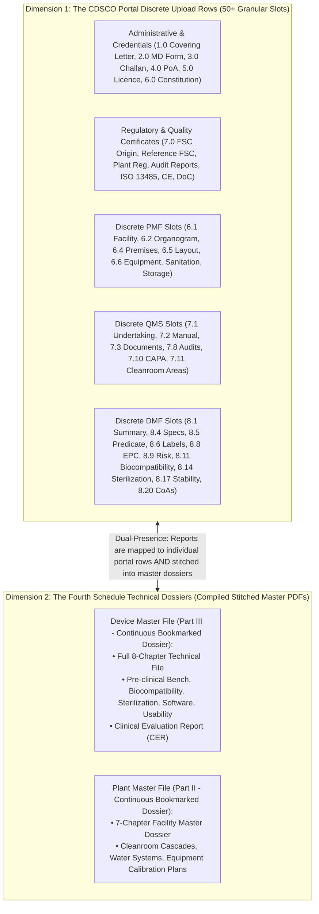
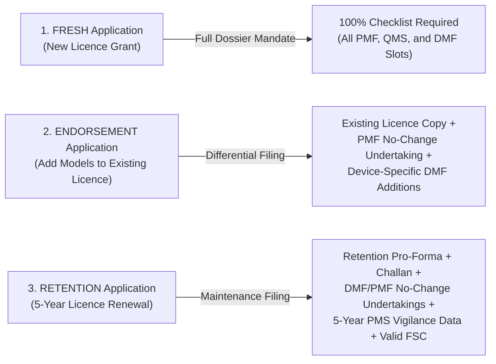
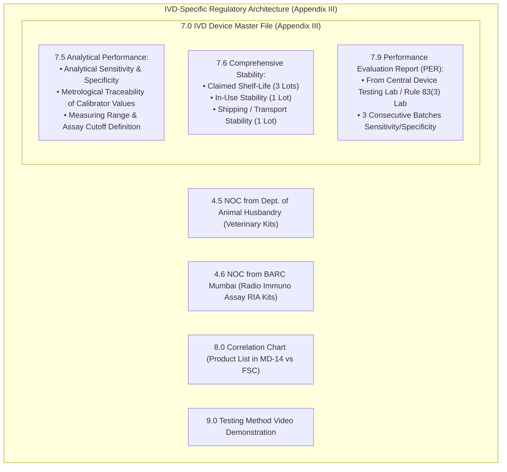
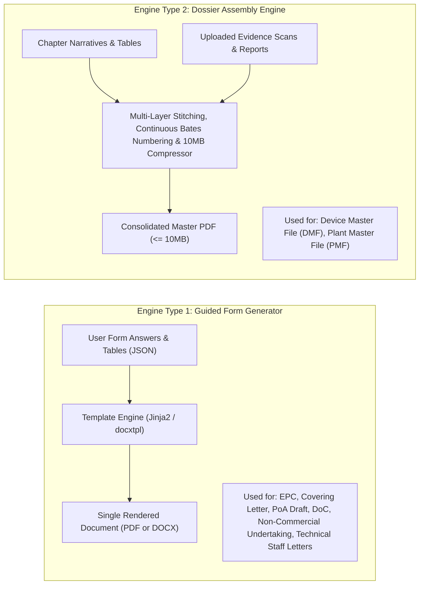
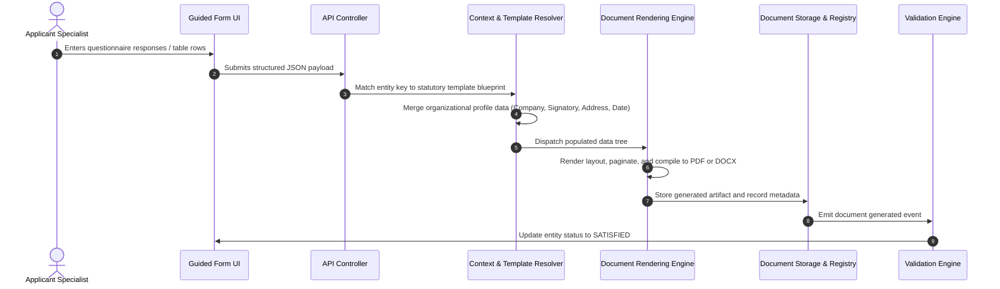
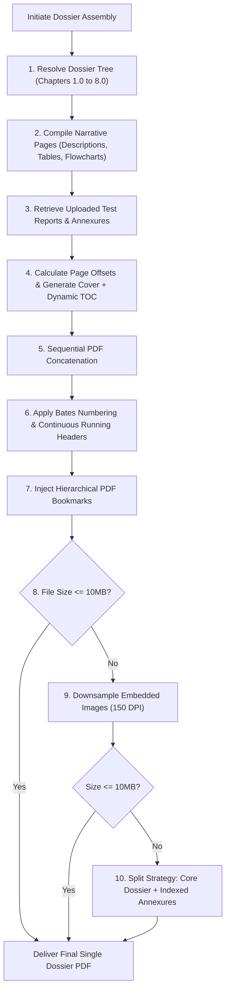

# Document Engines and Dual Fulfillment Logic

**Document Identifier:** DEF-CDSCO-001  
**Revision:** 1.3  
**Classification:** Technical Architecture and Engine Logic Specification  
**Governing Standard:** Medical Devices Rules, 2017 (MDR 2017), Gazette of India  
**Verified Primary Source:** Official CDSCO Online Portal Checklists (`cdscomdonline.gov.in` / SUGAM Repository)  
**Status:** Approved for Implementation  

---

## 1. Overview and Purpose

This document specifies the technical and regulatory logic for generating, assembling, and fulfilling documents across all statutory Medical Device (MD) and In Vitro Diagnostic (IVD) application forms under the *Medical Devices Rules, 2017*.

Every section, checklist identifier, and requirement documented herein has been audited and synchronized against the **official CDSCO system-generated checklists** (extracted from the production CDSCO Medical Devices Online Portal):
* `ReportChecklist_2.pdf` (Form MD-3)
* `ReportChecklist_3.pdf` (Form MD-4)
* `ReportChecklist_4.pdf` (Form MD-7)
* `ReportChecklist_5.pdf` (Form MD-8)
* `ReportChecklist_12.pdf` (Form MD-14)
* `ReportChecklistIVD_*.pdf` (IVD Equivalents)

This document addresses five core technical requirements:
1. **The Portal Architecture Reality:** How the CDSCO portal decomposes the Plant Master File (PMF), Quality Management System (QMS), and Device Master File (DMF) into over 50 discrete upload slots.
2. **The 35-Document Master Comparative Matrix:** Cross-stream mapping across all seven forms in our scope with statutory citations and fulfillment modes.
3. **MD versus IVD Specialization:** The statutory divergence between General Medical Devices (Fourth Schedule Appendix II) and In Vitro Diagnostics (Fourth Schedule Appendix III).
4. **The Three Statutory Filing Modalities:** Technical distinctions between **FRESH**, **ENDORSEMENT**, and **RETENTION** applications.
5. **The Operational Backend Logic for Both Engines:** Complete, step-by-step logic pipelines for **Dual Fulfillment (In-App Form Generation)** and **Dossier Assembly (Stitching & 10MB Optimization)**.

---

## 2. The Two Regulatory Dimensions of CDSCO Documentation

When applicants interact with CDSCO, documentation exists in two complementary dimensions:

1. **Dimension 1: The CDSCO Portal Upload Checklist (Granular Slots):** The online portal does **not** treat the DMF or PMF as a single upload box. Instead, the portal provides individual, numbered upload fields for every technical chapter and sub-clause (e.g. Slot 8.1 Executive Summary, Slot 8.6 Labels, Slot 8.11 Biocompatibility, Slot 8.14 Sterilization, Slot 8.20 Batch CoAs).
2. **Dimension 2: The Fourth Schedule Technical Master Files (Continuous Files):** Regulatory evaluators simultaneously expect compiled, bookmarked, continuously paginated Master Dossiers (DMF and PMF) prepared per the Fourth Schedule.
3. **The "Dual-Presence" Rule:** The application platform fulfills both realities:
   * It provides discrete export binaries mapped directly to CDSCO portal checklist slots.
   * It stitches these identical modular assets into the unified Device Master File and Plant Master File PDFs.

---

## 3. Statutory Filing Modalities (FRESH vs. ENDORSEMENT vs. RETENTION)

The CDSCO portal classifies submissions into three distinct operational modalities, each altering the required document checklist:

1. **FRESH Application:** Applies to initial grant of licence. Mandates all administrative credentials, full PMF facility chapters, full QMS manuals, and full DMF technical studies.
2. **ENDORSEMENT Application:** Applies when an active licensee adds new device models, sizes, or variants to an existing licence. Does **not** require resubmission of the entire Plant Master File; instead, mandates a **"No Major Change in PMF Undertaking"** accompanied by device-specific DMF technical data (Executive Summary, Specifications, Labels, Biocompatibility, Sterilization, and CoAs).
3. **RETENTION Application:** Required every 5 years under Rule 21(2) and Rule 34(3) to maintain licence validity. Requires:
   * Formal Retention Application and BharatKosh Fee Challan.
   * Undertaking affirming **No Change in Constitution and No Major Change in DMF/PMF**.
   * Comprehensive **5-Year Post-Marketing Surveillance (PMS) Vigilance Report** (complaints, recalls, adverse events, CAPA).
   * Re-authenticated Free Sale Certificates and ISO 13485 QMS certificates.

---

## 4. Master Statutory Document Checklist Across All Seven Forms

Below is the complete, granular inventory of all 35 statutory documents recognized across the seven application pathways.

### Legend:
* **Fulfillment Modes:**
  * `Upload Only`: External third-party certificates, laboratory test reports, or government challans.
  * `In-App Generate (Engine 1)`: Statutory pro-forma, covering letters, legal declarations, and structured matrices produced from questionnaire data.
  * `Dossier Assembly (Engine 2)`: Multi-chapter master files compiled from typed narratives, specification tables, and attached laboratory test reports.
* **Dual Presence:** Documents that appear both as a standalone portal checklist row and as an internal chapter inside the DMF/PMF.

| # | Statutory Document Name | MDR 2017 Source | MD-14 *(Import)* | MD-7 *(Mfg C/D)* | MD-8 *(Loan C/D)* | MD-3 *(Mfg A/B)* | MD-4 *(Loan A/B)* | MD-12 *(Test Mfg)* | MD-16 *(Test Import)* | Fulfillment Mode | Dual Presence in DMF/PMF? |
| :- | :--- | :--- | :---: | :---: | :---: | :---: | :---: | :---: | :---: | :--- | :--- |
| **A. Administrative & Legal Documentation** | | | | | | | | | | |
| **1** | Statutory Covering Letter | Rule 20 / 34 | Mandatory | Mandatory | Mandatory | Mandatory | Mandatory | Mandatory | Mandatory | Upload OR In-App Generate | No (Standalone) |
| **2** | Treasury Fee Challan (BharatKosh) | Second Schedule | Mandatory | Mandatory | Mandatory | Mandatory | Mandatory | Mandatory | Mandatory | Upload Only | No (Standalone) |
| **3** | Statutory Application Form Pro-Forma | Forms MD-3 to 16 | Mandatory | Mandatory | Mandatory | Mandatory | Mandatory | Mandatory | Mandatory | Upload OR In-App Generate | No (Standalone) |
| **4** | Power of Attorney (PoA) Executed | First Sched. Part I | Mandatory | N/A | N/A | N/A | N/A | N/A | Mandatory | Upload OR In-App Generate (Draft) | No (Standalone) |
| **5** | Authorized Agent Undertaking | Fourth Sched. Part I | Mandatory | N/A | N/A | N/A | N/A | N/A | N/A | Upload OR In-App Generate | No (Standalone) |
| **6** | Wholesale Licence (Form 20B/21B / MD-42) | Rule 34(1) | Mandatory | N/A | N/A | N/A | N/A | N/A | Mandatory | Upload Only | No (Standalone) |
| **7** | Applicant Legal Constitution (MoA, AoA, Board Res.) | Rule 20 / 34 | Mandatory | Mandatory | Mandatory | Mandatory | Mandatory | Mandatory | Mandatory | Upload Only | No (Standalone) |
| **8** | Primary Site Consent & Quality Agreement | Rule 20(3) | N/A | N/A | Mandatory | N/A | Mandatory | N/A | N/A | Upload Only | No (Standalone) |
| **9** | Competent Technical Staff Appointments | Rule 26 | N/A | Mandatory | Mandatory | Mandatory | Mandatory | N/A | N/A | Upload OR In-App Generate | In PMF (Chapter 4) |
| **B. Regulatory Approvals & Overseas Certifications** | | | | | | | | | | |
| **10** | Free Sale Certificate (Country of Origin) | Fourth Sched. Part I | Mandatory | N/A | N/A | N/A | N/A | N/A | N/A | Upload Only | No (Standalone) |
| **11** | Free Sale Certificate (Reference GHTF Countries) | Fourth Sched. Part I | Conditional | N/A | N/A | N/A | N/A | N/A | N/A | Upload Only | No (Standalone) |
| **12** | Overseas Manufacturing Site Registration / Licence | Fourth Sched. Part I | Mandatory | N/A | N/A | N/A | N/A | N/A | N/A | Upload Only | In PMF (Chapter 1) |
| **13** | Notified Body Audit / Inspection Report (Last 3 Yrs) | Fourth Sched. Part I | Mandatory | N/A | N/A | N/A | N/A | N/A | N/A | Upload Only | In PMF (Chapter 3) |
| **14** | Form MD-27 Clinical Investigation Permission | Rule 51 / 63 | Conditional | Conditional | N/A | N/A | N/A | N/A | N/A | Upload Only | In DMF (Chapter 7) |
| **C. Quality Management & Conformity Declarations** | | | | | | | | | | |
| **15** | ISO 13485:2016 QMS Certificate | Fifth Schedule | Mandatory | Mandatory | Mandatory | Mandatory | Mandatory | N/A | N/A | Upload Only | In PMF (Chapter 3) |
| **16** | CE Quality Assurance / Type Examination Certificate | Fourth Sched. Part I | Mandatory | N/A | N/A | N/A | N/A | N/A | N/A | Upload Only | No (Standalone) |
| **17** | Declaration of Conformity (DoC) | Fourth Sched. Part I | Mandatory | Mandatory | Mandatory | Mandatory | Mandatory | N/A | N/A | Upload OR In-App Generate | In DMF (Chapter 4) |
| **D. Product Identification, Packaging & Batch Release** | | | | | | | | | | |
| **18** | Product Labels (Primary, Secondary, Shipper) | Sixth Schedule | Mandatory | Mandatory | Mandatory | Mandatory | Mandatory | N/A | N/A | Upload Only | **Yes** (In DMF Chapter 8) |
| **19** | Instructions for Use (IFU) / Package Insert | Sixth Schedule | Mandatory | Mandatory | Mandatory | Mandatory | Mandatory | N/A | N/A | Upload Only | **Yes** (In DMF Chapter 8) |
| **20** | Certificate of Analysis (CoA) - 3 Batches | Fourth Sched. Part III | Mandatory | Mandatory | Mandatory | Mandatory | Mandatory | N/A | N/A | Upload Only | **Yes** (In DMF Chapter 6) |
| **E. Master Dossiers & Verification Evidence** | | | | | | | | | | |
| **21** | Essential Principles (EP) Checklist | Fourth Sched. App II | Mandatory | Mandatory | Mandatory | Mandatory | Mandatory | N/A | N/A | Upload OR In-App Generate | **Yes** (In DMF Chapter 4) |
| **22** | Device Master File (DMF) | Fourth Sched. Part III | **Full** | **Full** | **Full** | **Abbr.** | **Abbr.** | **N/A** | **N/A** | Dossier Assembly Engine | **Master Compiled PDF** |
| **23** | Plant Master File (PMF) | Fourth Sched. Part II | **Full** | **Full** | **Primary** | **Full** | **Parent** | **N/A** | **N/A** | Dossier Assembly Engine | **Master Compiled PDF** |
| **24** | Risk Management Report (ISO 14971) | Fourth Sched. Part III | Mandatory | Mandatory | Mandatory | Conditional | Conditional | N/A | N/A | Upload Only | **Yes** (In DMF Chapter 5) |
| **25** | Biocompatibility Evaluation (ISO 10993) | Fourth Sched. Part III | Conditional | Conditional | Conditional | Conditional | Conditional | N/A | N/A | Upload Only | **Yes** (In DMF Chapter 6.2) |
| **26** | Sterilization Validation Report (ISO 11135/11137) | Fourth Sched. Part III | Conditional | Conditional | Conditional | Conditional | Conditional | N/A | N/A | Upload Only | **Yes** (In DMF Chapter 6.3) |
| **27** | Software Lifecycle Dossier (IEC 62304) | Fourth Sched. Part III | Conditional | Conditional | Conditional | Conditional | Conditional | N/A | N/A | Upload Only | **Yes** (In DMF Chapter 6.4) |
| **28** | Clinical Evaluation Report (CER) | Fourth Sched. Part III | Mandatory | Mandatory | Mandatory | Conditional | Conditional | N/A | N/A | Upload Only | **Yes** (In DMF Chapter 7) |
| **F. Domestic Site Premises & Infrastructure (Mfg)** | | | | | | | | | | |
| **29** | Site Layout Plan & Cleanroom Differential Cascade | Fifth Schedule | N/A | Mandatory | Mandatory | Mandatory | Mandatory | N/A | N/A | Upload Only | In PMF (Chapter 2 & 5) |
| **30** | HVAC Air Balance & HEPA Filter Integrity Reports | Fifth Schedule | N/A | Mandatory | Mandatory | Conditional | Conditional | N/A | N/A | Upload Only | In PMF (Chapter 5) |
| **31** | Water Purification Validation (Purified / WFI) | Fifth Schedule | N/A | Mandatory | Mandatory | Conditional | Conditional | N/A | N/A | Upload Only | In PMF (Chapter 5) |
| **G. Test, Research & Evaluation Streams Only** | | | | | | | | | | |
| **32** | Test Protocol & Objective Specification | Rule 31 / 40 | N/A | N/A | N/A | N/A | N/A | **Mandatory** | **Mandatory** | Upload OR In-App Generate | No (Test Licences Only) |
| **33** | Quantitative Justification Math Formula | Rule 31 / 40 | N/A | N/A | N/A | N/A | N/A | **Mandatory** | **Mandatory** | Upload OR In-App Generate | No (Test Licences Only) |
| **34** | Non-Commercial Undertaking (Stamp Paper) | Rule 31 / 40 | N/A | N/A | N/A | N/A | N/A | **Mandatory** | **Mandatory** | Upload OR In-App Generate | No (Test Licences Only) |
| **35** | Post-Testing Destruction / Reconciliation Plan | Rule 31 / 40 | N/A | N/A | N/A | N/A | N/A | **Mandatory** | **Mandatory** | Upload OR In-App Generate | No (Test Licences Only) |

---

## 5. Granular Checklists from the Production CDSCO Portal

### 5.1 Form MD-14: Commercial Import Licence (ReportChecklist_12.pdf)
* **1.0 Covering Letter** (Mandatory)
* **2.0 Fee Challan** (Mandatory - BharatKosh)
* **3.0 Form MD-14 Execution** (Mandatory)
* **4.0 Power of Attorney & Undertaking per Fourth Schedule Part I** (Mandatory - Apostilled / Embassy Attested)
* **5.0 Wholesale Licence (20B/21B) or MD-42 Registration** (Mandatory)
* **6.0 Constitution Details of Indian Agent** (Mandatory)
* **7.0 Regulatory Certificates:**
  * 7.1 Free Sale Certificate from Country of Origin (Mandatory)
  * 7.2 Free Sale Certificate from GHTF Reference Regulators (USA, UK, EU, Canada, Japan, Australia) (Mandatory)
  * 7.3 Overseas Manufacturing Site Registration Certificate (Mandatory)
  * 7.4 Latest Inspection or Audit Report within last 3 years (Mandatory)
* **8.0 Quality Certificates:**
  * 8.1 ISO 13485:2016 QMS Certificate (Mandatory)
  * 8.2 Full Quality Assurance / CE Certificate (Mandatory)
  * 8.3 Declaration of Conformity by Manufacturer (Mandatory)
* **9.0 Plant Master File (Appendix I of Fourth Schedule)** (Mandatory)
* **10.0 Device Master File (Appendix II of Fourth Schedule):**
  * 10.1 Executive Summary
  * 10.2 Descriptive Information of Device
  * 10.3 Grouping Justification
  * 10.4 Product Specification (Variants, Accessories)
  * 10.5 Predicate Device Substantial Equivalence
  * 10.6 Labelling Information (Labels, IFU)
  * 10.7 Device Design and Manufacturing Information
  * 10.8 Essential Principles Checklist (EPSP)
  * 10.9 Risk Analysis Summary (ISO 14971)
  * 10.10 Verification and Validation Overview
  * 10.11 Biocompatibility Validation Data (ISO 10993)
  * 10.12 Medicinal Substances Data (if drug incorporated)
  * 10.13 Biological Safety (TSE/BSE if animal derived)
  * 10.14 Sterilization Validation Data (ISO 11135/11137)
  * 10.15 Software Verification and Validation (IEC 62304)
  * 10.16 Animal Studies Pre-clinical Data
  * 10.17 Stability Study Data (Real-time and Accelerated)
  * 10.18 Clinical Evidence / CER
  * 10.19 Post-Marketing Surveillance Vigilance Data
  * 10.20 Batch Release CoAs for 3 consecutive batches
* **11.0 Additional Documents** (Conditional)
* **12.0 Copy of Permission in Form MD-27** (Investigational devices)

---

### 5.2 Form MD-7: Commercial Manufacturing Class C & D (ReportChecklist_4.pdf)
* **1.0 Covering Letter** (Mandatory)
* **2.0 Form MD-7 Application** (Mandatory)
* **3.0 Fee Challan** (Mandatory)
* **4.0 Firm Constitution Documents** (Mandatory)
* **5.0 Site Ownership Deed / Tenancy Agreement** (Mandatory)
* **6.0 Plant Master File (Appendix I):**
  * 6.1 General Info | 6.2 Organogram | 6.3 Technical Staff (Rule 26) | 6.4 Premises | 6.5 Scaled Layout | 6.6 Equipment List | 6.7 Sanitation | 6.8 Production | 6.9 QA | 6.10 Storage | 6.11 Documentation
* **7.0 Quality Management System Requirements (Fifth Schedule):**
  * 7.1 Fifth Schedule Undertaking | 7.2 Quality Manual | 7.3 Document Control | 7.4 Record Control | 7.5 Management Responsibility | 7.6 Resources | 7.7 Production Control | 7.8 Internal Audits | 7.9 Non-conformance Control | 7.10 CAPA | 7.11 Cleanroom Environmental Classification Table (Annexure A)
* **8.0 Device Master File (Appendix II):**
  * Slots 8.1 to 8.20 (Identical technical structure to MD-14 Slots 10.1–10.20)
* **9.0 Additional Documents** | **10.0 Test Licence Form MD-13** | **11.0 Form MD-27 Permission**

---

### 5.3 Forms MD-3 & MD-4: Class A & B Manufacturing and Loan Licences (ReportChecklist_2.pdf & 3.pdf)
* **1.0 Covering Letter** | **1.1 Firm Constitution** | **1.2 Premises Ownership / Tenancy Agreement**
* **Loan Licence Specifics (MD-4):** Bilateral Manufacturing Agreement + Copy of Parent Site's Form MD-5 Licence + Host Consent Letter
* **2.0 Quality Certificates:** ISO 13485 QMS Certificate (Slot 2.1)
* **3.0 Plant Master File:** Parts 1 to 10 (Part 1 mandatory for MD-3; Parts 1–5 mandatory for MD-4)
* **4.0 Device Master File:**
  * *Statutory Note from CDSCO Portal:* *"In case of Class A devices, Appendix II is not required. For Class A devices upload information as specified in Part II of Fourth Schedule (Abbreviated technical file)"*.
  * For Class B devices: Abbreviated technical file (intended use, materials, manufacturing flowchart, specifications, shelf life)
* **5.0 Performance Evaluation Report** (IVDs only)
* **6.0 Test Licence Obtained (Form MD-13)**
* **7.0 Fifth Schedule Undertaking**
* **8.0 State Treasury Fee Challan**
* **9.0 Form MD-3 / MD-4 Execution Pro-Forma**

---

### 5.4 Form MD-8: Loan Licence for Class C & D Devices (ReportChecklist_5.pdf)
* **1.0 Covering Letter** | **2.0 Firm Constitution** | **3.0 Premises Deed**
* **4.0 Bilateral Agreement** between applicant and host manufacturer
* **5.0 Copy of Host Manufacturer's Form MD-9 Licence** showing licensed authority for the applied device
* **6.1 PMF Undertaking:** Undertaking from host manufacturer affirming **No Major Changes in Host PMF**
* **7.1 QMS Undertaking:** Fifth Schedule compliance undertaking for loan product
* **8.1 DMF Applicability Undertaking:** Formal declaration that the approved DMF applies to the loan product
* **8.2 to 8.13 Device Master File:** Executive Summary, Description, Grouping, Specifications, Labels, Essential Principles Checklist, Risk Analysis, Biocompatibility, Sterilization, Stability, PMS, and 3-Batch CoAs
* **10.0 Form MD-8 Execution** | **11.0 Fee Challan**

---

## 6. In Vitro Diagnostics (IVD) Specialized Checklist Requirements

*Extracted directly from official CDSCO `ReportChecklistIVD_12.pdf` and IVD technical files.*

When the regulatory context identifies an **In Vitro Diagnostic (IVD)**, the Fourth Schedule transitions from Appendix II to **Appendix III (Part III)**, triggering specialized scientific upload slots:

1. **Analytical Performance Studies (Clause 7.5):** Requires documentation of specimen types, analytical sensitivity (limit of detection), analytical specificity (cross-reactivity and interference), metrological traceability of assigned calibrator/control values, and assay cutoff calculation.
2. **Three-Tier Stability Testing (Clause 7.6):** Must provide:
   * Real-time and accelerated shelf-life stability on 3 batches.
   * **In-Use Open-Vial Stability** on 1 batch.
   * **Shipping and Transport Stress Stability** on 1 batch.
3. **Statutory Performance Evaluation Report (PER - Clause 7.9):** Formal testing report issued by an accredited Central Medical Device Testing Laboratory or registered facility under Rule 83(3) evaluating clinical sensitivity and specificity across 3 batches.
4. **Correlation Chart (Clause 8.0):** Mandatory tabular correlation cross-referencing every catalogue code listed in the MD-14 application with the corresponding entry in the foreign Free Sale Certificate.
5. **Testing Video Demonstration (Clause 9.0):** Option to submit an instructional video demonstrating testing procedure for rapid diagnostic test kits.
6. **Specialized Agency Clearances:**
   * Department of Animal Husbandry NOC for Veterinary IVD kits (Clause 4.5).
   * Bhabha Atomic Research Centre (BARC) NOC for Radio Immuno Assay (RIA) kits (Clause 4.6).

---

## 7. Test Licences Checklists (Forms MD-12 & MD-16)

*Governed by Rule 31 (Test Manufacture) and Rule 40 (Test Import).*

As established by regulatory statute, test licences are non-commercial evaluation permits. They strictly **bypass** the DMF, PMF, and EPC engines, requiring:

1. **Covering Letter:** Explaining test, evaluation, training, or demonstration objectives.
2. **Statutory Application:** Form MD-12 or Form MD-16 pro-forma with BharatKosh challan.
3. **Brief Technical Description:** Device working principles, specifications, and materials of construction.
4. **Mathematical Quantity Justification:** Formula proving why the requested unit count is necessary:
   $$\text{Total Units} = (\text{Destructive Tests} \times \text{Replicates}) + \text{Bench Tests} + \text{Demonstration Retention}$$
5. **Test Protocol:** Formal testing parameters, cited standards, and lab booking confirmation.
6. **Non-Commercial Undertaking (Stamp Paper):** Notarized legal undertaking affirming that devices will **strictly not** be commercially sold or distributed.
7. **Reconciliation & Destruction Protocol:** Protocol governing inventory custody and post-testing sample destruction.
8. **Import Specifics (MD-16):** Foreign manufacturer authorization letter and pro-forma invoice.

---

## 8. Applicability Logic for DMF, PMF, and EPC Engines

A central architectural rule of the platform is determining which submission streams trigger the deep technical compilation engines:

### 8.1 Commercial and Loan Streams (MD-14, MD-7, MD-8, MD-3, MD-4)
* **Applicability:** **MANDATORY.**
* **Statutory Basis:** Governed by Rule 20, Rule 21, Rule 34, and the Fourth Schedule.
* **Logic:** Commercial marketing authorization requires legal proof of device design safety, manufacturing facility control, and conformity to harmonized standards:
  * **DMF Engine:** Stitches design specifications, risk analysis, pre-clinical bench data, biocompatibility, sterilization, software validation, and clinical evidence into a bookmarked dossier.
  * **PMF Engine:** Assembles manufacturing operations, site schematics, environmental monitoring, QMS processes, and personnel organograms.
  * **EPC Engine:** Verifies and formats the clause-by-clause compliance matrix against Fourth Schedule Appendix II.

### 8.2 Test and Evaluation Streams (MD-12, MD-16)
* **Applicability:** **EXEMPT (Engines Completely Bypassed).**
* **Statutory Basis:** Governed by Rule 31 (Test Manufacture) and Rule 40 (Test Import).
* **Logic:** Test licences exist solely for laboratory testing, bench analysis, clinical trial supplies, or demonstration at accredited testing institutes. An applicant cannot possess a finalized commercial Device Master File or finished commercial Plant Master File prior to completing testing. Triggering DMF, PMF, or EPC compilation for Form MD-12 or MD-16 violates statutory procedure.
* **Test Pathway Engine Trigger:** These forms trigger the **Test Protocol & Undertaking Generator** instead (producing items 32 through 35 in the master matrix).

---

## 9. Architectural Separation: The Two Technical Engines

To fulfill this 35-item document catalog, the platform provides two specialized backend engines:

---

## 10. Engine Type 1: Guided Form Generation Logic (Dual Fulfillment Backend)

When an applicant selects `Option B: Generate via In-App Guided Form`, the backend executes a structured six-step pipeline from questionnaire responses to a finalized document:

### 10.1 Step-by-Step Processing Logic

1. **Questionnaire Schema Delivery:**
   * The backend delivers a structured questionnaire blueprint tailored to the statutory requirement.
   * For the Essential Principles Checklist (EPC), the schema provides the 15 statutory clauses from Fourth Schedule Appendix II, allowing the user to select applicability, cited harmonized standards (e.g. ISO 10993, ISO 11135, IEC 60601), and evidence document titles.

2. **Payload Receipt and Validation:**
   * The API receives the submitted answers.
   * The system validates that all mandatory responses are provided and cross-references exist for all applicable clauses.

3. **Context Injection:**
   * The backend automatically merges system-level metadata into the template without user re-entry:
     * Applicant corporate identity, registered address, and constitution type.
     * Medical device proprietary name, intended use, and model variant numbers.
     * Execution date and authorized signatory name/designation.

4. **Template Transformation:**
   * The merged data tree is fed into an official layout blueprint.
   * For tabular statutory documents (like the EPC), strict pagination rules ensure table headers repeat on page breaks, line items do not split awkwardly, and font hierarchies conform to CDSCO submission standards.

5. **Binary Compilation:**
   * The blueprint is compiled into a finalized binary:
     * **PDF Compilation:** For locked statutory declarations, undertakings, and the EPC, ensuring layout stability and non-editable presentation.
     * **Word (DOCX) Export:** For legal instruments requiring physical execution or stamp-paper drafting (e.g. Power of Attorney pro-forma or custom affidavits).

6. **Registry and Entity State Resolution:**
   * The compiled file is deposited into the submission's Document Library.
   * An evidence link attaches the generated file to the requirement node.
   * The entity's state transitions from `MISSING` to `SATISFIED`.

---

## 11. Engine Type 2: Dossier Assembly Engine Logic (DMF and PMF)

Because a Device Master File (DMF) or Plant Master File (PMF) contains both typed specifications and extensive external third-party test reports, it cannot be generated from a simple questionnaire.

The Assembly Engine executes a composite stitching, pagination, and optimization workflow:

### 11.1 Step-by-Step Assembly Logic

1. **Hierarchy Resolution:**
   * The engine inspects the submission's dossier tree (Fourth Schedule Part III: Chapters 1.0 through 8.0).
   * It verifies that every required chapter contains either narrative content or an attached evidence report.

2. **Narrative Page Synthesis:**
   * Chapters authored directly within the workspace (e.g. Chapter 1 Device Description, Chapter 2 Product Specifications, Chapter 3 Predicate Equivalence Table) are rendered into clean section pages.

3. **Sequential Concatenation:**
   * The engine stitches all assets in statutory sequence:
     * Official Cover Page (Device Name, Manufacturer, Date, Dossier Version).
     * Detailed Table of Contents with dynamic page numbers.
     * Chapter 1.0 through 8.0 narratives, each followed immediately by its attached laboratory reports (Biocompatibility reports behind Chapter 6.2, Sterilization validation behind Chapter 6.3, Electrical safety behind Chapter 6.1).

4. **Page Numbering and Bookmark Injection:**
   * Continuous running page numbers (`Page X of Y`) are stamped at the bottom center of every page across the entire merged document.
   * Hierarchical PDF bookmarks are inserted corresponding to each chapter heading and attached laboratory report, enabling navigation by CDSCO regulatory evaluators.

5. **Size Verification and 10MB Portal Limit Enforcement:**
   * The engine manages the strict 10MB government portal limit through a three-stage mitigation strategy:
     * **Stage A (Direct Pass):** If the compiled file is 10MB or less, it is accepted immediately.
     * **Stage B (Lossless/Image Downsampling):** If the file exceeds 10MB, the engine downsamples embedded color diagrams and scanned test reports to 150 DPI (preserving crisp signatures and test curves while reducing file size by 60–80%).
     * **Stage C (Core Dossier + Indexed Annexures):** If hundreds of pages of bench test data keep the file over 10MB, the engine creates:
       * `Core Technical Dossier (~3–5 MB):` Contains all 8 chapters, descriptions, tables, and test report executive summaries (uploaded to SUGAM's primary DMF slot).
       * `Indexed Individual Annexures (Each < 10MB):` e.g., `Annexure_6.2_Biocompatibility_Report.pdf` and `Annexure_6.3_Sterilization_Study.pdf` (uploaded to SUGAM's supplemental checklist rows).

---

## 12. Comparative Engine Summary

| Functional Metric | Guided Form Generator (Engine 1) | Dossier Assembly Engine (Engine 2) |
| :--- | :--- | :--- |
| **Primary Target Documents** | EPC, Covering Letter, PoA Pro-Forma, Undertakings, Technical Staff Letters | Device Master File (DMF), Plant Master File (PMF) |
| **Input Data** | Structured questionnaire answers and tabular JSON | Rich text narratives, specification tables, and uploaded binary PDF reports |
| **Processing Operation** | Single template rendering and layout pagination | Multi-file merging, offset calculation, bookmarking, Bates stamping, compression |
| **Portal Destination** | Specific administrative and checklist upload slots | Primary Technical Dossier upload slot (with overflow annexures) |
| **Applicable Forms** | All 7 Forms (MD-14, MD-7, MD-8, MD-3, MD-4, MD-12, MD-16) | Commercial & Loan streams only (MD-14, MD-7, MD-8, MD-3, MD-4) |
| **Output Format** | Standardized PDF or editable DOCX | Optimized single PDF (with overflow Annexure splitting) |
