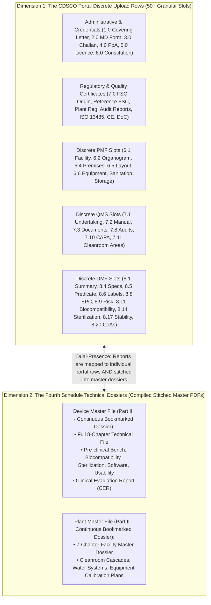
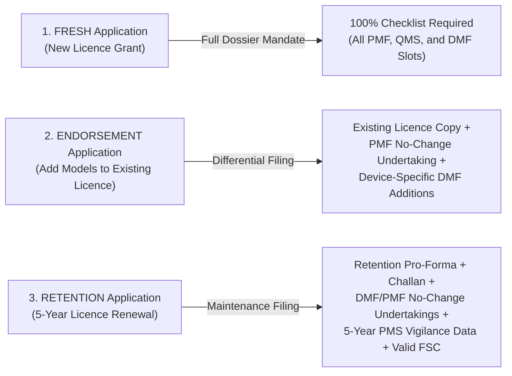
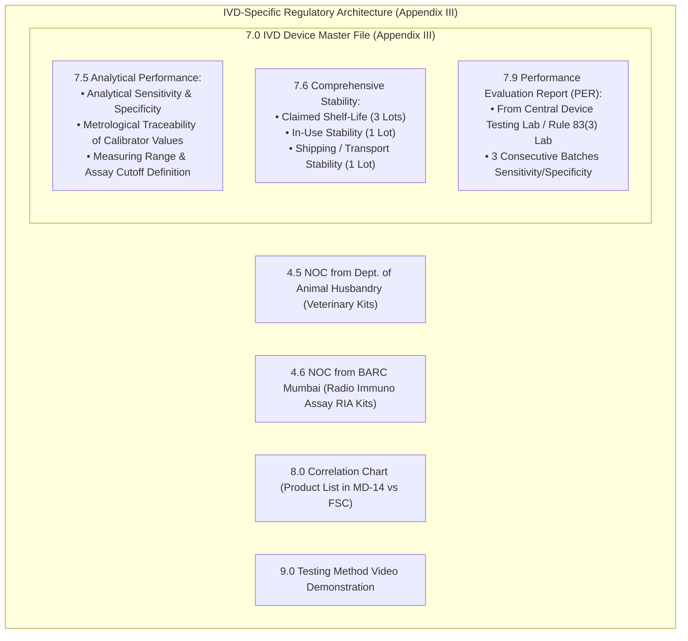
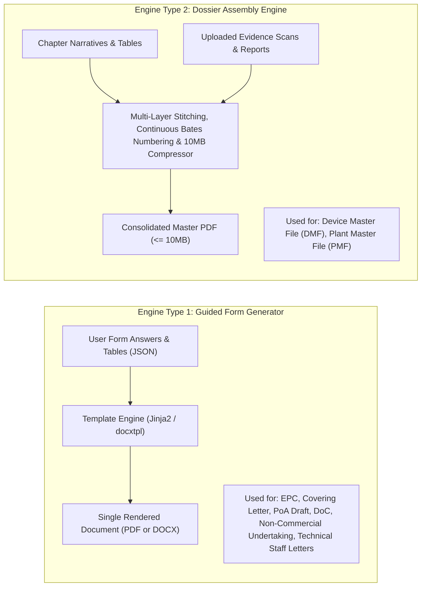
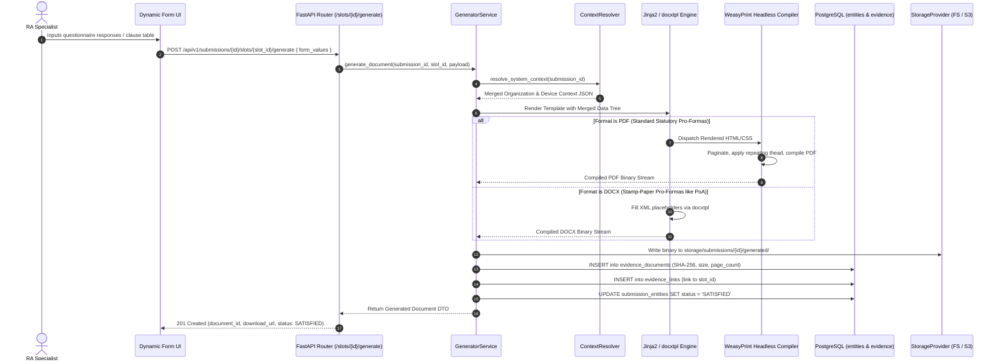
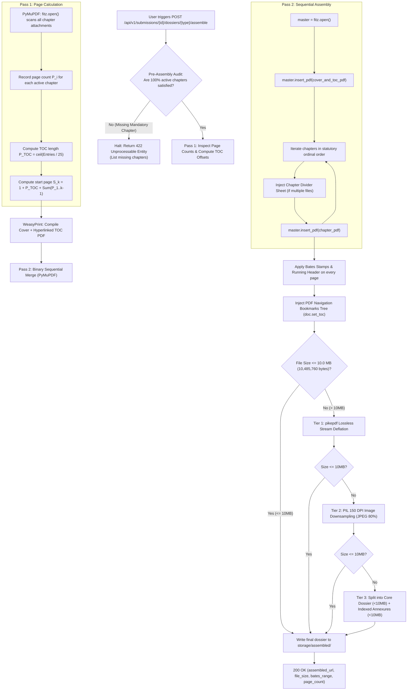
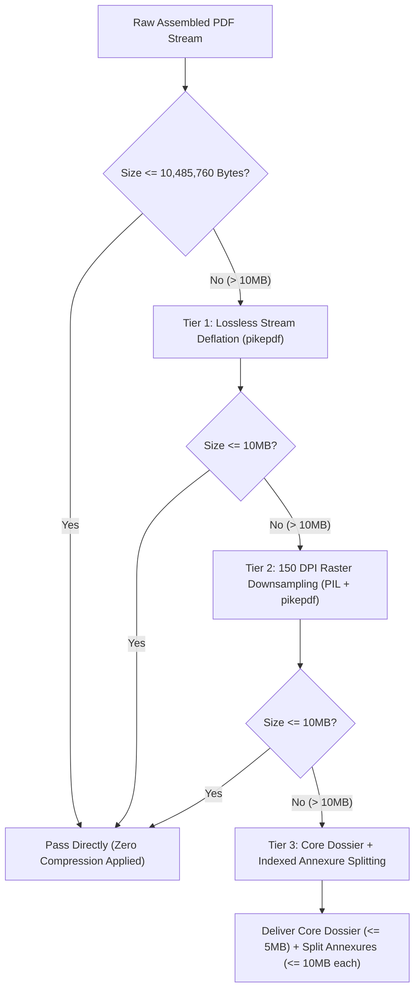

# Document Engines and Dual Fulfillment Logic

**Document Identifier:** DEF-CDSCO-001  
**Revision:** 1.3  
**Classification:** Technical Architecture and Engine Logic Specification  
**Governing Standard:** Medical Devices Rules, 2017 (MDR 2017), Gazette of India  
**Verified Primary Source:** Official CDSCO Online Portal Checklists (`cdscomdonline.gov.in` / SUGAM Repository)  
**Status:** Approved for Implementation  

---

## 1. Overview and Purpose

This document specifies the technical and regulatory logic for generating, assembling, and fulfilling documents across all statutory Medical Device (MD) and In Vitro Diagnostic (IVD) application forms under the *Medical Devices Rules, 2017*.

Every section, checklist identifier, and requirement documented herein has been audited and synchronized against the **official CDSCO system-generated checklists** (extracted from the production CDSCO Medical Devices Online Portal):
* `ReportChecklist_2.pdf` (Form MD-3)
* `ReportChecklist_3.pdf` (Form MD-4)
* `ReportChecklist_4.pdf` (Form MD-7)
* `ReportChecklist_5.pdf` (Form MD-8)
* `ReportChecklist_12.pdf` (Form MD-14)
* `ReportChecklistIVD_*.pdf` (IVD Equivalents)

This document addresses five core technical requirements:
1. **The Portal Architecture Reality:** How the CDSCO portal decomposes the Plant Master File (PMF), Quality Management System (QMS), and Device Master File (DMF) into over 50 discrete upload slots.
2. **The 35-Document Master Comparative Matrix:** Cross-stream mapping across all seven forms in our scope with statutory citations and fulfillment modes.
3. **MD versus IVD Specialization:** The statutory divergence between General Medical Devices (Fourth Schedule Appendix II) and In Vitro Diagnostics (Fourth Schedule Appendix III).
4. **The Three Statutory Filing Modalities:** Technical distinctions between **FRESH**, **ENDORSEMENT**, and **RETENTION** applications.
5. **The Operational Backend Logic for Both Engines:** Complete, step-by-step logic pipelines for **Dual Fulfillment (In-App Form Generation)** and **Dossier Assembly (Stitching & 10MB Optimization)**.

---

## 2. The Two Regulatory Dimensions of CDSCO Documentation

When applicants interact with CDSCO, documentation exists in two complementary dimensions:



1. **Dimension 1: The CDSCO Portal Upload Checklist (Granular Slots):** The online portal does **not** treat the DMF or PMF as a single upload box. Instead, the portal provides individual, numbered upload fields for every technical chapter and sub-clause (e.g. Slot 8.1 Executive Summary, Slot 8.6 Labels, Slot 8.11 Biocompatibility, Slot 8.14 Sterilization, Slot 8.20 Batch CoAs).
2. **Dimension 2: The Fourth Schedule Technical Master Files (Continuous Files):** Regulatory evaluators simultaneously expect compiled, bookmarked, continuously paginated Master Dossiers (DMF and PMF) prepared per the Fourth Schedule.
3. **The "Dual-Presence" Rule:** The application platform fulfills both realities:
   * It provides discrete export binaries mapped directly to CDSCO portal checklist slots.
   * It stitches these identical modular assets into the unified Device Master File and Plant Master File PDFs.

---

## 3. Statutory Filing Modalities (FRESH vs. ENDORSEMENT vs. RETENTION)

The CDSCO portal classifies submissions into three distinct operational modalities, each altering the required document checklist:



1. **FRESH Application:** Applies to initial grant of licence. Mandates all administrative credentials, full PMF facility chapters, full QMS manuals, and full DMF technical studies.
2. **ENDORSEMENT Application:** Applies when an active licensee adds new device models, sizes, or variants to an existing licence. Does **not** require resubmission of the entire Plant Master File; instead, mandates a **"No Major Change in PMF Undertaking"** accompanied by device-specific DMF technical data (Executive Summary, Specifications, Labels, Biocompatibility, Sterilization, and CoAs).
3. **RETENTION Application:** Required every 5 years under Rule 21(2) and Rule 34(3) to maintain licence validity. Requires:
   * Formal Retention Application and BharatKosh Fee Challan.
   * Undertaking affirming **No Change in Constitution and No Major Change in DMF/PMF**.
   * Comprehensive **5-Year Post-Marketing Surveillance (PMS) Vigilance Report** (complaints, recalls, adverse events, CAPA).
   * Re-authenticated Free Sale Certificates and ISO 13485 QMS certificates.

---

## 4. Master Statutory Document Checklist Across All Seven Forms

Below is the complete, granular inventory of all 35 statutory documents recognized across the seven application pathways.

### Legend:
* **Fulfillment Modes:**
  * `Upload Only`: External third-party certificates, laboratory test reports, or government challans.
  * `In-App Generate (Engine 1)`: Statutory pro-forma, covering letters, legal declarations, and structured matrices produced from questionnaire data.
  * `Dossier Assembly (Engine 2)`: Multi-chapter master files compiled from typed narratives, specification tables, and attached laboratory test reports.
* **Dual Presence:** Documents that appear both as a standalone portal checklist row and as an internal chapter inside the DMF/PMF.

| # | Statutory Document Name | MDR 2017 Source | MD-14 *(Import)* | MD-7 *(Mfg C/D)* | MD-8 *(Loan C/D)* | MD-3 *(Mfg A/B)* | MD-4 *(Loan A/B)* | MD-12 *(Test Mfg)* | MD-16 *(Test Import)* | Fulfillment Mode | Dual Presence in DMF/PMF? |
| :- | :--- | :--- | :---: | :---: | :---: | :---: | :---: | :---: | :---: | :--- | :--- |
| **A. Administrative & Legal Documentation** | | | | | | | | | | |
| **1** | Statutory Covering Letter | Rule 20 / 34 | Mandatory | Mandatory | Mandatory | Mandatory | Mandatory | Mandatory | Mandatory | Upload OR In-App Generate | No (Standalone) |
| **2** | Treasury Fee Challan (BharatKosh) | Second Schedule | Mandatory | Mandatory | Mandatory | Mandatory | Mandatory | Mandatory | Mandatory | Upload Only | No (Standalone) |
| **3** | Statutory Application Form Pro-Forma | Forms MD-3 to 16 | Mandatory | Mandatory | Mandatory | Mandatory | Mandatory | Mandatory | Mandatory | Upload OR In-App Generate | No (Standalone) |
| **4** | Power of Attorney (PoA) Executed | First Sched. Part I | Mandatory | N/A | N/A | N/A | N/A | N/A | Mandatory | Upload OR In-App Generate (Draft) | No (Standalone) |
| **5** | Authorized Agent Undertaking | Fourth Sched. Part I | Mandatory | N/A | N/A | N/A | N/A | N/A | N/A | Upload OR In-App Generate | No (Standalone) |
| **6** | Wholesale Licence (Form 20B/21B / MD-42) | Rule 34(1) | Mandatory | N/A | N/A | N/A | N/A | N/A | Mandatory | Upload Only | No (Standalone) |
| **7** | Applicant Legal Constitution (MoA, AoA, Board Res.) | Rule 20 / 34 | Mandatory | Mandatory | Mandatory | Mandatory | Mandatory | Mandatory | Mandatory | Upload Only | No (Standalone) |
| **8** | Primary Site Consent & Quality Agreement | Rule 20(3) | N/A | N/A | Mandatory | N/A | Mandatory | N/A | N/A | Upload Only | No (Standalone) |
| **9** | Competent Technical Staff Appointments | Rule 26 | N/A | Mandatory | Mandatory | Mandatory | Mandatory | N/A | N/A | Upload OR In-App Generate | In PMF (Chapter 4) |
| **B. Regulatory Approvals & Overseas Certifications** | | | | | | | | | | |
| **10** | Free Sale Certificate (Country of Origin) | Fourth Sched. Part I | Mandatory | N/A | N/A | N/A | N/A | N/A | N/A | Upload Only | No (Standalone) |
| **11** | Free Sale Certificate (Reference GHTF Countries) | Fourth Sched. Part I | Conditional | N/A | N/A | N/A | N/A | N/A | N/A | Upload Only | No (Standalone) |
| **12** | Overseas Manufacturing Site Registration / Licence | Fourth Sched. Part I | Mandatory | N/A | N/A | N/A | N/A | N/A | N/A | Upload Only | In PMF (Chapter 1) |
| **13** | Notified Body Audit / Inspection Report (Last 3 Yrs) | Fourth Sched. Part I | Mandatory | N/A | N/A | N/A | N/A | N/A | N/A | Upload Only | In PMF (Chapter 3) |
| **14** | Form MD-27 Clinical Investigation Permission | Rule 51 / 63 | Conditional | Conditional | N/A | N/A | N/A | N/A | N/A | Upload Only | In DMF (Chapter 7) |
| **C. Quality Management & Conformity Declarations** | | | | | | | | | | |
| **15** | ISO 13485:2016 QMS Certificate | Fifth Schedule | Mandatory | Mandatory | Mandatory | Mandatory | Mandatory | N/A | N/A | Upload Only | In PMF (Chapter 3) |
| **16** | CE Quality Assurance / Type Examination Certificate | Fourth Sched. Part I | Mandatory | N/A | N/A | N/A | N/A | N/A | N/A | Upload Only | No (Standalone) |
| **17** | Declaration of Conformity (DoC) | Fourth Sched. Part I | Mandatory | Mandatory | Mandatory | Mandatory | Mandatory | N/A | N/A | Upload OR In-App Generate | In DMF (Chapter 4) |
| **D. Product Identification, Packaging & Batch Release** | | | | | | | | | | |
| **18** | Product Labels (Primary, Secondary, Shipper) | Sixth Schedule | Mandatory | Mandatory | Mandatory | Mandatory | Mandatory | N/A | N/A | Upload Only | **Yes** (In DMF Chapter 8) |
| **19** | Instructions for Use (IFU) / Package Insert | Sixth Schedule | Mandatory | Mandatory | Mandatory | Mandatory | Mandatory | N/A | N/A | Upload Only | **Yes** (In DMF Chapter 8) |
| **20** | Certificate of Analysis (CoA) - 3 Batches | Fourth Sched. Part III | Mandatory | Mandatory | Mandatory | Mandatory | Mandatory | N/A | N/A | Upload Only | **Yes** (In DMF Chapter 6) |
| **E. Master Dossiers & Verification Evidence** | | | | | | | | | | |
| **21** | Essential Principles (EP) Checklist | Fourth Sched. App II | Mandatory | Mandatory | Mandatory | Mandatory | Mandatory | N/A | N/A | Upload OR In-App Generate | **Yes** (In DMF Chapter 4) |
| **22** | Device Master File (DMF) | Fourth Sched. Part III | **Full** | **Full** | **Full** | **Abbr.** | **Abbr.** | **N/A** | **N/A** | Dossier Assembly Engine | **Master Compiled PDF** |
| **23** | Plant Master File (PMF) | Fourth Sched. Part II | **Full** | **Full** | **Primary** | **Full** | **Parent** | **N/A** | **N/A** | Dossier Assembly Engine | **Master Compiled PDF** |
| **24** | Risk Management Report (ISO 14971) | Fourth Sched. Part III | Mandatory | Mandatory | Mandatory | Conditional | Conditional | N/A | N/A | Upload Only | **Yes** (In DMF Chapter 5) |
| **25** | Biocompatibility Evaluation (ISO 10993) | Fourth Sched. Part III | Conditional | Conditional | Conditional | Conditional | Conditional | N/A | N/A | Upload Only | **Yes** (In DMF Chapter 6.2) |
| **26** | Sterilization Validation Report (ISO 11135/11137) | Fourth Sched. Part III | Conditional | Conditional | Conditional | Conditional | Conditional | N/A | N/A | Upload Only | **Yes** (In DMF Chapter 6.3) |
| **27** | Software Lifecycle Dossier (IEC 62304) | Fourth Sched. Part III | Conditional | Conditional | Conditional | Conditional | Conditional | N/A | N/A | Upload Only | **Yes** (In DMF Chapter 6.4) |
| **28** | Clinical Evaluation Report (CER) | Fourth Sched. Part III | Mandatory | Mandatory | Mandatory | Conditional | Conditional | N/A | N/A | Upload Only | **Yes** (In DMF Chapter 7) |
| **F. Domestic Site Premises & Infrastructure (Mfg)** | | | | | | | | | | |
| **29** | Site Layout Plan & Cleanroom Differential Cascade | Fifth Schedule | N/A | Mandatory | Mandatory | Mandatory | Mandatory | N/A | N/A | Upload Only | In PMF (Chapter 2 & 5) |
| **30** | HVAC Air Balance & HEPA Filter Integrity Reports | Fifth Schedule | N/A | Mandatory | Mandatory | Conditional | Conditional | N/A | N/A | Upload Only | In PMF (Chapter 5) |
| **31** | Water Purification Validation (Purified / WFI) | Fifth Schedule | N/A | Mandatory | Mandatory | Conditional | Conditional | N/A | N/A | Upload Only | In PMF (Chapter 5) |
| **G. Test, Research & Evaluation Streams Only** | | | | | | | | | | |
| **32** | Test Protocol & Objective Specification | Rule 31 / 40 | N/A | N/A | N/A | N/A | N/A | **Mandatory** | **Mandatory** | Upload OR In-App Generate | No (Test Licences Only) |
| **33** | Quantitative Justification Math Formula | Rule 31 / 40 | N/A | N/A | N/A | N/A | N/A | **Mandatory** | **Mandatory** | Upload OR In-App Generate | No (Test Licences Only) |
| **34** | Non-Commercial Undertaking (Stamp Paper) | Rule 31 / 40 | N/A | N/A | N/A | N/A | N/A | **Mandatory** | **Mandatory** | Upload OR In-App Generate | No (Test Licences Only) |
| **35** | Post-Testing Destruction / Reconciliation Plan | Rule 31 / 40 | N/A | N/A | N/A | N/A | N/A | **Mandatory** | **Mandatory** | Upload OR In-App Generate | No (Test Licences Only) |

---

## 5. Granular Checklists from the Production CDSCO Portal

### 5.1 Form MD-14: Commercial Import Licence (ReportChecklist_12.pdf)
* **1.0 Covering Letter** (Mandatory)
* **2.0 Fee Challan** (Mandatory - BharatKosh)
* **3.0 Form MD-14 Execution** (Mandatory)
* **4.0 Power of Attorney & Undertaking per Fourth Schedule Part I** (Mandatory - Apostilled / Embassy Attested)
* **5.0 Wholesale Licence (20B/21B) or MD-42 Registration** (Mandatory)
* **6.0 Constitution Details of Indian Agent** (Mandatory)
* **7.0 Regulatory Certificates:**
  * 7.1 Free Sale Certificate from Country of Origin (Mandatory)
  * 7.2 Free Sale Certificate from GHTF Reference Regulators (USA, UK, EU, Canada, Japan, Australia) (Mandatory)
  * 7.3 Overseas Manufacturing Site Registration Certificate (Mandatory)
  * 7.4 Latest Inspection or Audit Report within last 3 years (Mandatory)
* **8.0 Quality Certificates:**
  * 8.1 ISO 13485:2016 QMS Certificate (Mandatory)
  * 8.2 Full Quality Assurance / CE Certificate (Mandatory)
  * 8.3 Declaration of Conformity by Manufacturer (Mandatory)
* **9.0 Plant Master File (Appendix I of Fourth Schedule)** (Mandatory)
* **10.0 Device Master File (Appendix II of Fourth Schedule):**
  * 10.1 Executive Summary
  * 10.2 Descriptive Information of Device
  * 10.3 Grouping Justification
  * 10.4 Product Specification (Variants, Accessories)
  * 10.5 Predicate Device Substantial Equivalence
  * 10.6 Labelling Information (Labels, IFU)
  * 10.7 Device Design and Manufacturing Information
  * 10.8 Essential Principles Checklist (EPSP)
  * 10.9 Risk Analysis Summary (ISO 14971)
  * 10.10 Verification and Validation Overview
  * 10.11 Biocompatibility Validation Data (ISO 10993)
  * 10.12 Medicinal Substances Data (if drug incorporated)
  * 10.13 Biological Safety (TSE/BSE if animal derived)
  * 10.14 Sterilization Validation Data (ISO 11135/11137)
  * 10.15 Software Verification and Validation (IEC 62304)
  * 10.16 Animal Studies Pre-clinical Data
  * 10.17 Stability Study Data (Real-time and Accelerated)
  * 10.18 Clinical Evidence / CER
  * 10.19 Post-Marketing Surveillance Vigilance Data
  * 10.20 Batch Release CoAs for 3 consecutive batches
* **11.0 Additional Documents** (Conditional)
* **12.0 Copy of Permission in Form MD-27** (Investigational devices)

---

### 5.2 Form MD-7: Commercial Manufacturing Class C & D (ReportChecklist_4.pdf)
* **1.0 Covering Letter** (Mandatory)
* **2.0 Form MD-7 Application** (Mandatory)
* **3.0 Fee Challan** (Mandatory)
* **4.0 Firm Constitution Documents** (Mandatory)
* **5.0 Site Ownership Deed / Tenancy Agreement** (Mandatory)
* **6.0 Plant Master File (Appendix I):**
  * 6.1 General Info | 6.2 Organogram | 6.3 Technical Staff (Rule 26) | 6.4 Premises | 6.5 Scaled Layout | 6.6 Equipment List | 6.7 Sanitation | 6.8 Production | 6.9 QA | 6.10 Storage | 6.11 Documentation
* **7.0 Quality Management System Requirements (Fifth Schedule):**
  * 7.1 Fifth Schedule Undertaking | 7.2 Quality Manual | 7.3 Document Control | 7.4 Record Control | 7.5 Management Responsibility | 7.6 Resources | 7.7 Production Control | 7.8 Internal Audits | 7.9 Non-conformance Control | 7.10 CAPA | 7.11 Cleanroom Environmental Classification Table (Annexure A)
* **8.0 Device Master File (Appendix II):**
  * Slots 8.1 to 8.20 (Identical technical structure to MD-14 Slots 10.1–10.20)
* **9.0 Additional Documents** | **10.0 Test Licence Form MD-13** | **11.0 Form MD-27 Permission**

---

### 5.3 Forms MD-3 & MD-4: Class A & B Manufacturing and Loan Licences (ReportChecklist_2.pdf & 3.pdf)
* **1.0 Covering Letter** | **1.1 Firm Constitution** | **1.2 Premises Ownership / Tenancy Agreement**
* **Loan Licence Specifics (MD-4):** Bilateral Manufacturing Agreement + Copy of Parent Site's Form MD-5 Licence + Host Consent Letter
* **2.0 Quality Certificates:** ISO 13485 QMS Certificate (Slot 2.1)
* **3.0 Plant Master File:** Parts 1 to 10 (Part 1 mandatory for MD-3; Parts 1–5 mandatory for MD-4)
* **4.0 Device Master File:**
  * *Statutory Note from CDSCO Portal:* *"In case of Class A devices, Appendix II is not required. For Class A devices upload information as specified in Part II of Fourth Schedule (Abbreviated technical file)"*.
  * For Class B devices: Abbreviated technical file (intended use, materials, manufacturing flowchart, specifications, shelf life)
* **5.0 Performance Evaluation Report** (IVDs only)
* **6.0 Test Licence Obtained (Form MD-13)**
* **7.0 Fifth Schedule Undertaking**
* **8.0 State Treasury Fee Challan**
* **9.0 Form MD-3 / MD-4 Execution Pro-Forma**

---

### 5.4 Form MD-8: Loan Licence for Class C & D Devices (ReportChecklist_5.pdf)
* **1.0 Covering Letter** | **2.0 Firm Constitution** | **3.0 Premises Deed**
* **4.0 Bilateral Agreement** between applicant and host manufacturer
* **5.0 Copy of Host Manufacturer's Form MD-9 Licence** showing licensed authority for the applied device
* **6.1 PMF Undertaking:** Undertaking from host manufacturer affirming **No Major Changes in Host PMF**
* **7.1 QMS Undertaking:** Fifth Schedule compliance undertaking for loan product
* **8.1 DMF Applicability Undertaking:** Formal declaration that the approved DMF applies to the loan product
* **8.2 to 8.13 Device Master File:** Executive Summary, Description, Grouping, Specifications, Labels, Essential Principles Checklist, Risk Analysis, Biocompatibility, Sterilization, Stability, PMS, and 3-Batch CoAs
* **10.0 Form MD-8 Execution** | **11.0 Fee Challan**

---

## 6. In Vitro Diagnostics (IVD) Specialized Checklist Requirements

*Extracted directly from official CDSCO `ReportChecklistIVD_12.pdf` and IVD technical files.*

When the regulatory context identifies an **In Vitro Diagnostic (IVD)**, the Fourth Schedule transitions from Appendix II to **Appendix III (Part III)**, triggering specialized scientific upload slots:



1. **Analytical Performance Studies (Clause 7.5):** Requires documentation of specimen types, analytical sensitivity (limit of detection), analytical specificity (cross-reactivity and interference), metrological traceability of assigned calibrator/control values, and assay cutoff calculation.
2. **Three-Tier Stability Testing (Clause 7.6):** Must provide:
   * Real-time and accelerated shelf-life stability on 3 batches.
   * **In-Use Open-Vial Stability** on 1 batch.
   * **Shipping and Transport Stress Stability** on 1 batch.
3. **Statutory Performance Evaluation Report (PER - Clause 7.9):** Formal testing report issued by an accredited Central Medical Device Testing Laboratory or registered facility under Rule 83(3) evaluating clinical sensitivity and specificity across 3 batches.
4. **Correlation Chart (Clause 8.0):** Mandatory tabular correlation cross-referencing every catalogue code listed in the MD-14 application with the corresponding entry in the foreign Free Sale Certificate.
5. **Testing Video Demonstration (Clause 9.0):** Option to submit an instructional video demonstrating testing procedure for rapid diagnostic test kits.
6. **Specialized Agency Clearances:**
   * Department of Animal Husbandry NOC for Veterinary IVD kits (Clause 4.5).
   * Bhabha Atomic Research Centre (BARC) NOC for Radio Immuno Assay (RIA) kits (Clause 4.6).

---

## 7. Test Licences Checklists (Forms MD-12 & MD-16)

*Governed by Rule 31 (Test Manufacture) and Rule 40 (Test Import).*

As established by regulatory statute, test licences are non-commercial evaluation permits. They strictly **bypass** the DMF, PMF, and EPC engines, requiring:

1. **Covering Letter:** Explaining test, evaluation, training, or demonstration objectives.
2. **Statutory Application:** Form MD-12 or Form MD-16 pro-forma with BharatKosh challan.
3. **Brief Technical Description:** Device working principles, specifications, and materials of construction.
4. **Mathematical Quantity Justification:** Formula proving why the requested unit count is necessary:
   $$\text{Total Units} = (\text{Destructive Tests} \times \text{Replicates}) + \text{Bench Tests} + \text{Demonstration Retention}$$
5. **Test Protocol:** Formal testing parameters, cited standards, and lab booking confirmation.
6. **Non-Commercial Undertaking (Stamp Paper):** Notarized legal undertaking affirming that devices will **strictly not** be commercially sold or distributed.
7. **Reconciliation & Destruction Protocol:** Protocol governing inventory custody and post-testing sample destruction.
8. **Import Specifics (MD-16):** Foreign manufacturer authorization letter and pro-forma invoice.

---

## 8. Applicability Logic for DMF, PMF, and EPC Engines

A central architectural rule of the platform is determining which submission streams trigger the deep technical compilation engines:

### 8.1 Commercial and Loan Streams (MD-14, MD-7, MD-8, MD-3, MD-4)
* **Applicability:** **MANDATORY.**
* **Statutory Basis:** Governed by Rule 20, Rule 21, Rule 34, and the Fourth Schedule.
* **Logic:** Commercial marketing authorization requires legal proof of device design safety, manufacturing facility control, and conformity to harmonized standards:
  * **DMF Engine:** Stitches design specifications, risk analysis, pre-clinical bench data, biocompatibility, sterilization, software validation, and clinical evidence into a bookmarked dossier.
  * **PMF Engine:** Assembles manufacturing operations, site schematics, environmental monitoring, QMS processes, and personnel organograms.
  * **EPC Engine:** Verifies and formats the clause-by-clause compliance matrix against Fourth Schedule Appendix II.

### 8.2 Test and Evaluation Streams (MD-12, MD-16)
* **Applicability:** **EXEMPT (Engines Completely Bypassed).**
* **Statutory Basis:** Governed by Rule 31 (Test Manufacture) and Rule 40 (Test Import).
* **Logic:** Test licences exist solely for laboratory testing, bench analysis, clinical trial supplies, or demonstration at accredited testing institutes. An applicant cannot possess a finalized commercial Device Master File or finished commercial Plant Master File prior to completing testing. Triggering DMF, PMF, or EPC compilation for Form MD-12 or MD-16 violates statutory procedure.
* **Test Pathway Engine Trigger:** These forms trigger the **Test Protocol & Undertaking Generator** instead (producing items 32 through 35 in the master matrix).

---

## 9. Architectural Separation: The Two Technical Engines

To fulfill this 35-item document catalog, the platform provides two specialized backend engines:



---

## 10. Engine Type 1: Guided Form Generation Logic (Dual Fulfillment Backend)

Engine 1 fulfills the statutory requirement for documents that can be authored directly within the application via structured questionnaires, eliminating the need for applicants to prepare external Word files or manual scans.



### 10.1 Engine 1 Statutory Document Catalog & Template Mapping

| Statutory Document Name | Template Key | Target Portal Slot(s) | Applicable Forms | Compiler Engine | Output MIME Type | Governing MDR 2017 Citation |
| :--- | :--- | :--- | :--- | :--- | :--- | :--- |
| **Statutory Covering Letter** | `covering_letter` | Slot 1.0 (All Forms) | All 7 Pathways | Jinja2 + WeasyPrint | `application/pdf` | Rule 20 / Rule 34 |
| **Essential Principles Checklist** | `essential_principles` | Slot 10.8 (MD-14), Slot 8.8 (MD-7), Slot 4.0 (MD-3) | MD-14, MD-7, MD-8, MD-3, MD-4 | Jinja2 + WeasyPrint | `application/pdf` | Fourth Schedule, Appendix II |
| **Manufacturer Declaration of Conformity** | `declaration_of_conformity` | Slot 8.3 (MD-14), Slot 7.3 (MD-7) | MD-14, MD-7, MD-8, MD-3, MD-4 | Jinja2 + WeasyPrint | `application/pdf` | Fourth Schedule, Part I |
| **Power of Attorney Pro-Forma** | `power_of_attorney_proforma` | Slot 4.0 (MD-14), Slot 4.0 (MD-16) | MD-14, MD-16 | docxtpl (Word) | `application/vnd.openxmlformats` | First Schedule, Part I |
| **Non-Commercial Test Undertaking** | `non_commercial_undertaking` | Slot 10.13 (MD-12/16) | MD-12, MD-16 | Jinja2 + WeasyPrint | `application/pdf` | Rule 31 / Rule 40 |
| **Competent Technical Staff Letter** | `technical_staff_appointment` | Slot 6.3 (MD-7), Slot 3.3 (MD-3) | MD-7, MD-8, MD-3, MD-4 | Jinja2 + WeasyPrint | `application/pdf` | Rule 26 (Production / QA) |
| **TR6 Fee Challan Summary Sheet** | `tr6_fee_challan_summary` | Slot 2.0 (All Forms) | All 7 Pathways | Jinja2 + WeasyPrint | `application/pdf` | Second Schedule |

### 10.2 Context Injection Contract (System Metadata Merge)

The backend automatically extracts organization and device parameters from `profiles` and `submissions` and injects them into the template rendering context, ensuring zero redundant data entry:

```json
{
  "context": {
    "applicant": {
      "legal_name": "Apex MedTech Private Limited",
      "registered_address": "Plot 42, Okhla Industrial Area, Phase-III, New Delhi, 110020, India",
      "constitution_type": "Private Limited Company",
      "wholesale_licence_number": "DL-OKH-2023-004218 (Form 20B/21B)",
      "signatory_name": "Dr. Rajesh Sharma",
      "signatory_designation": "Director & Authorized Indian Agent",
      "contact_email": "regulatory@apexmedtech.in",
      "contact_phone": "+91-11-45678900"
    },
    "manufacturer": {
      "legal_name": "BioSensors International AG",
      "site_name": "Main Manufacturing Campus",
      "site_address": "Technoparkstrasse 1, 8005 Zürich, Switzerland",
      "country": "Switzerland",
      "site_registration_number": "CH-MFG-2018-9921",
      "signatory_name": "Dr. Markus Weber",
      "signatory_designation": "VP Global Regulatory Affairs"
    },
    "device": {
      "brand_name": "CardioTrack Pacemaker Lead System",
      "generic_name": "Implantable Cardiac Pacing Lead",
      "device_type": "MEDICAL_DEVICE",
      "risk_class": "CLASS_D",
      "intended_use": "Transvenous pacing and sensing of cardiac chambers in bradycardia therapies.",
      "model_variants": ["CT-PL-052", "CT-PL-058", "CT-PL-065"],
      "shelf_life_months": 36,
      "storage_conditions": "Store between 15°C and 25°C in dry conditions.",
      "is_sterile": true,
      "sterilization_method": "Ethylene Oxide (EtO)"
    },
    "submission": {
      "tracking_code": "SUB-2026-MD14-00412",
      "application_code": "MD-14",
      "filing_modality": "FRESH",
      "submission_date": "2026-10-22",
      "bharatkosh_challan_id": "BK-2026-881920",
      "fee_paid_inr": 150000
    }
  }
}
```

### 10.3 Structured Input Schemas for Core Generated Documents

#### 1. Statutory Covering Letter Questionnaire (`covering_letter`)
```json
{
  "subject_line": "Application for Grant of Licence to Import Class D Medical Device under Rule 34",
  "reference_portal_id": "CDSCO/MD/2026/009182",
  "device_model_table": [
    { "model_number": "CT-PL-052", "specification": "52cm Bipolar Active Fixation Lead", "accessories": "Stylet Kit" },
    { "model_number": "CT-PL-058", "specification": "58cm Bipolar Active Fixation Lead", "accessories": "Stylet Kit" }
  ],
  "enclosures_list": [
    "Treasury Fee Challan in BharatKosh",
    "Executed Power of Attorney in First Schedule Part I",
    "Free Sale Certificate issued by Swissmedic",
    "Complete Device Master File (Fourth Schedule Part III)"
  ],
  "custom_declarations": "We confirm that the applied models are identical to those commercially marketed in Switzerland and the EU."
}
```

#### 2. Essential Principles Checklist Questionnaire (`essential_principles`)
The schema enforces the **15 statutory clauses** of Fourth Schedule Appendix II. Every applicable clause must reference an evidence document:
```json
{
  "clauses": [
    {
      "clause_id": "EP_01",
      "clause_number": "1",
      "title": "General Safety and Performance Principles",
      "applicable": true,
      "justification": null,
      "cited_standards": ["ISO 13485:2016", "ISO 14971:2019"],
      "evidence_document_titles": ["Risk Management Report RMR-2025-01", "ISO 13485 Certificate"]
    },
    {
      "clause_id": "EP_08",
      "clause_number": "8",
      "title": "Infection and Microbial Contamination (Sterility)",
      "applicable": true,
      "justification": null,
      "cited_standards": ["ISO 11135:2014"],
      "evidence_document_titles": ["Ethylene Oxide Sterilization Validation Report VAL-ETO-2024"]
    },
    {
      "clause_id": "EP_12",
      "clause_number": "12",
      "title": "Devices Incorporating Software",
      "applicable": false,
      "justification": "The device is a passive mechanical pacing lead containing no embedded software or programmable logic.",
      "cited_standards": [],
      "evidence_document_titles": []
    }
  ]
}
```

### 10.4 CSS Print and Pagination Specifications (WeasyPrint Standards)

All Engine 1 HTML templates must adhere to strict print-CSS rules to guarantee evaluator-grade typography and zero layout defects:
```css
@page {
    size: A4 portrait;
    margin: 20mm 15mm 20mm 15mm;
    @top-right {
        content: "CDSCO Form MD-14 Statutory Filing";
        font-family: "Liberation Sans", Arial, sans-serif;
        font-size: 8pt;
        color: #718096;
    }
    @bottom-center {
        content: "Page " counter(page) " of " counter(pages);
        font-family: "Liberation Sans", Arial, sans-serif;
        font-size: 9pt;
        color: #4a5568;
    }
}

body {
    font-family: "Liberation Sans", Arial, sans-serif;
    font-size: 10pt;
    line-height: 1.45;
    color: #1a202c;
}

table {
    width: 100%;
    border-collapse: collapse;
    margin-top: 12pt;
    margin-bottom: 12pt;
}

thead {
    display: table-header-group; /* Repeats table headers on every page break */
}

tr {
    page-break-inside: avoid; /* Prevents rows from splitting awkwardly across pages */
}

th, td {
    border: 1px solid #cbd5e0;
    padding: 6pt 8pt;
    font-size: 9pt;
    vertical-align: top;
}

th {
    background-color: #f7fafc;
    font-weight: bold;
    text-align: left;
}

.signature-block {
    page-break-inside: avoid;
    margin-top: 24pt;
}
```

---

## 11. Engine Type 2: Dossier Assembly Engine Logic (DMF and PMF)

Engine 2 compiles multi-chapter Fourth Schedule technical files (Device Master File and Plant Master File) from modular typed sections and third-party laboratory reports.



### 11.1 Deterministic Statutory Assembly Sequences (Which Goes Where)

Engine 2 enforces three statutory manifests governing chapter sequence:

#### Table 1: Device Master File (DMF) General Medical Devices (Fourth Schedule Part III)
| Ordinal | Chapter Code | Statutory Chapter Heading | Source Slot | Input Type | Inclusion & Pruning Condition |
| :---: | :--- | :--- | :---: | :--- | :--- |
| **0** | `COVER` | Official Dossier Cover Page | Generated | Jinja2 &rarr; PDF | Always Required |
| **0.1** | `TOC` | Dynamic Table of Contents | Generated | WeasyPrint &rarr; PDF | Always Required |
| **1** | `DMF_1_0` | Executive Summary & Device Description | Slot 10.1 & 10.2 | In-App / Narrative | Always Required |
| **2** | `DMF_2_0` | Product Specifications & Engineering Drawings | Slot 10.4 | Form + PDF Schematics | Always Required |
| **3** | `DMF_3_0` | Predicate Device Substantial Equivalence | Slot 10.5 | Tabular Comparison | Required if `has_predicate == true` |
| **4** | `DMF_4_0` | Essential Principles (EP) Compliance Matrix | Slot 10.8 / 10.10 | Compiled PDF (Engine 1) | Always Required |
| **5** | `DMF_5_0` | Risk Management Report (ISO 14971) | Slot 10.9 | Uploaded Third-Party File | Always Required |
| **6.1** | `DMF_6_1` | Electrical Safety & EMC (IEC 60601-1) | Slot 10.10 | Third-Party Lab Report | Active electrical devices only |
| **6.2** | `DMF_6_2` | Biocompatibility Studies (ISO 10993) | Slot 10.11 | GLP Lab Reports | Required if `is_contact_device == true` |
| **6.3** | `DMF_6_3` | Sterilization Validation (ISO 11135/11137) | Slot 10.14 | Validation Report | Required if `is_sterile == true` |
| **6.4** | `DMF_6_4` | Software Lifecycle & Cyber (IEC 62304) | Slot 10.15 | Software Architecture | Required if `is_samd == true` |
| **6.5** | `DMF_6_5` | Usability Engineering (IEC 62366) | Slot 10.10 | Human Factors Report | Class C & D devices only |
| **6.6** | `DMF_6_6` | Stability & Shelf-Life Validation | Slot 10.17 | Protocol + Lab Reports | Always Required |
| **6.7** | `DMF_6_7` | Batch Release CoAs (3 Batches) | Slot 10.20 | Manufacturer QA CoAs | Always Required |
| **7** | `DMF_7_0` | Clinical Evaluation Report (CER) / Investigation | Slot 10.18 | Literature CER or Study | Always Required |
| **8** | `DMF_8_0` | Device Labeling Artwork & Instructions for Use | Slot 10.6 | Primary, Carton, IFU | Always Required |

#### Table 2: Plant Master File (PMF) Chapter Sequence (Fourth Schedule Part II)
| Ordinal | Chapter Code | Statutory Chapter Heading | Source Slot | Input Type | Inclusion & Pruning Condition |
| :---: | :--- | :--- | :---: | :--- | :--- |
| **0** | `COVER_TOC` | Cover Page and Dynamic Table of Contents | Generated | Synthesized PDF | Always Required |
| **1** | `PMF_1_0` | General Facility Information & Site Registration | Slot 6.1 | Narrative + Licence | Always Required |
| **2** | `PMF_2_0` | Manufacturing Operations & Cleanroom Classifications| Slot 6.5 | Flowcharts & Layout | Always Required |
| **3** | `PMF_3_0` | Quality Management System (ISO 13485 Procedures) | Slot 7.2 | QMS Manual & Matrix | Always Required |
| **4** | `PMF_4_0` | Personnel, Organogram & Competencies (Rule 26) | Slot 6.2 & 6.3 | Organogram + Letters | Always Required |
| **5** | `PMF_5_0` | Premises, HVAC Differential Cascades & Water Systems| Slot 6.4 & 7.11 | AHU Logs + Water Tests| Always Required |
| **6** | `PMF_6_0` | Equipment Inventory, Qualification & Calibration | Slot 6.6 | Equipment Master Plan | Always Required |
| **7** | `PMF_7_0` | Sanitation, Pest Control & Contamination Control | Slot 6.7 | Hygiene Standard Ops | Always Required |

#### Table 3: IVD Device Master File Chapter Sequence (Fourth Schedule Appendix III)
| Ordinal | Chapter Code | Statutory Chapter Heading | Source Slot | Input Type | Inclusion & Pruning Condition |
| :---: | :--- | :--- | :---: | :--- | :--- |
| **0** | `COVER_TOC` | Cover Page and Table of Contents | Generated | Synthesized PDF | Always Required |
| **1** | `IVD_1_0` | Executive Summary & Analytical Principles | Slot 7.1 | Narrative Form | Always Required |
| **2** | `IVD_2_0` | Regulatory Status of Similar IVDs in India | Slot 7.2 | Market Survey Table | Always Required |
| **3** | `IVD_3_0` | Essential Principles Checklist (IVD Specifics) | Slot 7.3 | In-App Form (Engine 1)| Always Required |
| **4** | `IVD_4_0` | Risk Management Report (ISO 14971) | Slot 7.4 | Evaluation Report | Always Required |
| **5** | `IVD_5_0` | Analytical Performance (Sensitivity, Specificity)| Slot 7.5 | Bench Analytical Data | Always Required |
| **6** | `IVD_6_0` | Three-Tier Stability (Shelf-Life, In-Use, Transport)| Slot 7.6 | Lab Stability Reports | Always Required |
| **7** | `IVD_7_0` | Reagent Package Insert, Labels & Pack Presentation| Slot 7.7 | Artwork Binaries | Always Required |
| **8** | `IVD_8_0` | Specimen Batch Release CoAs (3 Batches) | Slot 7.8 | Quality CoAs | Always Required |
| **9** | `IVD_9_0` | Performance Evaluation Report (CDTL / Rule 83) | Slot 7.9 | Statutory Lab Report | Always Required |
| **10** | `IVD_10_0` | Post-Marketing Surveillance (PMS) Plan | Slot 7.10 | Vigilance Procedure | Always Required |

### 11.2 Inclusion, Exclusion, and Multi-File Ordering Rules (How Much to Stitch)

#### 1. Context-Driven Pruning Rules
Engine 2 inspects `submissions.regulatory_context` to prune irrelevant chapters:
* If `is_sterile == false`: Chapter 6.3 is pruned from the manifest; in its place, Engine 2 inserts a 1-page standard statutory declaration: *"Exemption per MDR 2017: Device is supplied non-sterile and does not undergo terminal sterilization."*
* If `is_contact_device == false`: Chapter 6.2 (Biocompatibility) is omitted from assembly.
* If `is_samd == false`: Chapter 6.4 (IEC 62304 Software Dossier) is omitted.
* If `has_predicate == false`: Chapter 3.0 switches from substantial equivalence to novel device waiver justification referencing Form MD-27 / MD-26.
* If `risk_class == "CLASS_A"`: The system selects the **Abbreviated Technical File** blueprint (4 chapters) per Fourth Schedule Part II, bypassing the full 8-chapter sequence.

#### 2. Multi-File Ordering Within a Single Chapter
When a user uploads multiple files to a single chapter (e.g., Chapter 6.2 Biocompatibility having separate reports for Cytotoxicity, Sensitization, and Irritation), Engine 2 orders them deterministically:
1. **Chapter Divider Sheet (1 Page):** Synthesized HTML cover indicating chapter number, title, governing standards (e.g. ISO 10993-5, ISO 10993-10), and a table of attached reports with test dates.
2. **Narrative Summary Page:** Typed executive summary authored in the workspace.
3. **Attached Laboratory Reports:** Appended in the exact order specified by the user in the workspace or ordered alphabetically by original filename.

### 11.3 The Two-Pass Assembly Pipeline (Deterministic Mathematical Offsets)

Because a Table of Contents must state the exact page number of every chapter, and because page lengths of third-party test reports vary, Engine 2 executes a **Two-Pass Algorithm**:

#### Pass 1: Inspection & Page Offset Mathematics
1. PyMuPDF inspects each binary attachment in the manifest:
   $$P_i = \text{page\_count}(\text{document}_i)$$
2. System computes the number of entries ($N$) in the Table of Contents. At 25 entries per page:
   $$P_{\text{TOC}} = \max\left(1, \left\lceil \frac{N}{25} \right\rceil\right)$$
3. The starting page ($S_k$) for any chapter $k$ is calculated deterministically:
   $$S_k = 1 + P_{\text{TOC}} + \sum_{i=1}^{k-1} P_i$$
   *(where Page 1 is the Dossier Cover Page, and Pages $2$ to $1 + P_{\text{TOC}}$ are the Table of Contents)*.

#### Intermediate Step: Cover and TOC Synthesis
The calculated page offsets are passed into `dossier_cover_toc.html`. WeasyPrint renders a standalone PDF containing:
* Official Cover Page with device metadata and authorized signatory block.
* Dynamic Table of Contents with hyperlinked chapter numbers pointing to internal PDF destinations (`#page=S_k`).

#### Pass 2: Binary Sequential Merge & Post-Processing
1. Engine 2 initializes an empty PyMuPDF document: `master = fitz.open()`.
2. Appends `cover_and_toc.pdf`.
3. Iterates through all active manifest chapters, appending each document: `master.insert_pdf(chapter_pdf)`.
4. **Continuous Bates Margin Stamping:**
   Engine 2 loops over all pages ($1$ to $P_{\text{total}}$) and inserts running margins:
   * **Top Running Header:** Injected at $(X=54, Y=30)$:  
     `"CDSCO Technical Dossier - MDR 2017 Fourth Schedule | " + submission.tracking_code`
   * **Bottom Bates Footer:** Centered at $(Y = \text{height} - 25)$:  
     `"{bates_prefix}-{page_num:04d}  |  Page {page_num} of {P_total}"` (e.g. `DMF-0042  |  Page 42 of 145`).
5. **Hierarchical Bookmarks Injection:**
   Engine 2 injects an outline tree via `master.set_toc()` allowing evaluators in Adobe Acrobat or web viewers to jump directly to any chapter or sub-annexure:
   ```text
   ├── Chapter 1.0: Executive Summary & Device Description (Page 4)
   ├── Chapter 2.0: Product Specifications & Engineering Drawings (Page 12)
   ├── Chapter 6.0: Verification and Validation Studies (Page 38)
   │   ├── 6.1 Electrical Safety & EMC (Page 39)
   │   ├── 6.2 Biocompatibility Evaluation (ISO 10993) (Page 58)
   │   │   ├── Divider Sheet (Page 58)
   │   │   ├── Cytotoxicity Report (Page 59)
   │   │   └── Sensitization Study (Page 74)
   │   └── 6.3 Sterilization Validation (ISO 11135) (Page 91)
   └── Chapter 8.0: Device Labeling & IFU (Page 134)
   ```

### 11.4 Strict 10MB Government Portal Limit Enforcement

The CDSCO online portal (`cdscomdonline.gov.in`) enforces an absolute maximum upload size of **10.0 MB (10,485,760 bytes)** per checklist slot. Third-party test reports containing high-resolution scans often cause assembled dossiers to reach 30MB to 70MB.

Engine 2 executes an automated three-tier optimization cascade:



#### Tier 1: Lossless Stream Deflation (pikepdf / qpdf)
* Recompresses all internal PDF streams using Flate compression (`compression_streams=pikepdf.CompressionStreams.generate`).
* Deduplicates redundant embedded font subsets and removes unreferenced dictionary objects (`normalize_content=True`).
* Achieves 10–25% reduction with zero loss of visual quality.

#### Tier 2: 150 DPI Raster Downsampling (PIL + pikepdf)
* Scans all embedded image objects in the PDF stream.
* If an image's effective resolution exceeds 150 DPI (such as 300–600 DPI scanner output from testing laboratories):
  1. Decodes raw bitmap stream.
  2. Resamples image to **150 DPI** using high-quality Lanczos anti-aliasing.
  3. Re-encodes image as progressive JPEG with quality factor `80%` in sRGB color space.
  4. Replaces original heavy stream in the PDF object table.
* **Statutory Compliance Guarantee:** 150 DPI preserves full visual legibility of laboratory director signatures, NABL stamp seals, calibration stamps, and oscillogram / test curves, while reducing document file size by **65% to 80%**.

#### Tier 3: Deterministic Overflow Split Strategy (Fallback)
If a master dossier with extensive raw bench data (e.g. 500+ pages) remains over 10.0 MB after Tier 2 downsampling, Engine 2 engages the Split Strategy:
1. **Core Technical Dossier (`Master_DMF_Core.pdf` - typically 3 to 5 MB):** Contains all Chapter 1.0 through 8.0 narratives, specifications, executive summaries, and the complete Table of Contents. Uploaded to SUGAM's primary DMF upload slot.
2. **Indexed Individual Annexures (Each strictly &le; 10MB):** Heavy laboratory test reports are extracted into standalone Bates-stamped files matching CDSCO's supplemental upload slots:
   * `Annexure_6_1_Electrical_Safety_Report.pdf`
   * `Annexure_6_2_Biocompatibility_Study.pdf`
   * `Annexure_6_3_Sterilization_Validation.pdf`
   * `Annexure_7_0_Clinical_Evaluation_Report.pdf`

---

## 12. Comparative Summary: Engine 1 versus Engine 2

| Architectural Parameter | Engine Type 1: Guided Form Generator | Engine Type 2: Dossier Assembly Engine |
| :--- | :--- | :--- |
| **Primary Scope** | Single statutory pro-formas, declarations, letters, and checklists | Multi-chapter statutory technical files (Device Master File & Plant Master File) |
| **Input Data Source** | Dynamic questionnaire answers, boolean toggles, and tabular JSON | Narrative section markdown/HTML + uploaded external binary PDFs |
| **Underlying Technologies** | Jinja2, docxtpl (Word), WeasyPrint (Headless Chromium/Pango) | PyMuPDF (`fitz`), pikepdf (`qpdf`), PIL / Pillow |
| **Processing Pipeline** | Single-template render &rarr; HTML-to-PDF / DOCX compilation | Two-pass scan &rarr; offset math &rarr; dynamic TOC &rarr; merge &rarr; Bates &rarr; bookmarks |
| **Pagination Handling** | Static/flow-based pagination via CSS `@page` and repeating `thead` | Dynamic offset calculation across mixed source files + continuous running Bates stamps |
| **10MB Constraint Role** | Output rarely exceeds 500KB; direct validation only | Active 3-tier compression cascade (Lossless &rarr; 150 DPI Lanczos &rarr; Split Strategy) |
| **Applicable Pathways** | All 7 Pathways (MD-14, MD-7, MD-8, MD-3, MD-4, MD-12, MD-16) | Commercial & Loan Pathways only (MD-14, MD-7, MD-8, MD-3, MD-4) |
| **Output Artifacts** | Standardized PDF or editable DOCX | Unified Master Dossier PDF (&le; 10MB) + overflow Annexure PDFs |
| **State Mutation on Completion** | Sets target `submission_entities.status = 'SATISFIED'` | Attaches assembled PDF to master dossier slot; creates chapter bookmark edges |

