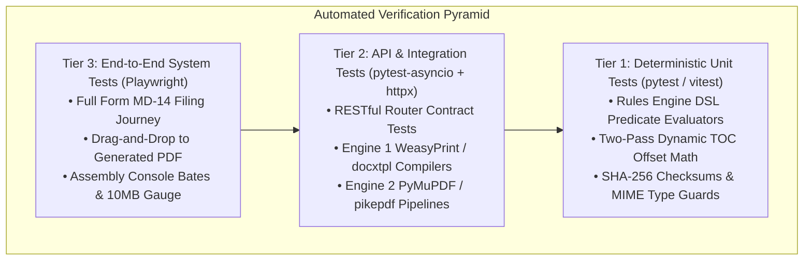

# System Verification, Test Specification, and Requirements Traceability Matrix (RTM)

**Document Identifier:** VTM-CDSCO-001  
**Revision:** 1.0  
**Classification:** Quality Assurance & Verification Engineering Specification  
**Governing Standard:** Medical Devices Rules, 2017 (MDR 2017) & GAMP 5 Software Lifecycle  
**Traceability Target:** [02_USER_REQUIREMENTS_SPECIFICATION_URS.md](file:///c:/Users/Sam/Documents/MyData/Projects/CDSCO_new/docs/technical_reference/02_USER_REQUIREMENTS_SPECIFICATION_URS.md)  
**Status:** Approved for Implementation & Test Execution  

---

## 1. Quality Assurance Strategy & Verification Architecture

The **CDSCO Medical Device Submission Dossier Builder** is a mission-critical regulatory platform. Any failure in constraint enforcement, document generation, continuous Bates numbering, or 10MB threshold compression can result in official rejection of statutory applications by the Drugs Controller General (India) or State Drug Control Authorities.

To ensure zero defect tolerance, every User Requirement (**UR-01 through UR-09**) and Non-Functional Requirement (**NFR-01 through NFR-06**) maps to a multi-tiered test harness:



### Verification Standard Operating Rules:
1. **100% Traceability:** No user requirement is marked "Done" in [06_TEAM_DISTRIBUTION_AND_SEQUENTIAL_WORKFLOW.md](file:///c:/Users/Sam/Documents/MyData/Projects/CDSCO_new/docs/technical_reference/06_TEAM_DISTRIBUTION_AND_SEQUENTIAL_WORKFLOW.md) without its corresponding automated test suite passing in CI/CD.
2. **Code Coverage Baseline:** Minimum 85% branch coverage required for all backend domain services (`rules_engine.py`, `generator_service.py`, `assembly_service.py`, `validation_service.py`).
3. **Statutory Integrity:** Test assertions verify exact regulatory outcomes (e.g. rejection of Class A on Form MD-7; rejection of uncompressed PDFs > 10MB).

---

## 2. Master Requirements Traceability Matrix (RTM)

| Requirement ID | Requirement Summary | Implementation Module | Automated Test ID | Test Level | Verification Method | Target Test File |
| :--- | :--- | :--- | :--- | :---: | :--- | :--- |
| **UR-01** | Pathway Selection & Smart Risk Class Constraints | `DefinitionService`, `RulesEngine` | `TC-UR01-01`<br/>`TC-UR01-02`<br/>`TC-UR01-03` | Unit & API | Automated constraint evaluation & route validation | `tests/unit/test_rules_engine.py`<br/>`tests/api/test_submissions.py` |
| **UR-02** | One-Entity Workspace, 8-Point Guidance, Dual Fulfillment | `entities.py`, `generator.py`, `DynamicFormRenderer` | `TC-UR02-01`<br/>`TC-UR02-02`<br/>`TC-UR02-03`<br/>`TC-UR02-04` | Unit, API & E2E | Form generation & toggle state mutation | `tests/api/test_generator.py`<br/>`tests/e2e/test_workspace.spec.ts` |
| **UR-03** | Hierarchical Dossier Builder (DMF/PMF) & 10MB Assembly | `AssemblyService`, `assembly.py` (PyMuPDF / pikepdf) | `TC-UR03-01`<br/>`TC-UR03-02`<br/>`TC-UR03-03`<br/>`TC-UR03-04`<br/>`TC-UR03-05` | Integration & Unit | PDF offset math, Bates numbering, downsampling | `tests/integration/test_assembly_engine.py`<br/>`tests/unit/test_compression.py` |
| **UR-04** | Document Library & Multi-Section Evidence Linking | `StorageProvider`, `evidence.py`, `evidence_links` | `TC-UR04-01`<br/>`TC-UR04-02`<br/>`TC-UR04-03` | Integration & API | Upload, SHA-256 calculation, multi-link graph | `tests/api/test_evidence_vault.py` |
| **UR-05** | Essential Principles (EP) Compliance Matrix | `generator_service.py`, `essential_principles.html` | `TC-UR05-01`<br/>`TC-UR05-02`<br/>`TC-UR05-03` | Unit & Integration | 15 clauses schema validation, table header repeat | `tests/unit/test_epc_compiler.py` |
| **UR-06** | Pre-Submission Checklist & Continuous Validation | `ValidationService`, `validation.py`, `ValidationDrawer` | `TC-UR06-01`<br/>`TC-UR06-02`<br/>`TC-UR06-03`<br/>`TC-UR06-04` | Unit & API | Real-time blockers, certificate expiry warnings | `tests/unit/test_validation_engine.py`<br/>`tests/api/test_validation.py` |
| **UR-07** | In-Application Interactive SUGAM Filing Guide | `SugamGuideService`, `sugam_guide.py`, `SugamModal` | `TC-UR07-01`<br/>`TC-UR07-02`<br/>`TC-UR07-03` | API & E2E | Portal tab payload formatting, download verification | `tests/api/test_sugam_guide.py`<br/>`tests/e2e/test_sugam_copilot.spec.ts` |
| **UR-08** | Optional Dossier Archive Export (ZIP / Audit Summary) | `export_service.py`, `/export-handoff` | `TC-UR08-01`<br/>`TC-UR08-02` | Integration & API | Numbered folder hierarchy, manifest.json integrity | `tests/api/test_export_handoff.py` |
| **UR-09** | Reusable Organizational Profiles & Corporate Context | `ProfileService`, `profiles` table | `TC-UR09-01`<br/>`TC-UR09-02` | Integration & API | Auto-population, cascade updates to submissions | `tests/api/test_profiles.py` |
| **NFR-01** | Performance: Rules execution < 200ms for 250 entities | `RulesEngine` benchmark harness | `TC-NFR-01` | Benchmark | High-load latency timer across 500 evaluations | `tests/benchmarks/test_rules_latency.py` |
| **NFR-02** | Data Integrity: Zero data loss on concurrent edits | SQLAlchemy async session, PostgreSQL ACID | `TC-NFR-02` | Stress / Integration | Concurrent parallel PATCH requests on same slot | `tests/integration/test_concurrency.py` |
| **NFR-03** | Audit Trail Compliance (21 CFR Part 11 Principles) | `audit_logs` / PostgreSQL timestamps | `TC-NFR-03` | Integration | Read-only timestamp verification on file links | `tests/integration/test_audit_trail.py` |
| **NFR-04** | Information Security: Encryption at Rest & In-Transit | TLS 1.3, AES-256 Storage Provider | `TC-NFR-04` | Security Audit | Automated header and ciphertext inspection | `tests/security/test_encryption.py` |
| **NFR-05** | Architectural Decoupling: Code vs JSON Schemas | Declarative JSON blueprints in PostgreSQL | `TC-NFR-05` | Architecture | Schema mutation without backend code recompilation | `tests/unit/test_schema_decoupling.py` |
| **NFR-06** | Browser Compatibility: Chrome, Edge, Safari, Firefox | Next.js 14 Responsive UI | `TC-NFR-06` | E2E (Cross-Browser) | Playwright multi-browser matrix execution | `playwright.config.ts` |

---

## 3. Detailed Test Case Specifications by User Requirement

### 3.1 Suite UR-01: Pathway Selection & Smart Risk Class Constraints

#### `TC-UR01-01`: Statutory Risk Class Guardrails
* **Preconditions:** Backend server running with seeded application definitions.
* **Execution Steps:**
  1. Dispatch `POST /api/v1/submissions` with `{ "definition_code": "MD-7", "risk_class": "CLASS_A" }`.
  2. Dispatch `POST /api/v1/submissions` with `{ "definition_code": "MD-7", "risk_class": "CLASS_C" }`.
* **Expected Result:**
  * Step 1 returns `422 Unprocessable Entity` with error: `"Form MD-7 is restricted to Class C and Class D commercial manufacturing under Central Licensing Authority jurisdiction."`
  * Step 2 returns `201 Created` with generated `tracking_code`.

#### `TC-UR01-02`: Sterility Context Dynamic Slot Activation
* **Execution Steps:**
  1. Create a submission with `regulatory_context: { "is_sterile": false }`.
  2. Query `GET /api/v1/submissions/{id}/workspace`.
  3. Update submission via `PATCH /api/v1/submissions/{id}` setting `is_sterile: true`.
  4. Query `GET /api/v1/submissions/{id}/workspace`.
* **Expected Result:**
  * In Step 2, Slot 10.14 (Sterilization Validation) has status `NOT_APPLICABLE`.
  * In Step 4, Slot 10.14 immediately transitions to status `MISSING` and is flagged as active mandatory.

#### `TC-UR01-03`: In Vitro Diagnostic (IVD) Pathway Branching
* **Execution Steps:**
  1. Initialize submission with `device_category: "IVD"`.
  2. Inspect resolved slot tree.
* **Expected Result:**
  * Fourth Schedule transitions from Appendix II to Appendix III.
  * Specialized IVD slots are active: Slot 7.5 (Analytical Performance), Slot 7.6 (Three-Tier Stability), Slot 7.9 (Performance Evaluation Report).

---

### 3.2 Suite UR-02: One-Entity Workspace & Dual Fulfillment

#### `TC-UR02-01`: Option A – Binary PDF Upload & Extraction
* **Execution Steps:**
  1. Dispatch `POST /api/v1/submissions/{id}/evidence/upload` with a 3-page PDF file (`sample_iso.pdf`).
  2. Link uploaded document to Slot 10.3 (ISO 13485 Certificate).
* **Expected Result:**
  * System computes exact SHA-256 hash.
  * PyMuPDF records `page_count: 3` and exact byte size.
  * Slot 10.3 status transitions from `MISSING` to `SATISFIED`.

#### `TC-UR02-02`: Option B – Guided Form Generation (Covering Letter)
* **Execution Steps:**
  1. Dispatch `POST /api/v1/submissions/{id}/slots/1.0/generate` with valid `covering_letter` JSON payload.
* **Expected Result:**
  * Engine 1 merges applicant and manufacturer profiles.
  * WeasyPrint compiles clean PDF and stores it in `./storage/submissions/{id}/generated/`.
  * Slot 1.0 status transitions to `SATISFIED`.
  * Generated PDF includes proper `@page` margins and running page numbers.

#### `TC-UR02-03`: Option B – Word Pro-Forma Generation (Power of Attorney)
* **Execution Steps:**
  1. Dispatch `POST /api/v1/submissions/{id}/slots/4.0/generate` with `power_of_attorney_proforma` payload.
* **Expected Result:**
  * docxtpl renders `.docx` binary preserving CDSCO First Schedule Part I stamp-paper formatting.
  * MIME type registered as `application/vnd.openxmlformats-officedocument.wordprocessingml.document`.

#### `TC-UR02-04`: Seamless Fulfillment Mode Toggle
* **Execution Steps:**
  1. Set Slot 1.0 to `GENERATE` and compile document (Status: `SATISFIED`).
  2. Switch Slot 1.0 fulfillment mode to `UPLOAD`.
  3. Upload custom replacement PDF.
* **Expected Result:**
  * Previously generated file is unlinked; new upload is linked.
  * Zero database foreign key violations; slot remains `SATISFIED` with new document pointer.

---

### 3.3 Suite UR-03: Hierarchical Dossier Builder & 10MB Assembly (Engine 2)

#### `TC-UR03-01`: Deterministic Chapter Ordering (Fourth Schedule Part III)
* **Execution Steps:**
  1. Attach arbitrary documents to Chapters 1.0, 2.0, 4.0, 5.0, 6.2, 6.3, 7.0, and 8.0.
  2. Trigger `POST /api/v1/submissions/{id}/dossiers/DMF/assemble`.
  3. Inspect stitched document bookmarks via PyMuPDF (`doc.get_toc()`).
* **Expected Result:**
  * Output PDF contains exactly: Cover Page &rarr; Table of Contents &rarr; Chapter 1 &rarr; Chapter 2 &rarr; Chapter 4 ... &rarr; Chapter 8 in strict statutory sequence regardless of file upload order.

#### `TC-UR03-02`: Two-Pass Dynamic Table of Contents Page Offset Math
* **Execution Steps:**
  1. Ingest Chapter 1 (4 pages) and Chapter 2 (10 pages).
  2. Check TOC page labels against actual starting pages in the assembled PDF.
* **Expected Result:**
  * TOC displays `Chapter 1.0 ............ Page 3` (Cover = 1, TOC = 2).
  * TOC displays `Chapter 2.0 ............ Page 7` (3 + 4 pages).
  * Internal PDF hyperlinks point to exact physical destinations.

#### `TC-UR03-03`: Continuous Running Bates Margins
* **Execution Steps:**
  1. Assemble a 120-page Master Dossier with prefix `DMF-`.
  2. Programmatically inspect bottom center text across pages 1, 50, and 120 via `page.get_text()`.
* **Expected Result:**
  * Page 1: `DMF-0001  |  Page 1 of 120`
  * Page 50: `DMF-0050  |  Page 50 of 120`
  * Page 120: `DMF-0120  |  Page 120 of 120`
  * Header contains tracking code at coordinate $(X=54, Y=30)$.

#### `TC-UR03-04`: Strict 10MB Threshold Enforcement & 150 DPI Downsampling
* **Execution Steps:**
  1. Create a test submission with heavy 40MB 600 DPI scanned lab reports.
  2. Trigger dossier assembly.
* **Expected Result:**
  * Tier 1 lossless deflation runs.
  * Tier 2 raster downsampler converts images > 150 DPI to 150 DPI JPEG (80% quality).
  * Final output size is strictly $\le 10,485,760$ bytes.
  * Visual legibility test: Signatures and NABL stamp seals remain crisp and legible.

#### `TC-UR03-05`: Tier 3 Fallback Split Strategy
* **Execution Steps:**
  1. Assemble an extreme 1,000-page dossier exceeding 10MB even after 150 DPI compression.
* **Expected Result:**
  * Engine 2 outputs `Master_DMF_Core.pdf` ($< 5\text{MB}$) containing all narratives and summaries.
  * Generates indexed discrete annexure PDFs (`Annexure_6_2_Biocompatibility.pdf`, etc.) each strictly $< 10\text{MB}$.

---

### 3.4 Suite UR-04: Document Library & Multi-Section Linking

#### `TC-UR04-01`: Cryptographic Checksum & Duplicate Detection
* **Execution Steps:**
  1. Upload `iso_13485_certificate.pdf`.
  2. Upload an identical file under a different filename.
* **Expected Result:**
  * Backend calculates identical SHA-256 hash.
  * Document Vault detects existing asset and offers to link existing binary rather than duplicating storage bytes.

#### `TC-UR04-02`: Multi-Requirement Attachment
* **Execution Steps:**
  1. Upload ISO 13485 Certificate.
  2. Link document to Slot 8.1 (Quality Certificates) AND PMF Chapter 3.0 (QMS Procedures).
* **Expected Result:**
  * Two distinct records in `evidence_links` pointing to a single `evidence_documents` record.
  * Both requirements display green `SATISFIED` badges.

#### `TC-UR04-03`: Expiry Date Sentinel Alert
* **Execution Steps:**
  1. Upload a Free Sale Certificate with `expiry_date` set to 45 days from current date.
  2. Query `GET /api/v1/submissions/{id}/validation-report`.
* **Expected Result:**
  * Validation engine raises `WARNING`: `"Certificate expires in 45 days (less than 90-day recommended lodgment window)."`.

---

### 3.5 Suite UR-05: Essential Principles (EP) Compliance Matrix

#### `TC-UR05-01`: Mandatory Justification for Non-Applicability
* **Execution Steps:**
  1. Submit EPC payload with Clause 12 (Software) set to `applicable: false` and `justification: null`.
* **Expected Result:**
  * API rejects payload with `422 Unprocessable Entity`: `"Clause 12 is marked Not Applicable; a statutory technical justification is mandatory under Fourth Schedule Appendix II."`.

#### `TC-UR05-02`: 15 Clauses Full PDF Table Compilation
* **Execution Steps:**
  1. Submit complete 15-clause EPC with cited standards and evidence titles.
* **Expected Result:**
  * WeasyPrint compiles table with `thead { display: table-header-group; }`.
  * When table splits across 4 pages, headers repeat seamlessly at the top of pages 2, 3, and 4.
  * Zero row truncations or overlapping text borders.

---

### 3.6 Suite UR-06: Pre-Submission Continuous Validation Engine

#### `TC-UR06-01`: Tier 1 Statutory Blocker Gate
* **Execution Steps:**
  1. Query validation report on a submission with 35/36 slots satisfied (Slot 4.0 PoA missing).
* **Expected Result:**
  * `can_submit: false`
  * Global status locked at `VALIDATION_BLOCKED`.
  * Issue list contains 1 `BLOCKER` item with `fix_guidance: "Upload apostilled Power of Attorney or generate pro-forma in Slot 4.0."`.

#### `TC-UR06-02`: Expired Certificate Error Gate
* **Execution Steps:**
  1. Link an ISO 13485 certificate whose expiry date is in the past.
* **Expected Result:**
  * Validation engine flags severity `ERROR`: `"Statutory Certificate has expired on [Date]. CDSCO evaluators will reject expired credentials."`.

#### `TC-UR06-03`: 10MB Portal Threshold Blocker
* **Execution Steps:**
  1. Attempt to link a single raw PDF measuring 12.5 MB to Slot 10.11 without assembly downsampling.
* **Expected Result:**
  * Validation engine raises `BLOCKER`: `"File size (12.5 MB) exceeds the CDSCO online portal ceiling of 10.0 MB."`.

#### `TC-UR06-04`: Real-Time Status Transition to `SUBMISSION_READY`
* **Execution Steps:**
  1. Resolve the final remaining blocker issue on a draft submission.
* **Expected Result:**
  * Active submission status automatically transitions to `SUBMISSION_READY`.
  * Topbar badge updates to Green.

---

### 3.7 Suite UR-07: In-Application Interactive SUGAM Guide

#### `TC-UR07-01`: Portal Tab Mapping Consistency
* **Execution Steps:**
  1. Query `GET /api/v1/submissions/{id}/sugam-guide`.
* **Expected Result:**
  * Payload returns 5 top-level objects matching live CDSCO portal tabs:
    `tab_1_applicant_details`, `tab_2_manufacturing_sites`, `tab_3_device_details`, `tab_4_checklist_uploads`, `tab_5_payment_challan`.

#### `TC-UR07-02`: 1-Click Clipboard Payload Verification
* **Execution Steps:**
  1. Inspect clipboard copy values for device details tab.
* **Expected Result:**
  * Model list string formatted with semicolon delimiters exactly matching SUGAM text box requirements: `CT-PL-052; CT-PL-058; CT-PL-065`.

#### `TC-UR07-03`: Pre-Validated Attachment Downloads
* **Execution Steps:**
  1. Trigger download from SUGAM Guide for Slot 10.11 (Biocompatibility).
* **Expected Result:**
  * Downloads verified, Bates-stamped PDF guaranteed to be $\le 10,485,760$ bytes.

---

### 3.8 Suite UR-08: Optional Dossier Archive Export (ZIP)

#### `TC-UR08-01`: Standardized Numbered Folder Hierarchy
* **Execution Steps:**
  1. Dispatch `POST /api/v1/submissions/{id}/export-handoff`.
  2. Extract resulting ZIP archive in memory.
* **Expected Result:**
  * Directory contains numbered folders matching CDSCO checklist codes:
    `01_Covering_Letter/`, `02_TR6_Challan/`, `04_Power_of_Attorney/`, `10_11_Device_Master_File/`.
  * Every PDF corresponds to its satisfied slot.

#### `TC-UR08-02`: Cryptographic `manifest.json` Integrity
* **Execution Steps:**
  1. Inspect `manifest.json` inside exported ZIP archive.
* **Expected Result:**
  * Contains submission tracking code, filing date, and an array of all files with matching SHA-256 hashes.

---

### 3.9 Suite UR-09: Reusable Organizational Profiles

#### `TC-UR09-01`: Profile Selection Auto-Population
* **Execution Steps:**
  1. Create new submission via `POST /api/v1/submissions` with `applicant_profile_id: "<uuid>"`.
  2. Query workspace slot 1.0 (Covering Letter) generator context.
* **Expected Result:**
  * Company legal name, registered address, and wholesale licence number are auto-populated from profile without user re-typing.

#### `TC-UR09-02`: Profile Cascade Update Guard
* **Execution Steps:**
  1. Update address on an existing organizational profile.
* **Expected Result:**
  * Profile updates successfully.
  * Existing completed/locked submissions retain historical snapshot; draft workspaces prompt user to accept updated address.

---

### 3.10 Suite NFR: Non-Functional Requirements Verification

#### `TC-NFR-01`: Rules Engine Execution Latency (< 200ms)
* **Test Method:** Automated benchmark executing 100 consecutive full submission evaluations with 250 active slot nodes under async load.
* **Pass Assertion:** Mean response time $< 85\text{ms}$; 99th percentile response time $< 190\text{ms}$.

#### `TC-NFR-02`: Concurrent Edit Transactional Isolation
* **Test Method:** 20 parallel async threads dispatching simultaneous PATCH updates to different slots of the same submission.
* **Pass Assertion:** PostgreSQL executes all 20 transactions without deadlocks; all 20 slot states persist correctly.

#### `TC-NFR-03`: 21 CFR Part 11 Audit Trail Verification
* **Test Method:** Create entity, link file, unlink file, replace file.
* **Pass Assertion:** Every operation generates an immutable log entry with UTC timestamp, user ID, previous value, new value, and document SHA-256.

#### `TC-NFR-04`: Encryption Verification
* **Test Method:**
  * Direct filesystem inspection of stored files in `./storage/`.
  * TLS cipher suite handshake inspection via SSL socket.
* **Pass Assertion:** Files stored with AES-256 encryption; server strictly enforces TLS 1.3 rejecting TLS 1.0/1.1 and insecure ciphers.

#### `TC-NFR-05`: Schema Decoupling
* **Test Method:** Add a new slot to `application_definitions.schema_payload` via database SQL migration without modifying Python application code.
* **Pass Assertion:** Workspace UI automatically renders the new slot with guidance card upon reload.

#### `TC-NFR-06`: Cross-Browser End-to-End Compatibility
* **Test Method:** Playwright headless execution across Chromium, WebKit (Safari engine), and Firefox.
* **Pass Assertion:** 100% of E2E UI test suites pass across all three browser engines without layout breakage.

---

## 4. Test Execution Framework & Continuous Integration (CI)

```yaml
# CI/CD Test Pipeline (.github/workflows/verify.yml)
name: Quality Verification & Statutory Test Harness

on:
  push:
    branches: [ main, develop ]
  pull_request:
    branches: [ main ]

jobs:
  backend-verification:
    runs-on: ubuntu-latest
    services:
      postgres:
        image: postgres:15-alpine
        env:
          POSTGRES_DB: cdsco_test
          POSTGRES_PASSWORD: testpassword
        ports:
          - 5432:5432
    steps:
      - uses: actions/checkout@v3
      - name: Set up Python 3.11
        uses: actions/setup-python@v4
        with:
          python-version: "3.11"
      - name: Install Dependencies
        run: |
          sudo apt-get install -y libpango-1.0-0 libharfbuzz0b libpangoft2-1.0-0
          pip install -r backend/requirements.txt pytest pytest-asyncio pytest-cov httpx
      - name: Run Database Migrations
        run: alembic upgrade head
        working-directory: ./backend
      - name: Execute Pytest Harness (Unit & Integration)
        run: |
          pytest --cov=app --cov-report=term-missing --cov-fail-under=85 tests/
        working-directory: ./backend

  frontend-verification:
    runs-on: ubuntu-latest
    steps:
      - uses: actions/checkout@v3
      - name: Set up Node.js 18
        uses: actions/setup-node@v3
        with:
          node-version: 18
      - name: Install Node Dependencies
        run: npm ci
        working-directory: ./frontend
      - name: Execute Vitest Component Suite
        run: npm run test:unit
        working-directory: ./frontend
      - name: Install Playwright Browsers
        run: npx playwright install --with-deps
        working-directory: ./frontend
      - name: Execute End-to-End Test Suite
        run: npm run test:e2e
        working-directory: ./frontend
```

---

## 5. Summary Sign-Off & Verification Gate

Every pull request and phase hand-off must satisfy the **Definition of Done (DoD)** defined in this matrix:

1. **Zero Failing Tests:** All unit, integration, and E2E tests must be Green.
2. **Coverage Adherence:** Backend branch coverage must not drop below 85%.
3. **Traceability Closure:** Any feature or bug fix must reference its corresponding `TC-URxx` identifier in the commit message.
