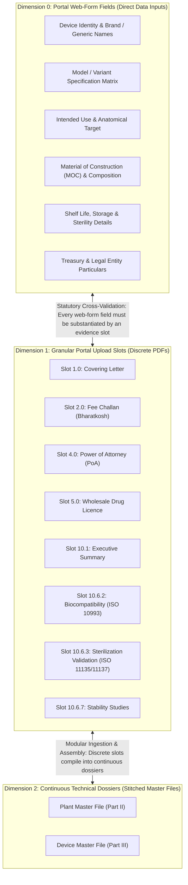
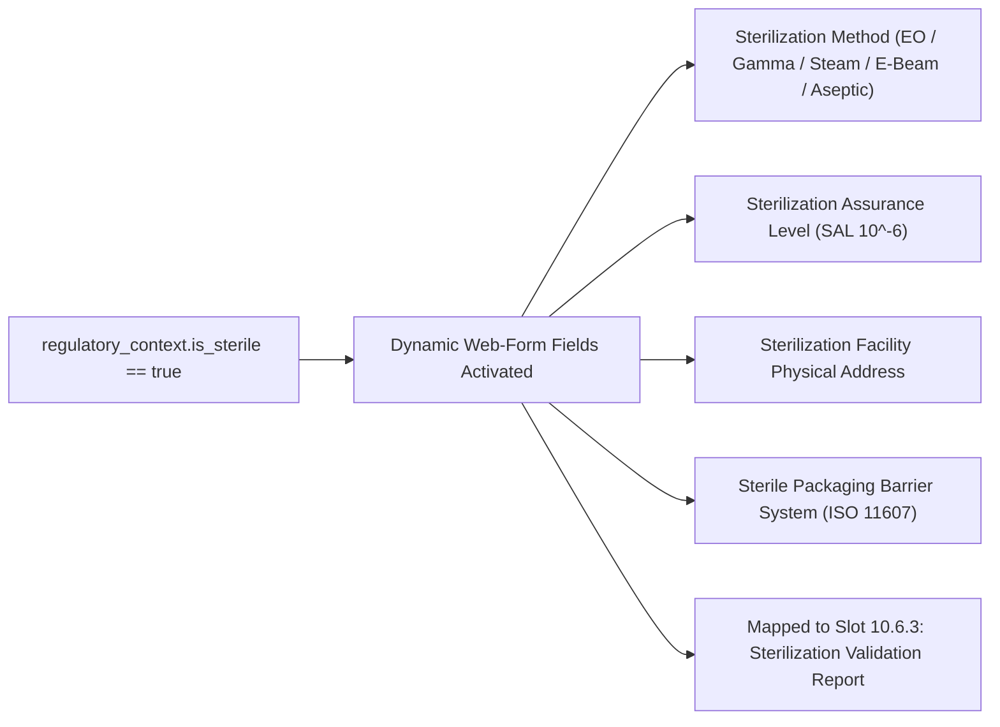
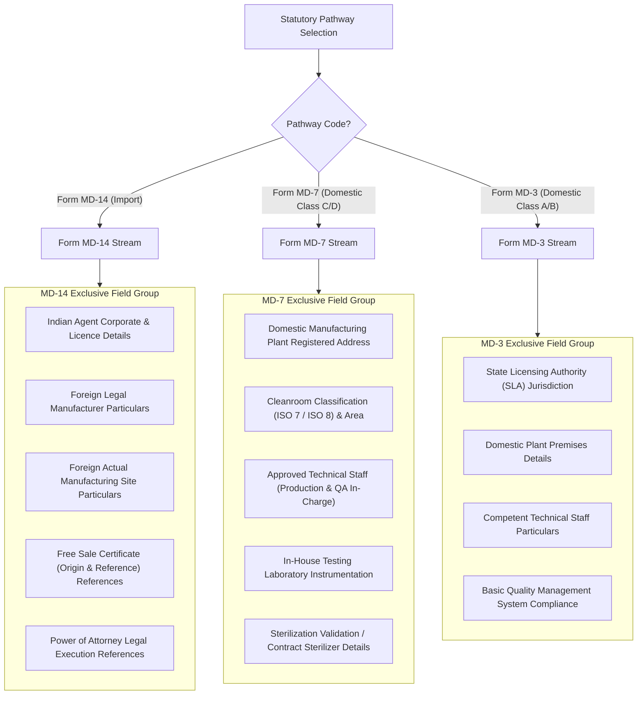

# CDSCO Portal Web-Form Fields Specification and Statutory Slot Traceability

**Document Identifier:** WFS-CDSCO-001  
**Revision:** 1.0  
**Classification:** Regulatory Technical Reference and Data Architecture  
**Governing Standard:** Medical Devices Rules, 2017 (MDR 2017), Gazette of India  
**Verified Primary Source:** CDSCO Medical Devices Online Portal (`cdscomdonline.gov.in` / SUGAM Online Licensing System)  
**Status:** Approved for Implementation (Phase 1 Dynamic Portal Fields Architecture)  

---

## 1. Executive Summary & Regulatory Rationale

### 1.1 The Triad Architecture of CDSCO Statutory Filings
Submitting a medical device or In Vitro Diagnostic (IVD) application to the Central Drugs Standard Control Organization (CDSCO) requires satisfying three concurrent dimensions:



1. **Dimension 0 (Portal Web-Form Fields):** The structured data inputs, textboxes, dropdowns, and variant tables that an applicant directly enters into the CDSCO MD-Online portal pages.
2. **Dimension 1 (Portal Checklist Upload Slots):** The 36 to 48 discrete PDF upload rows where applicants attach official certificates, test reports, and statutory declarations.
3. **Dimension 2 (Fourth Schedule Master Dossiers):** The compiled, bookmarked, Bates-stamped master PDFs (Plant Master File and Device Master File) assembled for substantive technical evaluation.

### 1.2 The Statutory Cross-Validation Rule
Under MDR 2017 Rules 20, 21, 34, and the Fourth Schedule, any discrepancy between the textual values entered in the portal web-form (Dimension 0) and the evidentiary documents uploaded to the slots (Dimension 1) constitutes a critical compliance defect resulting in immediate rejection or issuance of a query memorandum.

Every portal web-form field must display its **Connected Statutory Requirement**:
* The specific CDSCO checklist slot ID that provides supporting evidence.
* The governing rule under MDR 2017.
* The consistency rule ensuring data entered in the textbox matches the uploaded document.

---

## 2. Dynamic Field Taxonomy Across Functional Domains

### 2.1 Domain 1: Application Particulars & Statutory Fee Verification
Applicable to all pathways. Captures regulatory intent and national treasury verification.

| Field Key | Field Label | Data Type | Mandatory | Governing Rule | Connected Slot | Statutory Consistency Rule |
| :--- | :--- | :--- | :--- | :--- | :--- | :--- |
| `filing_modality` | Filing Modality | Enum (`FRESH`, `ENDORSEMENT`, `RETENTION`) | Yes | Rule 20 / 34 | Slot 1.0 (Covering Letter) | Must match application category stated in official letterhead. |
| `bharatkosh_challan_no` | Bharatkosh Challan Reference No. | String (20 char alphanumeric) | Yes | Second Schedule | Slot 2.0 (Fee Challan) | Transaction ID must match the receipt generated by NTRP Bharatkosh portal. |
| `payment_date` | Challan Payment Date | Date (`YYYY-MM-DD`) | Yes | Second Schedule | Slot 2.0 (Fee Challan) | Payment date must precede application submission date. |
| `fee_amount_inr` | Statutory Fee Amount (INR) | Number (Currency) | Yes | Second Schedule | Slot 2.0 (Fee Challan) | Amount must equal statutory fee for pathway + risk class + number of sites/models. |
| `bank_reference_no` | Bank Gateway Transaction ID | String (30 char) | Yes | Second Schedule | Slot 2.0 (Fee Challan) | Bank UTR / CBS reference number verifying funds debited to Consolidated Fund of India. |

---

### 2.2 Domain 2: Legal Representation & Corporate Credentials

#### Pathway A: Import Licences (Form MD-14)
Governed by Rule 34 and First Schedule (Part I).

| Field Key | Field Label | Data Type | Mandatory | Governing Rule | Connected Slot | Statutory Consistency Rule |
| :--- | :--- | :--- | :--- | :--- | :--- | :--- |
| `indian_agent_name` | Authorized Indian Agent Legal Name | String (150 char) | Yes | Rule 34(1) | Slot 5.0 (Wholesale Licence) & Slot 6.0 (Constitution) | Must match entity name on Form 20B/21B or Form MD-42. |
| `wholesale_licence_no` | Wholesale Drug Licence Number | String (50 char) | Yes | Rule 34(1)(b) | Slot 5.0 (Wholesale Licence) | Must be an active Form 20B, 21B, or MD-42 wholesale registration. |
| `wholesale_licence_validity` | Licence Expiry / Retention Due Date | Date (`YYYY-MM-DD`) | Yes | Rule 34(1)(b) | Slot 5.0 (Wholesale Licence) | Must be valid for at least 6 months post-submission. |
| `poa_execution_date` | Power of Attorney Execution Date | Date (`YYYY-MM-DD`) | Yes | First Schedule Part I | Slot 4.0 (Power of Attorney) | Must match execution date on notarized and apostilled pro-forma. |
| `foreign_mfr_name` | Legal Manufacturer Corporate Name | String (150 char) | Yes | Rule 34(1) | Slot 4.0 (PoA) & Slot 7.0 (FSC) | Must match corporate name across PoA, Free Sale Certificate, and ISO 13485. |
| `foreign_mfr_country` | Country of Legal Manufacturer | String (ISO Country Code) | Yes | Rule 34(1) | Slot 7.0 (Free Sale Certificate) | Must match issuing country of National Competent Authority FSC. |
| `foreign_site_address` | Actual Manufacturing Site Address | Text (Multi-line) | Yes | Rule 34(1) | Slot 9.0 (ISO 13485) & Slot 6.0 (PMF) | Physical facility street address, city, state, postal code, and country. |

#### Pathway B: Domestic Manufacturing Licences (Form MD-7 & Form MD-3)
Governed by Rule 20, Rule 21, and Third Schedule.

| Field Key | Field Label | Data Type | Mandatory | Governing Rule | Connected Slot | Statutory Consistency Rule |
| :--- | :--- | :--- | :--- | :--- | :--- | :--- |
| `domestic_mfr_name` | Domestic Applicant Entity Name | String (150 char) | Yes | Rule 20(1) / (2) | Slot 5.0 (Constitution) | Must match Certificate of Incorporation and GST registration. |
| `mfg_premises_address` | Manufacturing Facility Physical Address | Text (Multi-line) | Yes | Rule 20(1) | Slot 6.4 (Premises & Layout) | Must match ownership deed / registered industrial lease agreement. |
| `cleanroom_area_sqm` | Total Certified Cleanroom Area (sq m) | Number (Decimal) | Yes | Rule 20(1) | Slot 6.5 (Cleanroom Layout) & Slot 7.11 | Must match architectural cleanroom HVAC floor plans. |
| `production_incharge_name` | Competent Technical Staff (Production) | String (100 char) | Yes | Rule 26 | Slot 6.2 (Personnel Organogram) | Must possess approved degree in engineering/pharmacy/science with minimum 2 years experience. |
| `qa_incharge_name` | Competent Technical Staff (Quality) | String (100 char) | Yes | Rule 26 | Slot 6.2 (Personnel Organogram) | Production and Quality In-Charge must be independent individuals. |
| `inhouse_lab_available` | Dedicated In-house Testing Laboratory | Boolean | Yes | Rule 20(1) | Slot 6.6 (Equipment & Testing Lab) | If false, approved external testing laboratory agreement must be uploaded. |

---

### 2.3 Domain 3: Core Device Identity & Physical Specifications
Applicable across all medical devices and IVDs. Captures the primary statutory identifiers.

| Field Key | Field Label | Data Type | Mandatory | Governing Rule | Connected Slot | Statutory Consistency Rule |
| :--- | :--- | :--- | :--- | :--- | :--- | :--- |
| `generic_name` | Generic / Common Name of Device | String (120 char) | Yes | Rule 34(1) / 20(1) | Slot 1.0 (Covering Letter) & Slot 10.1 (DMF Summary) | Must match CDSCO classified medical device notification name. |
| `brand_name` | Brand / Proprietary Trade Name | String (120 char) | Yes | Rule 34(1) / 20(1) | Slot 1.0, Slot 10.4 (Labels), Slot 7.0 (FSC) | Must strictly match packaging artwork, labels, and Free Sale Certificate. |
| `intended_use` | Statutory Intended Use Statement | Text (Multi-line) | Yes | Fourth Schedule Part III | Slot 10.1 (Executive Summary) & Slot 10.4 (IFU) | Must align verbatim with Instructions for Use (IFU) and clinical indications. |
| `intended_patient_population` | Target Patient Population | String (150 char) | Yes | Fourth Schedule Part III | Slot 10.1 (Executive Summary) | Adults, pediatric, neonatal, geriatric, or specific anatomical subgroup. |
| `anatomical_site` | Target Anatomical Site / Tissue Type | String (150 char) | Yes | Fourth Schedule Part III | Slot 10.1 (Executive Summary) | Central circulatory, cardiovascular, central nervous system, subcutaneous, bone, etc. |
| `material_of_construction` | Material of Construction (MOC) | Text (Multi-line) | Yes | Fourth Schedule Part III | Slot 10.2 (Specifications) & Slot 10.6.2 (Biocompatibility) | All patient-contacting materials (e.g., Titanium Ti-6Al-4V ELI, PEEK, Silicone) must have corresponding ISO 10993 test records. |
| `shelf_life_months` | Claimed Shelf Life (in Months) | Integer | Yes | Fourth Schedule Part III | Slot 10.6.7 (Stability Study) & Slot 10.4 (Artwork) | Must not exceed duration validated by real-time / accelerated stability reports. |
| `storage_temperature_min` | Minimum Storage Temperature (°C) | Number | Yes | Fourth Schedule Part III | Slot 10.4 (Labels) & Slot 10.6.7 (Stability) | Temperature range must match label markings and stability protocol conditions. |
| `storage_temperature_max` | Maximum Storage Temperature (°C) | Number | Yes | Fourth Schedule Part III | Slot 10.4 (Labels) & Slot 10.6.7 (Stability) | Temperature range must match label markings and stability protocol conditions. |
| `storage_conditions_text` | Special Storage & Handling Cautions | String (200 char) | No | Fourth Schedule Part III | Slot 10.4 (Device Labels) | E.g., "Keep dry, protect from direct sunlight, do not freeze". |
| `is_single_use` | Single-Use or Reusable Device | Boolean | Yes | Fourth Schedule Part III | Slot 10.4 (Labels & IFU) | If false, reprocessing and sterilization instructions must appear in IFU. |
| `reuse_cycles_max` | Maximum Validated Reuse Cycles | Integer | Conditional (`is_single_use: false`) | Fourth Schedule Part III | Slot 10.4 (IFU) & Slot 10.6.1 (Bench Testing) | Validated cleaning, disinfection, and sterilization cycle durability count. |

---

### 2.4 Domain 4: Model Matrix / Product Variant Table
Every application covers a family of device variants. The CDSCO portal requires a structured variant table.

| Column Key | Column Label | Data Type | Mandatory | Connected Slot | Statutory Consistency Rule |
| :--- | :--- | :--- | :--- | :--- | :--- |
| `model_number` | Model / Catalogue / Ref Number | String (50 char) | Yes | Slot 1.0 (Covering Letter) & Slot 7.0 (FSC) | Every model in this table must appear in the Free Sale Certificate and Covering Letter. |
| `model_name` | Distinct Model Variant Name | String (100 char) | Yes | Slot 10.1 (Executive Summary) | Distinguishes variant within device family. |
| `dimension_spec` | Dimensional Specifications (Size / Gauge / Length) | String (100 char) | Yes | Slot 10.2 (Specifications) | Physical dimensions, working lengths, diameter, outer sheath French size. |
| `pack_size` | Commercial Packaging Configuration | String (50 char) | Yes | Slot 10.4 (Labels) | Unit of presentation (e.g. "1 Unit per sterile pouch, 5 pouches per box"). |
| `accessories_included` | Included Accessories or Components | Text | No | Slot 10.1 (Executive Summary) | Introducers, guidewires, dilators, or connectors packaged together. |

---

### 2.5 Domain 5: Dynamic Context-Driven Conditional Fields

#### 5.1 Technology Predicate: Sterility (`is_sterile: true`)
Activated when the medical device or IVD is marketed in a sterile state.



| Field Key | Field Label | Data Type | Mandatory | Governing Standard | Connected Slot | Validation Rule |
| :--- | :--- | :--- | :--- | :--- | :--- | :--- |
| `sterilization_method` | Sterilization Method | Enum (`ETHYLENE_OXIDE`, `GAMMA_IRRADIATION`, `ELECTRON_BEAM`, `STEAM_AUTOCLAVE`, `ASEPTIC_PROCESSING`) | Yes | ISO 11135 / ISO 11137 / ISO 17665 | Slot 10.6.3 (Sterilization Validation) | Must match validation protocol methodology. |
| `sterility_assurance_level` | Sterility Assurance Level (SAL) | String (Default: `10^-6`) | Yes | EN 556-1 / ISO 11137 | Slot 10.6.3 (Sterilization Validation) | Must achieve standard $10^{-6}$ SAL for terminally sterilized medical devices. |
| `sterilization_facility_address` | Contract Sterilization Facility Address | Text (Multi-line) | Yes | Fourth Schedule Part II / III | Slot 10.6.3 & Slot 9.0 (ISO 13485) | If outsourced, contract sterilizer ISO 13485 certificate must be linked. |
| `packaging_barrier_system` | Sterile Barrier System Description | String (150 char) | Yes | ISO 11607-1 / ISO 11607-2 | Slot 10.6.3 (Sterilization Validation) | Tyvek pouch, thermoformed blister with heat-seal lid, or medical vial. |

---

#### 5.2 Technology Predicate: Software / SaMD (`contains_software: true` or `is_samd: true`)
Activated when the device contains embedded firmware, programmable electrical medical systems (PEMS), or functions as standalone Software as a Medical Device (SaMD).

| Field Key | Field Label | Data Type | Mandatory | Governing Standard | Connected Slot | Validation Rule |
| :--- | :--- | :--- | :--- | :--- | :--- | :--- |
| `software_version` | Current Software / Firmware Release Version | String (30 char) | Yes | IEC 62304:2006+AMD1:2015 | Slot 10.6.4 (Software Validation) | Must match software build cited in covering letter and user manual. |
| `software_safety_class` | IEC 62304 Safety Classification | Enum (`CLASS_A`, `CLASS_B`, `CLASS_C`) | Yes | IEC 62304 Clause 4.3 | Slot 10.6.4 (Software Lifecycle) | Class A: No injury possible; Class B: Non-serious injury; Class C: Death or serious injury. |
| `target_operating_system` | Supported Operating System & Hardware Specs | String (150 char) | Yes | IEC 62304 Clause 5.2 | Slot 10.6.4 & Slot 10.4 (IFU) | iOS, Android, Windows Server, Linux; minimum RAM and processor specs. |
| `cloud_hosted` | Cloud / Server Architecture Used | Boolean | Yes | MDR 2017 Guidance | Slot 10.6.4 (Software Architecture) | If true, data sovereignty and cloud server geographic location must be declared. |
| `cybersecurity_standard_applied` | Applied Medical Device Cybersecurity Standard | String (100 char) | Yes | IEC 81001-5-1 / UL 2900 / AAMI TIR57 | Slot 10.6.4 (Cybersecurity Report) | Verified security architecture report must accompany software documentation. |

---

#### 5.3 Technology Predicate: Medicinal Substance / Drug-Device Combination (`contains_medicinal_substance: true`)
Activated when the device incorporates a pharmacological, immunological, or metabolic substance as an integral part (e.g. Drug-Eluting Stents, Silver/Antimicrobial Wound Dressings, Heparin-Coated Catheters).

| Field Key | Field Label | Data Type | Mandatory | Governing Standard | Connected Slot | Validation Rule |
| :--- | :--- | :--- | :--- | :--- | :--- | :--- |
| `drug_inn_name` | Active Pharmaceutical Ingredient (INN) | String (100 char) | Yes | Rule 34 / Fourth Schedule | Slot 10.6.6 (Medicinal Substance) | International Nonproprietary Name (e.g. Everolimus, Paclitaxel, Silver Sulfadiazine). |
| `drug_pharmacopoeial_grade` | Drug Pharmacopoeial Grade | Enum (`IP`, `BP`, `USP`, `EP`, `IN_HOUSE`) | Yes | Indian Pharmacopoeia / USP | Slot 10.6.6 (Medicinal Substance) | Must meet monograph specifications. |
| `drug_quantity_per_device` | Drug Quantity / Dosage per Device Unit | String (80 char) | Yes | Fourth Schedule Part III | Slot 10.6.6 & Slot 10.4 (Labels) | E.g., "$100\,\mu\text{g} \pm 10\,\mu\text{g}$ per stent" or "$1.0\%\,\text{w/w}$". |
| `drug_intended_action` | Intended Pharmacological / Ancillary Role | Text (Multi-line) | Yes | Fourth Schedule Part III | Slot 10.6.6 (Medicinal Substance) | Action must be ancillary to the primary physical/mechanical purpose of the device. |
| `drug_source_manufacturer` | API Bulk Manufacturer Name & Site | String (150 char) | Yes | Rule 34 / Fourth Schedule | Slot 10.6.6 (Medicinal Substance) | Active Drug Master File (DMF) reference or CoPP / GMP certificate. |

---

#### 5.4 Technology Predicate: Animal / Biological Tissue (`contains_animal_tissue: true`)
Activated when the device incorporates non-viable animal tissues, cells, or derivatives (e.g. Bovine Pericardial Heart Valves, Porcine Collagen Wound Dressings, Gelatin Sponges).

| Field Key | Field Label | Data Type | Mandatory | Governing Standard | Connected Slot | Validation Rule |
| :--- | :--- | :--- | :--- | :--- | :--- | :--- |
| `animal_species` | Animal Species of Origin | Enum (`BOVINE`, `PORCINE`, `EQUINE`, `OVINE`, `CAPRINE`, `OTHER`) | Yes | ISO 22442-1 / ISO 22442-2 | Slot 10.6.5 (Animal Tissue Report) | Must match sourcing records and viral inactivation certificates. |
| `tissue_type_harvested` | Anatomical Tissue / Organ Harvested | String (100 char) | Yes | ISO 22442-1 | Slot 10.6.5 (Animal Tissue Report) | E.g., Pericardium, Tendon, Dermis, Small Intestinal Submucosa (SIS). |
| `tse_bse_risk_category` | OIE / WHO TSE/BSE Risk Category | Enum (`CATEGORY_A_HIGH_INFECTIVITY`, `CATEGORY_B_LOWER_INFECTIVITY`, `CATEGORY_C_NO_DETECTABLE_INFECTIVITY`) | Yes | WHO Guidelines / OIE Terrestrial Code | Slot 10.6.5 (Animal Tissue Report) | Tissues from Category A (Brain, spinal cord, eyes) are strictly prohibited. |
| `geographical_origin_country` | Country of Animal Sourcing & Slaughter | String (ISO Country Code) | Yes | ISO 22442-2 | Slot 10.6.5 (Animal Tissue Report) | Country must possess negligible or controlled BSE risk status recognized by WOAH. |
| `viral_inactivation_method` | Viral Inactivation & Clearance Process | Text (Multi-line) | Yes | ISO 22442-3 | Slot 10.6.5 (Animal Tissue Report) | Validated reduction factors ($\ge 4\,\log_{10}$ reduction) for enveloped and non-enveloped viruses. |

---

#### 5.5 Modality Predicate: In Vitro Diagnostic (`device_category: IVD`)
Governed by Fourth Schedule Appendix III (Part I, II, III). Replaces general medical device fields with IVD-specific diagnostic parameters.

| Field Key | Field Label | Data Type | Mandatory | Governing Rule | Connected Slot | Validation Rule |
| :--- | :--- | :--- | :--- | :--- | :--- | :--- |
| `target_analyte` | Target Analyte / Biomarker Detected | String (120 char) | Yes | Fourth Schedule Appendix III | Slot 8.1 (IVD Description) & Slot 8.5 (Performance) | E.g., Hepatitis B Surface Antigen (HBsAg), Cardiac Troponin I (cTnI), HIV-1/2 Antibodies. |
| `ivd_test_principle` | Test Methodology / Principle | Enum (`RAPID_LATERAL_FLOW`, `ELISA`, `CLIA`, `REAL_TIME_RT_PCR`, `FLOW_CYTOMETRY`, `ELECTROCHEMISTRY`, `COLORIMETRY`) | Yes | Fourth Schedule Appendix III | Slot 8.1 & Slot 8.5 (Analytical Performance) | Must match assay protocol described in Instructions for Use. |
| `specimen_matrix` | Validated Clinical Specimen Matrix | Multi-Select (`SERUM`, `PLASMA`, `WHOLE_BLOOD`, `URINE`, `SALIVA`, `NASOPHARYNGEAL_SWAB`, `CSF`) | Yes | Fourth Schedule Appendix III | Slot 8.5 (Analytical Sensitivity & Specificity) | Each specimen matrix claimed must be substantiated by clinical matrix equivalence data. |
| `calibrator_traceability` | Calibrator Metrological Traceability | String (150 char) | Yes | ISO 17511 | Slot 8.5 (Traceability Dossier) | Traceable to WHO International Standard (e.g. WHO NIBSC 00/588) or certified reference material. |
| `open_vial_stability_days` | Reconstituted / Open-Vial Stability (Days) | Integer | Yes | Fourth Schedule Appendix III | Slot 8.6 (Three-Tier Stability) | Validated in-use working life after primary vial seal puncture. |
| `compatible_instruments` | Closed/Open System Compatible Analyzers | Text (Multi-line) | Yes | Fourth Schedule Appendix III | Slot 8.1 & Slot 8.5 | Dedicated automated analyzer models or generic microplate reader wavelength specs. |

---

## 3. Dynamic Pathway Conditional Logic Matrix

The web-form fields change systematically according to the selected Statutory Pathway:



### Detailed Pathway Distinction Table

| Regulatory Field Group | Form MD-14 (Commercial Import) | Form MD-7 (Domestic Class C & D) | Form MD-3 (Domestic Class A & B) |
| :--- | :--- | :--- | :--- |
| **Competent Licensing Authority** | Central Licensing Authority (DCG(I), CDSCO HQ, New Delhi) | Central Licensing Authority (DCG(I), CDSCO HQ, New Delhi) | State Licensing Authority (Respective State FDA / Drug Controller) |
| **Applicant Identity** | Authorized Indian Agent (Holding Form 20B/21B Wholesale Licence) | Actual Indian Manufacturer (Corporate Entity registered in India) | Actual Indian Manufacturer (Corporate Entity registered in India) |
| **Foreign Manufacturer Particulars** | **Mandatory** (Corporate name, country, plant address, PoA date) | **Not Applicable** | **Not Applicable** |
| **Domestic Factory Premises** | **Not Applicable** | **Mandatory** (Cleanroom area, layout, HVAC pressure cascades) | **Mandatory** (Manufacturing area, facility layout) |
| **Competent Technical Staff** | **Not Applicable** (Covered by Wholesale Licence qualified person) | **Mandatory** (Approved Production In-Charge & QA In-Charge under Rule 26) | **Mandatory** (Approved Technical Staff under Rule 26) |
| **Free Sale Certificate (FSC)** | **Mandatory** (Origin Country FSC + Reference Country Approvals) | **Not Applicable** (Not required for domestic manufacture) | **Not Applicable** (Not required for domestic manufacture) |
| **Power of Attorney (PoA)** | **Mandatory** (Notarized and Apostilled First Schedule Part I) | **Not Applicable** | **Not Applicable** |
| **Risk Classification Range** | Class A, Class B, Class C, and Class D | Class C and Class D only | Class A and Class B only |

---

## 4. Master Field-to-Slot Statutory Traceability Matrix

This table establishes the two-way relationship between the web-form fields (Dimension 0) and the statutory checklist upload slots (Dimension 1). The frontend UI renders this relationship as an interactive statutory badge and guidance tooltip next to each field.

| Portal Web-Form Field Key | CDSCO Checklist Slot ID | Checklist Slot Title | Statutory Rule Reference | Mandatory Evidence Document Required |
| :--- | :--- | :--- | :--- | :--- |
| `bharatkosh_challan_no` | `2.0` | Fee Challan | Rule 34(1) & Second Schedule | Official Bharatkosh Payment Receipt PDF with active UTR/Challan reference. |
| `poa_execution_date` | `4.0` | Power of Attorney | Rule 34(1) & First Schedule | Notarized & Apostilled Power of Attorney document signed by Foreign Manufacturer. |
| `wholesale_licence_no` | `5.0` | Wholesale Licence | Rule 34(1)(b) | Valid Form 20B/21B or Form MD-42 issued by State Drug Licensing Authority. |
| `foreign_site_address` | `9.0` / `6.0` | ISO 13485:2016 Certificate / PMF | Rule 34(1) & Fourth Schedule Part II | Accredited ISO 13485 certificate stating exact factory street address. |
| `generic_name` | `1.0` & `10.1` | Covering Letter & Executive Summary | Rule 34(1) & Fourth Schedule Part III | Official Covering Letter signed by Indian Agent & DMF Chapter 1 Executive Summary. |
| `brand_name` | `10.4` & `7.0` | Labels & IFU Artwork / FSC | Rule 34(1) & Chapter VI Rules | Primary label artwork, outer carton artwork, and Free Sale Certificate. |
| `material_of_construction` | `10.2` & `10.6.2` | Specifications & Biocompatibility | Fourth Schedule Part III Clause 3 & 6 | Raw material engineering specifications & ISO 10993 biological evaluation test reports. |
| `intended_use` | `10.1` & `10.4` | Executive Summary & IFU | Fourth Schedule Part III Clause 1 & 8 | Instructions for Use booklet and Device Master File intended use statement. |
| `shelf_life_months` | `10.6.7` & `10.4` | Stability Studies & Product Labels | Fourth Schedule Part III Clause 6 & 8 | Real-time and accelerated stability study data curves validating claimed shelf life. |
| `sterilization_method` | `10.6.3` | Sterilization Validation | Fourth Schedule Part III Clause 6 | Full validation report complying with ISO 11135 (EO) or ISO 11137 (Radiation). |
| `software_version` | `10.6.4` | Software Lifecycle Records | Fourth Schedule Part III Clause 6 | IEC 62304 software verification protocol, hazard analysis, and cybersecurity dossier. |
| `drug_inn_name` | `10.6.6` | Medicinal Substance Dossier | Fourth Schedule Part III Clause 6 | Quality documentation, stability, and compatibility study for active drug component. |
| `animal_species` | `10.6.5` | Animal Tissue Safety Report | Fourth Schedule Part III Clause 6 | ISO 22442 risk assessment, WOAH BSE certificate, and viral clearance validation. |
| `target_analyte` (IVD) | `8.1` & `8.5` | IVD Description & Performance | Fourth Schedule Appendix III | Analytical sensitivity, specificity, cross-reactivity, and interference study reports. |

---

## 5. TypeScript Data Architecture and State Model

For immediate implementation in the Next.js workspace and FastAPI backend:

```typescript
/**
 * Regulatory Application Fields Model representing Dimension 0 web-form values.
 * Persisted in submissions.regulatory_context and submission_entities.form_values.
 */
export interface CDSCOApplicationFields {
  // Application & Treasury
  filing_modality: 'FRESH' | 'ENDORSEMENT' | 'RETENTION';
  bharatkosh_challan_no: string;
  payment_date: string;
  fee_amount_inr: number;
  bank_reference_no: string;

  // Legal Representation (Import MD-14)
  indian_agent_name?: string;
  wholesale_licence_no?: string;
  wholesale_licence_validity?: string;
  poa_execution_date?: string;
  foreign_mfr_name?: string;
  foreign_mfr_country?: string;
  foreign_site_address?: string;

  // Domestic Premises (MD-7 & MD-3)
  domestic_mfr_name?: string;
  mfg_premises_address?: string;
  cleanroom_area_sqm?: number;
  production_incharge_name?: string;
  qa_incharge_name?: string;
  inhouse_lab_available?: boolean;

  // Core Device Identity
  generic_name: string;
  brand_name: string;
  intended_use: string;
  intended_patient_population: string;
  anatomical_site: string;
  material_of_construction: string;
  shelf_life_months: number;
  storage_temperature_min: number;
  storage_temperature_max: number;
  storage_conditions_text?: string;
  is_single_use: boolean;
  reuse_cycles_max?: number;

  // Model Variant Matrix
  model_variants: Array<{
    model_number: string;
    model_name: string;
    dimension_spec: string;
    pack_size: string;
    accessories_included?: string;
  }>;

  // Technology Predicates (Conditional)
  is_sterile: boolean;
  sterilization_method?: 'ETHYLENE_OXIDE' | 'GAMMA_IRRADIATION' | 'ELECTRON_BEAM' | 'STEAM_AUTOCLAVE' | 'ASEPTIC_PROCESSING';
  sterility_assurance_level?: string;
  sterilization_facility_address?: string;
  packaging_barrier_system?: string;

  contains_software: boolean;
  software_version?: string;
  software_safety_class?: 'CLASS_A' | 'CLASS_B' | 'CLASS_C';
  target_operating_system?: string;
  cloud_hosted?: boolean;
  cybersecurity_standard_applied?: string;

  contains_medicinal_substance: boolean;
  drug_inn_name?: string;
  drug_pharmacopoeial_grade?: 'IP' | 'BP' | 'USP' | 'EP' | 'IN_HOUSE';
  drug_quantity_per_device?: string;
  drug_intended_action?: string;
  drug_source_manufacturer?: string;

  contains_animal_tissue: boolean;
  animal_species?: 'BOVINE' | 'PORCINE' | 'EQUINE' | 'OVINE' | 'CAPRINE' | 'OTHER';
  tissue_type_harvested?: string;
  tse_bse_risk_category?: 'CATEGORY_A_HIGH_INFECTIVITY' | 'CATEGORY_B_LOWER_INFECTIVITY' | 'CATEGORY_C_NO_DETECTABLE_INFECTIVITY';
  geographical_origin_country?: string;
  viral_inactivation_method?: string;

  // Modality Predicate: IVD
  target_analyte?: string;
  ivd_test_principle?: 'RAPID_LATERAL_FLOW' | 'ELISA' | 'CLIA' | 'REAL_TIME_RT_PCR' | 'FLOW_CYTOMETRY' | 'ELECTROCHEMISTRY' | 'COLORIMETRY';
  specimen_matrix?: Array<'SERUM' | 'PLASMA' | 'WHOLE_BLOOD' | 'URINE' | 'SALIVA' | 'NASOPHARYNGEAL_SWAB' | 'CSF'>;
  calibrator_traceability?: string;
  open_vial_stability_days?: number;
  compatible_instruments?: string;
}
```

---

## 6. Implementation Roadmap for Phase 1 Portal Fields Tab

1. **Backend Persistence (Task 1.5.10):**
   * Expose `PATCH /api/v1/submissions/{id}` accepting partial updates to `regulatory_context`.
   * Store structured portal form values in `regulatory_context["portal_fields"]`.
2. **Frontend UI Tab (Task 1.5.11):**
   * Introduce a two-tab navigation header in the Workspace:
     * **Tab 1: Statutory Document Checklist (Upload Slots)**
     * **Tab 2: CDSCO Portal Form Fields & Specifications (Web Form Inputs)**
   * In Tab 2, render grouped inputs matching the specification:
     * Section 1: Application Particulars & Bharatkosh Challan
     * Section 2: Legal Entity & Manufacturing Site Details
     * Section 3: Device Identity & Specifications
     * Section 4: Model / Variant Matrix Table (with Add / Remove row controls)
     * Section 5: Dynamic Technology Predicates (Sterile, Software, Drug, Animal Tissue, IVD)
   * Render side-by-side **Connected Statutory Requirement Cards** beside each field group, highlighting the exact slot ID, governing rule citation, and consistency requirements.
   * Auto-save or explicit "Save Application Fields" action with visual confirmation.

